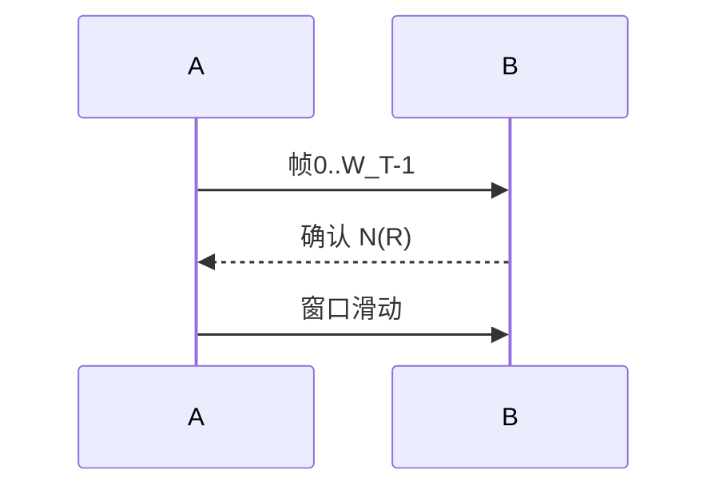

# 流量控制与可靠传输（停止等待、连续ARQ、选择ARQ及窗口尺寸）

## 它是什么：从“发一帧等一下”说起

数据链路层把长比特流拆成一个个帧后，首先要解决：**收方来不及处理怎么办？** 这就是 ==流量控制==——由收方控制发方速率。配合检错重传，就构成可靠传输。

最简单的是 **停止-等待协议**：发一帧，停下，等确认再发下一帧；用 1 比特编号就够（0、1 交替）。可问题是信道常常空着等确认，利用率很低。怎么算利用率？设帧长 $L$、速率 $R$、单程传播时延 $t_p$，忽略确认与处理时间：

$$ U = \frac{L/R}{L/R + 2t_p} $$

## 为什么需要滑动窗口

停止等待太慢。于是引入 **滑动窗口**：发完一帧不等着，继续发窗口内的若干帧。发送窗口 $W_T$ 限制未确认帧数；接收窗口 $W_R$ 决定收方还能收多少。当 $W_T=W_R=1$ 时，就是停止等待。

## 连续 ARQ（Go-back-N）

在滑动窗口里出错怎么办？连续 ARQ 规定：若某帧出错，从该帧起后面已发的都要重传——所以叫 **Go-back-N（返回 N 帧）**。确认号 $N(R)$ 表示“期望收下一帧”，也即确认了 $N(R)-1$ 及以前。

> [!WARNING]
> 用 $n$ 比特编号时，连续 ARQ 必须满足 ==$W_T \le 2^n - 1$==，否则收方分不清新旧帧。

它的坑：一个帧坏掉，后面好帧也白传。

## 选择 ARQ（选择重传）

只重传真正出错的帧，接收窗口可>1。用 $n$ 比特编号时，==最大 $W_R = 2^{n-1}$==，且 $W_T + W_R \le 2^n$。这和连续 ARQ 不同，别混。

| 协议 | $W_T$ | $W_R$ | 重传范围 |
|---|---|---|---|
| 停止等待 | 1 | 1 | 仅该帧 |
| 连续 ARQ | $\le 2^n-1$ | 1 | 出错帧起全部 |
| 选择 ARQ | $\le 2^{n-1}$ | $\le 2^{n-1}$ | 仅出错帧 |

> [!TIP]
> 记尺寸：连续 ARQ 是“模减一” $2^n-1$；选择 ARQ 是“对半” $2^{n-1}$。

## 算对了的例子

题：卫星信道 $R=1\,\text{Mb/s}$，$t_p=250\,\text{ms}$，帧长 $1000\,\text{bit}$，求最大信道利用率。

先算一帧发送时间：
$$ T_f = \frac{1000}{10^6}=1\,\text{ms} $$

- **停止等待**（$W_T=1$）：
$$ U = \frac{1}{1+2\times250}=\frac{1}{501}\approx 0.2\% $$

- **连续 ARQ，$W_T=7$**：
$$ U = \frac{7\times 1}{501}\approx 1.4\% $$

- **连续 ARQ，$W_T=127$**：
$$ U = \frac{127\times1}{501}\approx 25.3\% $$

窗口越大，信道越忙；但连续 ARQ 有“一坏全退”的代价。这就是停止等待、连续 ARQ 与选择 ARQ 之间的核心取舍。
