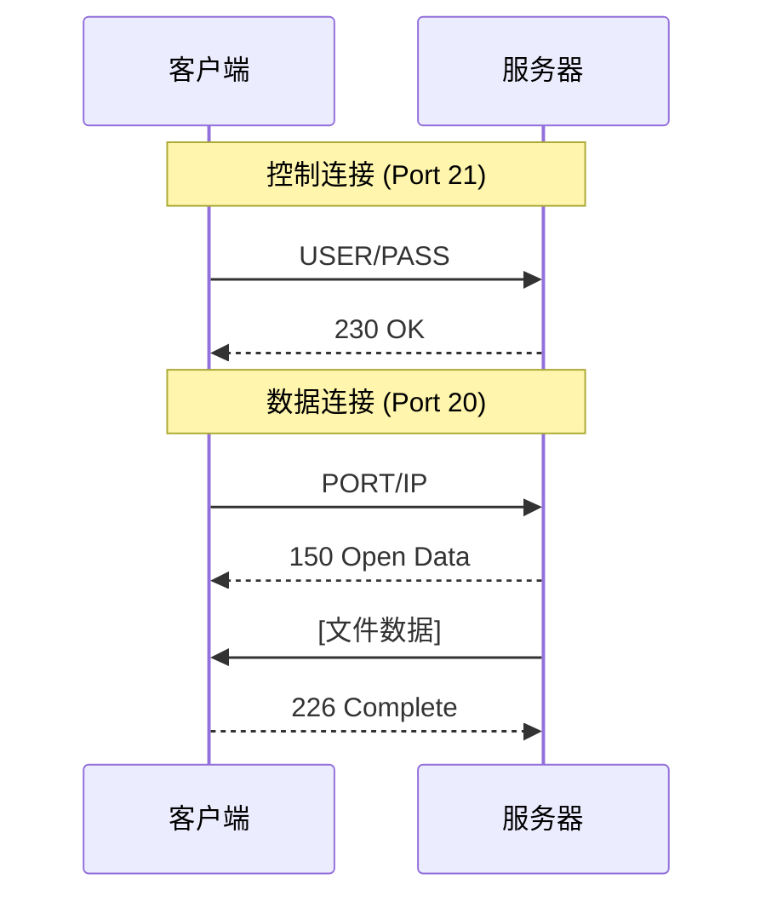

# 文件传送与远程登录（FTP双连接机制、TFTP、Telnet）

## 远程登录 Telnet

Telnet 是 Internet 早期的基本应用服务，采用客户/服务器模式。它的核心目标是让用户在本地终端上操作远程主机，仿佛直接连接在远程主机上一样。

> [!IMPORTANT]
> Telnet 使用 **TCP** 协议（端口 23），提供可靠的字节流传输。它通过 **NVT（网络虚拟终端）** 标准解决不同操作系统和终端类型的差异，将本地键盘输入转换为标准 NVT 格式发送，接收端再转换回本地格式。

**为什么需要 NVT？**
想象一下，如果 Windows 的“回车”是 `\r\n`，而 Linux 是 `\n`，直接传输会导致乱码或命令失效。NVT 作为中间翻译层，屏蔽了这些底层差异。

> [!WARNING]
> Telnet 最大的缺陷是 **明文传输**。用户名、密码和数据均以未加密形式在网络中传播，极易被嗅探。现代应用中已被 SSH（Secure Shell）取代，但在理解应用层原理时仍具代表性。

## 文件传送协议 FTP

FTP 是 Internet 上使用最广泛的文件传送协议，基于 C/S 架构，使用 **TCP** 提供可靠服务。与 HTTP 或 Telnet 不同，FTP 的最大特点是使用 **两条并行的 TCP 连接**。

### 双连接机制

1.  **控制连接**：端口 21。用于发送命令（如 `USER`, `PASS`, `LIST`）和接收响应。在整个会话期间保持打开。
2.  **数据连接**：端口 20（主动模式）。仅在传输文件时建立，传输完毕后立即关闭。

> [!TIP]
> 记忆口诀：**“控长数短”**。控制连接长久保持以维持会话状态，数据连接短暂存在以传输具体文件。

**常见考点辨析：**
*   传输命令使用的是？ ==建立在 TCP 之上的控制连接==。
*   传输文件内容使用的是？ ==建立在 TCP 之上的数据连接==。

## 简单文件传送协议 TFTP

TFTP (Trivial File Transfer Protocol) 是一个轻量级协议，常用于无盘工作站启动或路由器固件更新。

| 特性 | FTP | TFTP |
| :--- | :--- | :--- |
| **运输层协议** | TCP | UDP |
| **端口** | 20, 21 | 69 |
| **功能复杂度** | 高（支持目录、权限） | 低（仅读写文件） |
| **可靠性保证** | 由 TCP 保证 | 需自行实现差错控制 |

> [!NOTE]
> TFTP 使用 **停止-等待协议** 机制来保证可靠性。每个数据块大小为 512 字节。若收到重复分组，则重发确认；若超时未收到确认，则重发数据。

**特殊边界情况：**
如果文件大小恰好是 512 字节的整数倍，发送方在最后必须发送一个 **长度为 0 的数据包**，以便接收方知道传输已结束。否则，接收方无法区分“最后一个完整包”和“传输结束”。

> [!CAUTION]
> TFTP 没有身份鉴别功能，也不支持列目录，因此安全性极低，仅限受信任的内部网络使用。
