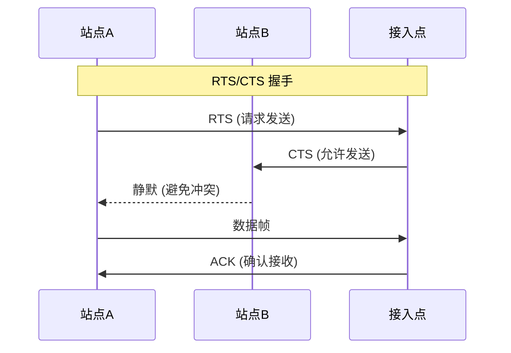

# 高速以太网与无线局域网（VLAN、CSMA/CA）

## 高速以太网与虚拟局域网

随着网络带宽需求激增，传统 10Mb/s 以太网已无法满足需求。**高速以太网**指速率在 100Mb/s 及以上的以太网技术，如快速以太网（100BASE-T）、吉比特以太网等。它们保留了 IEEE 802.3 标准帧格式，但在物理层和介质访问控制上做了优化。

> [!IMPORTANT]
> **全双工与 CSMA/CD 的关系**：在半双工模式下，高速以太网仍使用 ==CSMA/CD== 协议；但在全双工模式下，由于发送和接收信道独立，==不存在冲突==，因此**不使用** CSMA/CD 协议，传输距离也不再受争用期限制。

**虚拟局域网（VLAN）** 是由 IEEE 802.1Q 标准定义的逻辑分组技术。它允许交换机通过软件方式将物理上分散的工作站划分到不同的逻辑工作组中。

- **实现机制**：在以太网帧的源地址字段后插入 4 字节的 **VLAN 标记**（Tag）。
- **标记识别**：当长度/类型字段值为 `0x8100` 时，表示后续为 VLAN 标记。
- **优势**：逻辑组划分不受物理位置限制，便于管理和广播风暴抑制。

> [!WARNING]
> **常见误区**：VLAN **不是**一种新型的物理局域网硬件，而是建立在现有交换式以太网之上的**逻辑服务**。建立 VLAN 必须依赖支持该功能的**交换机**。

## 无线局域网与 CSMA/CA

无线局域网（WLAN）基于 IEEE 802.11 标准，分为有固定基础设施（基本服务集 BSS）和无基础设施（自组网络 Ad-hoc）两类。由于无线介质的特殊性（隐蔽站、暴露站问题及信号衰减），无法像有线网络那样进行可靠的“冲突检测”，因此采用 ==CSMA/CA（载波监听多点接入/冲突避免）== 协议。

### CSMA/CD 与 CSMA/CA 对比

| 特性 | CSMA/CD (有线) | CSMA/CA (无线) |
| :--- | :--- | :--- |
| **核心机制** | 冲突检测 (Collision Detection) | 冲突避免 (Collision Avoidance) |
| **监听方式** | 边发边听 | 先听后发，预约发送 |
| **确认机制** | 无 ACK (靠校验和重传) | **有 ACK** (正确接收需确认) |
| **典型问题** | 争用期限制距离 | 隐蔽站、暴露站 |

> [!TIP]
> **解题技巧**：看到“无线”、“802.11”或“ACK 确认”，优先联想 **CSMA/CA**。CSMA/CD 用于传统有线以太网，且不涉及 MAC 层的显式 ACK 确认。

## 典型例题解析

**题目**：下列选项中，对正确接收到的数据帧进行确认的 MAC 协议是？
A. CDMA  B. CSMA  C. CSMA/CD  D. CSMA/CA

**解析**：
1.  **排除法**：CDMA 是码分多址物理层技术；CSMA 是基础监听机制；CSMA/CD 用于有线以太网，依靠高层重传，MAC 层无 ACK。
2.  **核心特征**：无线信道误码率高且无法可靠检测冲突，因此 802.11 规定接收方成功收到数据帧后，必须返回 **ACK 帧** 进行确认。
3.  **结论**：只有 **CSMA/CA** 具备此机制。故选 **D**。

**题目**：关于 VLAN 描述错误的是？
A. VLAN 是一种新型的局域网

**解析**：VLAN 是逻辑划分技术，非新型物理局域网。故 **A** 错误。
