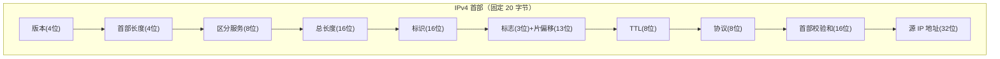

# IPv4协议与数据报格式（分类IP地址、分片计算、首部字段）

## IPv4 协议与数据报格式

网络层要解决的核心问题：**怎样把数据报从源主机送到目的主机**。IP 协议（Internet Protocol）为此定义了统一的编址方案和数据报格式。可以把 IP 数据报想象成一个“快递包裹”：首部是面单，数据部分是内容物——路由器只看面单，不关心内容。

> [!IMPORTANT]
> IPv4 地址是 **32 位**的二进制数，固定分为 **首部** 和 **数据** 两部分；首部固定部分为 **20 字节**，最多可达 60 字节（含选项字段）。

---

## 分类 IP 地址：地址自己能“说明”边界

分类 IP 地址的核心特点是 **自标识（self-identifying）**：只从地址本身，就能判断网络号和主机号的分界在哪里。

| 类别  | 首部特征（前几位） | 网络号位数 | 主机号位数 | 默认掩码 | 适用范围 |
|-------|-------------------|-----------|-----------|----------|----------|
| A 类  | `0` (首位为 0)     | 8 位      | 24 位     | `255.0.0.0` | 大型网络 |
| B 类  | `10`              | 16 位     | 16 位     | `255.255.0.0` | 中型网络 |
| C 类  | `110`             | 24 位     | 8 位      | `255.255.255.0` | 小型网络 |
| D 类  | `1110`            | —         | —         | —   | 多播 |
| E 类  | `1111`            | —         | —         | —   | 保留 |

看完上表可以自己问一句：如果拿到地址 `192.168.10.0`，第一位二进制形式是 `110`，它是哪一类？——C 类。它默认的子网掩码就应当是 `255.255.255.0`。

> [!TIP]
> 记类别只需看前几个比特：`0` 是 A，`10` 是 B，`110` 是 C，`1110` 是 D。看到十进制首字节落在 `192~223`，就是 C 类。

---

## IPv4 数据报首部字段

IPv4 首部固定 20 字节，是网络采集报文解析的核心。下图按位排列：



重点字段含义：

| 字段 | 位数 | 含义 |
|------|------|------|
| 版本 | 4 | IPv4 为 `0100` |
| 首部长度 | 4 | 以 **4 字节** 为单位，最小值 5（20 字节） |
| 总长度 | 16 | 首部 + 数据的总字节数 |
| 标识 | 16 | 同一数据报的分片持有相同标识 |
| 标志 | 3 | `DF`（禁止分片）、`MF`（还有后续分片） |
| 片偏移 | 13 | 以 **8 字节** 为单位，指明分片在原数据报中的位置 |
| TTL | 8 | 生存时间，每经过一个路由器减 1，降到 0 丢弃，==限制跳数== |
| 协议 | 8 | 上层协议编号：TCP 为 6，UDP 为 17 |
| 首部校验和 | 16 | ==只校验 IP 首部==，不校验数据部分 |
| 源/目的地址 | 各 32 | 逻辑地址，用于寻址 |

> [!WARNING]
> 三个最容易踩坑的点：
> 1. **首部长度单位是 4 字节**，若字段值为 `6`，实际首部为 $6 \times 4 = 24$ 字节。
> 2. **片偏移单位是 8 字节**，分片时数据长度必须是 8 字节的整数倍（最后一片除外）。
> 3. **首部校验和校验的是 IP 首部**，不是整个数据报——每次经过路由器 TTL 减一，校验和都要重新计算。

---

## 分片计算

当一个数据报比链路层允许的最大传输单元（MTU）大时，就得分片。分完的每一片都要带上原来的 IP 首部（稍加修改）。

如何计算分片？核心在于两条规则：

- **规则一**：片偏移 = 该片数据在原数据报数据区的起始位置 / 8。
- **规则二**：除最后一片外，每片数据长度必须是 8 的整数倍。

### 一个算对了的例子

设原始 IP 数据报总长度为 4020 字节（固定首部 20 字节，数据 4000 字节），链路 MTU 为 1420 字节。首部 20 字节后，每片最多携带数据 $1420 - 20 = 1400$ 字节。因 1400 是 8 的整数倍，分片如下：

| 分片 | 数据长度 | 片偏移字段值 | MF 标志 |
|------|---------|--------------|---------|
| 1 | 1400 字节 | $0/8 = 0$ | 1 |
| 2 | 1400 字节 | $1400/8 = 175$ | 1 |
| 3 | 1200 字节 | $2800/8 = 350$ | 0 |

总数据 4000 字节恰好被分成 1400 + 1400 + 1200，片偏移字段分别为 `0`、`175`、`350`。目的端收到后按片偏移重组。

> [!NOTE]
> 如果 DF（Don't Fragment）位被置 1，而数据报又超过 MTU，路由器不会分片，而是丢弃并返回 ICMP 差错报告报文。

---

## 分类地址与子网划分

分类地址解决“网络号 + 主机号”的边界问题，子网掩码进一步在主机号中“借位”划分出子网位。

以题目为例：`192.168.10.0` 是 C 类地址，要划分两个一样大且尽可能大的子网（不适用全 0 全 1 子网）。

```
子网掩码：255.255.255.192
        → 主机号原 8 位，借 2 位作子网位
        → 子网位取值：01（64）、10（128）
```

| 子网网络地址 | 可用主机范围 | 广播地址 |
|-------------|-------------|----------|
| `192.168.10.64` | `65` ~ `126` | `192.168.10.127` |
| `192.168.10.128` | `129` ~ `190` | `192.168.10.191` |

每个子网主机位剩 6 位，可用主机数为 $2^{6} - 2 = 62$。

> [!IMPORTANT]
> 子网划分的本质是：==IP 地址 = 网络号 + 子网号 + 主机号==。路由器只看“网络号 + 子网号”，主机只看自己所在子网范围。路由表的项目数取决于 **网络数目**，而不是主机数目。

---

## CIDR 与传统分类地址的区别

传统分类地址边界固定（A/B/C 类），CIDR（无分类域间路由）打破了这一限制，用“斜线记法”表示前缀长度，如 `128.10.64.0/20` 表示前 20 位为前缀，剩余 12 位为主机位，共有 $2^{12}$ 个地址。掩码为前缀 20 位全 1：`255.255.240.0`，最大地址为主机位全 1，即 `128.10.79.255`。

| 对比项 | 分类 IP 地址 | CIDR |
|--------|-------------|------|
| 边界判定 | 从地址高位特征确定 | 由前缀长度 `/n` 确定 |
| 灵活性 | 差（只能 A/B/C 三档） | 好（任意前缀长度） |
| 地址利用率 | 低 | 高 |
| 路由表规模 | 大 | 通过地址聚合缩小 |

> [!NOTE]
> 南邮题目常将分类地址与 CIDR 概念混考。填空题“CIDR 地址块 `128.10.64.0/20` 包含 $2^{12}$ 个地址”考的就是：**主机位 = 32 - 前缀长度**。
