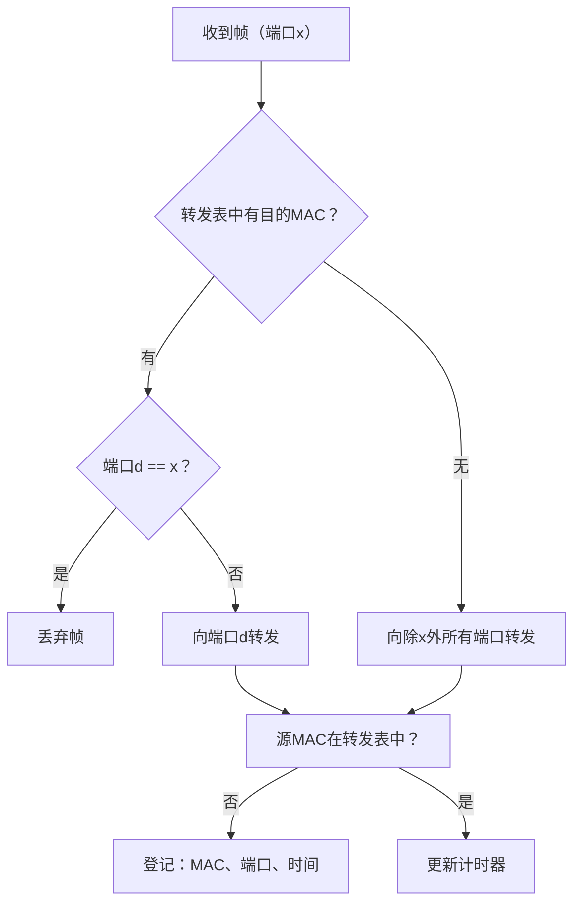
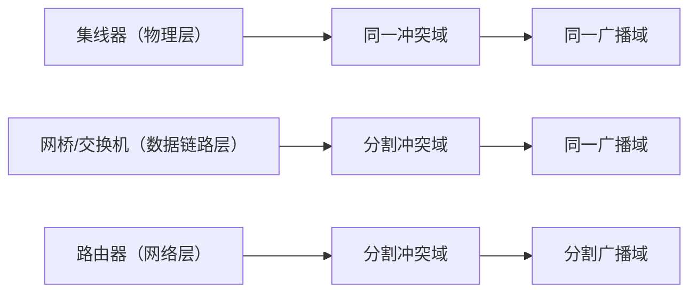

# 局域网的扩展与互连设备（集线器、网桥、交换机、冲突域与广播域）

## 局域网的扩展与互连设备

### 为什么需要扩展局域网

单个局域网能覆盖的地理范围和容纳的主机数量有限。比如，一栋办公楼的不同楼层可能需要各自的网络，但彼此之间又需要通信。这就产生了局域网扩展的需求。

扩展局域网可以在不同层次上进行，不同层次的设备决定了如何分割冲突域和广播域。这两个概念是理解网络性能的关键：

> [!IMPORTANT]
> **冲突域**：同一时间内只能有一台主机发送数据的范围。处于同一冲突域的主机同时发送数据会产生冲突。
> **广播域**：网络中任意一台主机发送广播帧，所有能收到该广播帧的主机所构成的集合。

### 物理层扩展：集线器

集线器工作在**物理层**，所有端口属于同一个冲突域。用它连接起来的网络：

- **物理拓扑**：星形（所有主机通过双绞线连到集线器）
- **逻辑拓扑**：总线型（集线器直接把收到的比特流复制到所有其他端口）

==用集线器扩展局域网，扩大了广播域，也扩大了冲突域，但最大总吞吐量并没有提高。== 因为任意时刻只能有一台主机发送数据，所有主机共享带宽。

### 数据链路层扩展：网桥

网桥工作在**数据链路层**，根据 MAC 帧的目的地址转发。它能够：

- **过滤通信量**：只把帧转发到目的站所在的端口，不向无关端口转发
- **分割冲突域**：每个端口是一个独立的冲突域，==但网桥不能分割广播域==

网桥的核心机制是**转发表**。以透明网桥为例，转发算法如下：

> [!TIP]
> **转发表学习原则**：收到帧的端口 = 到达源地址的端口。网桥通过源地址逆向学习建立转发表。

网桥的缺点是转发前要存储查找，引入了时延，不适合过大规模的网络。

### 多端口网桥：以太网交换机

交换机本质上是**多端口的高速网桥**，工作于数据链路层。其最大优势是：

- 每个端口独占带宽，支持多对端口同时无冲突通信
- 若拥有 $N$ 对端口，交换机总容量为 $2N \times$ 端口速率

==交换机有过滤广播通信的功能吗？没有。== 它仍然会向所有端口转发广播帧，因此交换机的所有端口仍属于同一个广播域。

交换机转发帧有三种方式：

| 方式 | 特点 |
|---|---|
| **直通交换** | 收到目的地址后立即转发，时延小，但不检测差错 |
| **存储转发** | 完整接收后校验再转发，时延大，但可过滤错误帧 |
| **无碎片交换** | 收到前 64 字节后开始转发，过滤碎片帧，时延适中 |

> [!WARNING]
> 无碎片交换引入的转发延迟至少是 $64 \times 8 \text{ bit} / 100\text{Mbps} = 5.12\,\mu\text{s}$。如果题目问的是转发 1000 字节帧的延迟，计算基数是 $64$ 字节而非帧全长，因为交换机检查完 64 字节就启动转发。

### 冲突域与广播域的分割总结

> [!NOTE]
> **只有路由器（网络层设备）能抑制广播风暴**，因为它不转发广播包。网桥和交换机虽然能隔离冲突域，但广播帧仍会泛洪到所有端口。

### 一个计算例子

**题目**：对于 100Mbps 的以太网交换机，当输出端口无排队，以无碎片交换方式转发一个 1000 字节的以太网帧时，引入的转发延迟至少是多少 μs？

**解析**：无碎片交换方式在收到 64 字节后才开始转发，因此转发延迟 = $64 \times 8 \text{ bit} / (100 \times 10^6 \text{ bps}) = 5.12\,\mu\text{s}$。

> [!CAUTION]
> 常见的坑是把整个帧长 1000 字节代入计算。无碎片交换的延迟仅取决于交换机开始转发前必须读取的最小帧长（64 字节），与帧实际长度无关。
