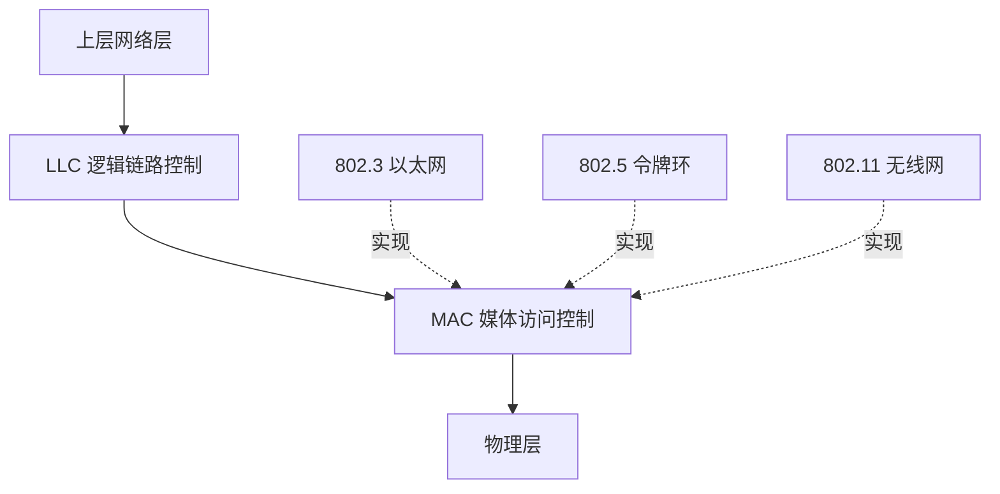

# 局域网体系结构与IEEE 802标准（LLC与MAC子层）

## 为什么局域网需要专门的体系结构

广域网技术覆盖地理范围大、链路类型多，数据链路层通常直接采用点到点协议（PPP 等）。局域网则不同：==共享介质==是常态，多个站点竞争同一条总线或同一个信道，因此数据链路层必须额外解决“**谁来占用介质**”这一问题。IEEE 在 1980 年成立 802 委员会，制定出 **IEEE 802 系列标准**，主要规范 OSI 体系结构的==低两层==（物理层 + 数据链路层）。

## IEEE 802 的子层划分：LLC 与 MAC

由于不同局域网的介质访问方法（CSMA/CD、令牌环、令牌总线）差异巨大，802 委员会把数据链路层进一步拆成两个子层：

- **逻辑链路控制子层（LLC，IEEE 802.2）**：与具体介质访问方式无关，向上层提供统一的接口（==屏蔽底层 MAC 差异==），支持多类型局域网互联。
- **媒体访问控制子层（MAC）**：负责帧的封装、寻址、差错检测以及最重要的==介质访问控制==（如 CSMA/CD、二进制指数退避）。

> [!IMPORTANT]
> 一句话记忆：**LLC 管“连”，MAC 管“抢”**——LLC 处理与上层、与对方 LLC 实体的逻辑链路；MAC 处理帧的收发与介质争用。

> [!NOTE]
> 随着以太网占据垄断地位，LLC 的作用已弱化，==现代网卡基本只实现 MAC 协议==。这也是考题里“以太网交换机工作在 MAC 子层”“网桥工作在 MAC 子层”的由来。

## IEEE 802.3 与以太网命名规则

IEEE 802.3 规定的 CSMA/CD 标准常用**三段式命名**：速率 + 信号类型 + 介质。例如 **100BASE-T**：

| 段 | 含义 | 说明 |
| :-- | :-- | :-- |
| 100 | 数据率 100 Mb/s | 亦称快速以太网（IEEE 802.3u） |
| BASE | 基带传输 | 未经调制的数字信号 |
| T | 双绞线 | 100BASE-T 用 5 类 UTP，100 m |

类似地，==10BASE-T 中“10”指 10 Mb/s，“T”指双绞线==。

MAC 帧的封装链路：

当发送失败次数未超阈值时，MAC 执行**二进制指数退避算法**，按 $2^k$ 随机选择退避时间后重发；超阈值则停止发送并通知 LLC 报告网络故障。

> [!WARNING]
> ==MAC 子层没有流量控制功能==，负荷过重时会产生帧丢失；另外，802 标准里的“地址”严格说是站点的==标识符（名字）==，与网络层 IP 地址是不同层面的概念。

## 一个算对了的例子：MAC 帧填充

IEEE 802.3 规定 MAC 帧==数据字段最小长度 46 字节==（与最小帧长 64 字节对应：$14+46+4=64$）。用它传送 ASCII 字符串 "NJUPT"，共 5 字节：

$$
\text{填充字节数} = 46 - 5 = 41
$$

> [!TIP]
> 做题口诀：**数据字段 < 46 字节就要填**；填多少用 $46 - \text{实际数据长度}$ 一算即得。注意"NJUPT"是 5 个字节而非 6 个，若误当成"6 字节"会算成 40 而选不出答案。

## 后续标准一览

| 标准 | 名称 | 关键点 |
| :-- | :-- | :-- |
| 802.3u | 快速以太网 | 100 Mb/s，仍用 CSMA/CD |
| 802.3z / 802.3ab | 吉比特以太网 | 802.3z 光纤、802.3ab 5 类 UTP |
| 802.3ae | 万兆以太网 | 帧格式与前代==完全相同==，向后兼容 |
| 802.1Q | 虚拟局域网 VLAN | 逻辑分组服务 |
| 802.1D | 透明网桥 | 即插即用 |
| 802.11 | 无线局域网 | 含 a/b/g 等；用虚拟载波监听 |
