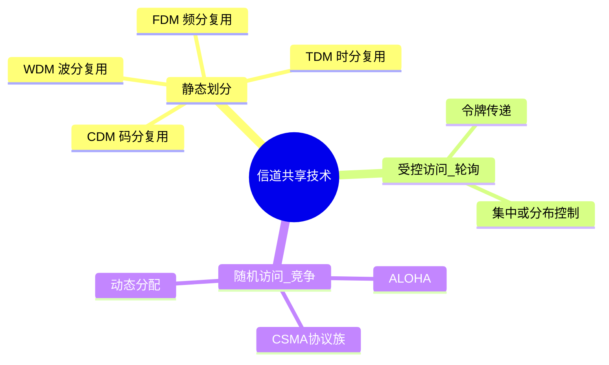
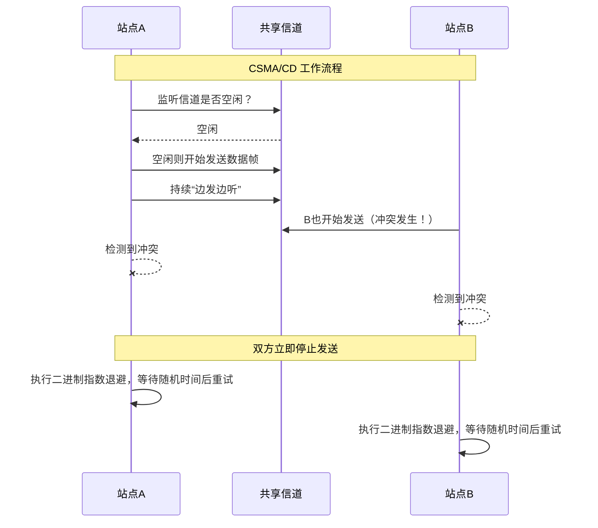

# 介质访问控制基础（信道共享、竞争系统与令牌机制）

## 介质访问控制基础

### 从一个问题开始

想象一间教室，只有一个麦克风。老师提了一个问题，全班同学都想抢答。如果大家同时喊，谁也听不清。怎样才能让信息高效、有序地传递出去？

通信网络里的“共享信道”就面临这个问题。多个站点共享同一条物理传输介质（如同轴电缆、无线电频段），当它们同时发送数据，信号就会在信道上重叠、破坏，这就是**冲突**。介质访问控制（MAC）正是为解决“谁在什么时候可以使用信道”而制定的一套规则。

### 信道共享的三种思路

网络通信中，信道分配策略分为三大类，理解它们的区别是掌握本章知识点的基础。

- **信道划分（静态分配）**：如同把马路划分为固定的车道，每个站点独占一份资源。频分复用（FDM）、时分复用（TDM）、码分复用（CDM）、波分复用（WDM）均属此类。它属于==受控访问==，通常需要集中控制器。优点是公平、无冲突，缺点是不灵活，哪怕某个站点不传数据，分配给它资源也无法被其他人利用。
- **轮询（受控访问）**：令牌环网就是典型例子。一个特殊的“令牌”帧在站点间依次传递，谁拿到令牌谁就获得了发送权。这好比击鼓传花，只有拿到花的人才能发言。这是集中或分布式的控制机制。
- **随机访问（竞争系统）**：最自由，也最容易“撞车”。所有站点公平地随时监听、随时发送，一旦发现冲突就按照某种策略重传。==竞争系统就是动态分配资源==，核心问题就是如何高效地处理冲突。我们常说的 CSMA（载波监听多点接入）系列协议就属于这种方案。

### 竞争系统的核心：CSMA 协议族

竞争系统必须解决“先听后说”和“边说边听”的问题。我们用表格来对比常考的 CSMA/CD 和 CSMA/CA 协议：

| 特性 | CSMA/CD | CSMA/CA |
| :--- | :--- | :--- |
| **核心动作** | 冲突**检测**（Collision Detection） | 冲突**避免**（Collision Avoidance） |
| **适用网络** | 有线局域网（传统以太网） | 无线局域网（Wi-Fi） |
| **工作机制** | 发送前先听（持续/非持续）；**边发边听**；一旦检测到冲突立即停止发送，执行退避算法后重试。 | 发前先听；==采用预约/确认机制减少冲突==；通常不边发边听。 |
| **能否确认** | 不能对接收帧确认 | **能**对正确接收到的数据帧进行确认（使用 ACK 帧） |

[!IMPORTANT]
在无线环境中，信号衰减和多径效应使得检测冲突极其困难，因此 CSMA/CA 通过短控制帧（RTS/CTS）交换和接收确认（ACK）来**避免**冲突，而不是检测冲突。

### 常见考点与易错辨析

[!WARNING]
**易错点1：协议归属混淆**
题目问“下列属于随机介质访问控制的是”，凡是出现 FDM、TDM、CDMA、令牌传递的，都要立刻排除，因为它们是静态划分或受控访问。只有 **CSMA 协议**才是动态的随机竞争访问。

[!WARNING]
**易错点2：设备对冲突域的影响**
冲突域就是一块可能发生冲突的网络区域。
- **集线器**：对信号只进行放大和广播，会把所有端口连成一个更大的冲突域，==扩展了冲突域范围==。
- **交换机/网桥**：基于 MAC 地址转发，能隔离不同端口间的冲突，从而**减小/隔离**冲突域。
- **路由器**：在更高层工作，直接隔离广播域和冲突域。

[!TIP]
**填空解析：CSMA/CD 协议要点**  
题目答案：==**载波监听**== 和 ==**冲突检测**==。  
“多点接入”说明是总线型网络多站点接入同一信道；“载波监听”即“先听后说”，发送前先检测信道是否空闲；“冲突检测”即“边说边听”，一边发送一边监测信号是否发生碰撞。

一个正确理解流程的例子如下：

掌握信道共享的三种思路和 CSMA 协议族的对比，能够让你在单选题、填空题中快速锁定正确选项，不落入概念的陷阱。
