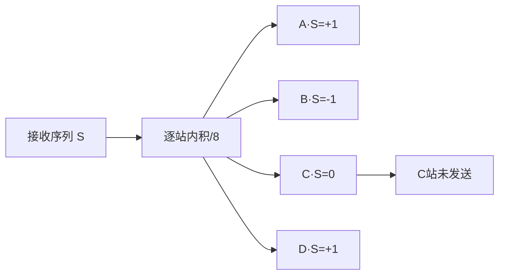

# 信道复用技术（FDM、TDM、WDM、CDM）

## 为什么需要信道复用

一条物理信道的带宽往往远大于单个信号的需求，若只传一路信号是否太浪费？==信道复用技术==正是为了解决这一问题，允许多路信号共享同一传输媒体，从而大幅提高线路利用率。南邮《计算机通信与网络》课程要求掌握四种核心复用方式：频分（FDM）、时分（TDM）、波分（WDM）和码分（CDM）。

## 四种复用技术对比

| 复用类型 | 划分维度 | 适用信号 | 核心特点 |
| :--- | :--- | :--- | :--- |
| FDM | 频率 | 模拟 | 频段隔离，保护带防干扰 |
| TDM | 时间片 | 数字 | 固定时隙，同步开销大 |
| STDM | 动态时隙 | 数字 | 按需分配，利用率更高 |
| WDM | 光波长 | 光信号 | 本质是光域的FDM |
| CDM | 码型序列 | 数字 | 抗干扰强，容量软受限 |

> [!NOTE]
> WDM 本质上就是光通信中的 FDM，只是将“频率”换成了“波长”表述；而 ==STDM（统计时分复用）== 通过动态分配时隙解决了传统 TDM 在用户无数据发送时的资源浪费问题。

## CDMA 的核心机制与计算

CDMA 与其他复用最大的不同是什么？它不划分频率也不划分时间，而是给每个站分配一个唯一的 ==码片序列==。所有站同时同频发送，依靠码型的正交性来区分信号。

### 码片序列的关键特性

- **归一化**：自身内积除以长度等于 1，即 $S \cdot S / N = 1$。
- **正交性**：不同站码片序列内积为 0，即 $S_i \cdot S_j = 0 (i \neq j)$。
- **反码表示**：发送比特“1”用原码片序列，发送比特“0”用其反码（各位取反），==未发送数据则不发出任何码片==。

> [!IMPORTANT]
> 接收端解码公式：$\text{结果} = \frac{S_{\text{recv}} \cdot S_{\text{station}}}{N}$。结果为 +1 表示发“1”，-1 表示发“0”，==结果为 0 表示该站未发送==。这是解题的唯一判据。

### 真题计算演示

以课件经典题为例，已知 A/B/C/D 四站码片序列（长度 $N=8$），收到混合序列 $S=(-1,+1,-3,+1,-1,-3,+1,+1)$，判断谁没发数据。

逐步验证：
$$
\begin{aligned}
S \cdot C &= (-1)(-1)+(1)(1)+(-3)(-1)+(1)(1) \\
&\quad +(-1)(1)+(-3)(1)+(1)(-1)+(1)(-1) \\
&= 1+1+3+1-1-3-1-1 = 0
\end{aligned}
$$
$0/8=0$，故 C 站未发送。同理可算出 A、D 发“1”，B 发“0”。

> [!WARNING]
> 填空题常考：若某站码片为 `11100101`，发“0”时应写反码 `00011010`，而非原码！务必注意题目给出的码片是用 0/1 还是 ±1 表示，==计算时统一转为 ±1 再做内积==。

> [!TIP]
> 做题口诀：“==内积除长看符号，零值即为未发送==”。考试中遇到 CDMA 计算题，直接套公式，无需还原每站的原始比特流再叠加，那样极易出错且耗时。
