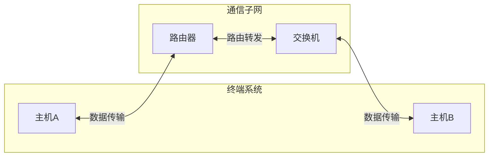
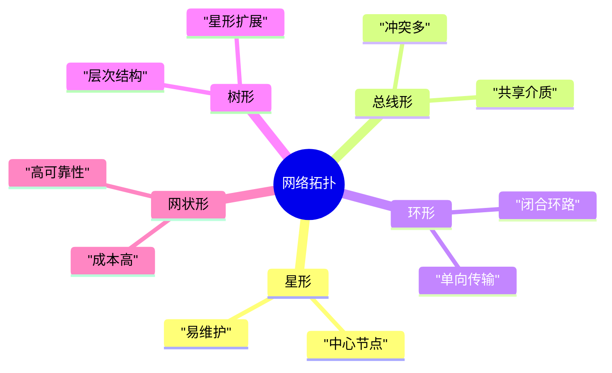

# 计算机网络的定义、组成与拓扑分类

如果两台相距千里的计算机想要交换数据，仅靠一根网线直连显然不够。它们之间需要怎样的中间设备？又该遵循什么规则才能“听懂”彼此？这就引出了计算机网络最基础的三个问题：它是什么、由什么构成、长什么样。

## 定义与逻辑组成

> [!IMPORTANT]
> **计算机网络的定义**：将地理位置不同的、具有独立功能的多台计算机及其外部设备，通过通信线路和通信设备连接起来，在网络操作系统、管理软件及==网络协议==的协调下，实现资源共享和信息传递的系统。

从逻辑上看，计算机网络由哪两个部分组成？答案是==通信子网==和==终端系统==（资源子网）。

- **通信子网**：由大量网络和连接这些网络的路由器等设备组成，核心作用是为边缘部分提供连通性和交换服务。
- **终端系统**：由所有连接在网络上的主机组成，是用户直接使用的部分，用来进行通信和资源共享。

这与因特网（Internet）中“核心部分”与“边缘部分”的划分在思想上一脉相承。

## 网络协议的三要素

终端与通信子网之间要协同工作，必须遵守网络协议。网络协议是为进行网络中的数据交换而建立的规则、标准和约定。

> [!TIP]
> 填空题高频考点：网络协议主要由==语法==、==语义==和==同步==三个要素组成。

| 要素 | 含义 | 通俗理解 |
| :--- | :--- | :--- |
| **语法** | 数据与控制信息的结构或格式 | “怎么说话”（如报文格式） |
| **语义** | 需要发出何种控制信息、完成何种动作及做出何种响应 | “说什么话”（如各字段含义） |
| **同步** | 事件实现顺序的详细说明 | “何时说话”（如时序关系） |

> [!WARNING]
> 常见坑：不要把“同步”写成“时序”。虽然两者含义相近，但南邮课件和历年填空真题的标准答案均使用“==同步==”一词。另外，网络体系结构只定义功能的规范，**不包含**协议内部实现细节。

## 拓扑分类与作用范围

网络拓扑是指网络中节点（站点）和链路组成的几何形状。常见的几种基本拓扑结构如下：

若网络形状是由站点和连接站点的链路组成的一个==闭合环==，则称这种拓扑结构为**环形拓扑**。

除了按拓扑分类，按照网络的作用范围，计算机网络可分为：
1. **个人区域网**（PAN）
2. **局域网**（LAN）
3. **城域网**（MAN）
4. **广域网**（WAN）
5. **因特网**（Internet）

> [!NOTE]
> 简答题常考：“按照网络的作用范围划分，计算机网络有哪些分类？”答出上述五类即可拿满分，注意顺序从小到大。

## 概念辨析

初学者容易混淆“物理组成”与“逻辑组成”。

| 视角 | 组成部分 | 侧重点 |
| :--- | :--- | :--- |
| **物理组成** | 硬件（主机、路由器、链路）、软件、协议 | 看得见摸得着的实体 |
| **逻辑组成** | ==通信子网== + ==终端系统== | 功能角色的抽象划分 |

考试时务必看清题干问的是“从逻辑上看”还是“物理上”，前者必答通信子网与终端系统及其各自作用。
