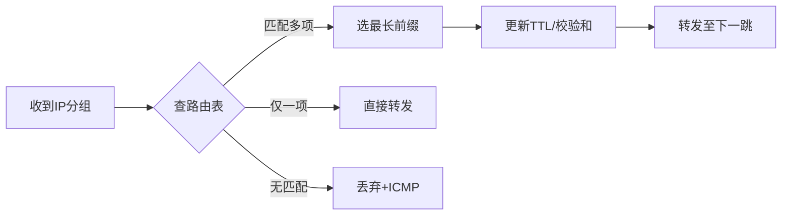

# 网络互连与IP转发（路由器转发过程、NAT、VPN、移动IP、组播）

## 网络互连与IP转发核心机制

如果互联网中每一台路由器都要记录所有主机的位置，路由表会有多大？显然不可行。因此，==路由表项数仅取决于网络数目而非主机数目==，这是理解网络层互连的基石。本章围绕“如何让不同网络高效、安全、灵活地通信”展开，涵盖转发、NAT、VPN、移动IP及组播五大核心。

### 路由器转发与最长前缀匹配

路由器如何决定数据报的下一跳？当目的IP匹配多个表项时，必须选择==最长前缀匹配==（Longest Prefix Match）。例如，将 `136.23.12.64/26` 划分为4个等大子网，需借用2位主机号，新前缀为 `/28`。若收到目的地址为 `136.23.12.97` 的分组，它同时属于原 `/26` 和新 `/28` 范围，路由器优先选择更精确的 `/28` 表项转发。

> [!IMPORTANT]
> CIDR环境下，路由查找**永远**遵循最长前缀匹配原则，而非先入为主或数值大小比较。

### NAT与专用网互连

使用私有地址（如192.168.x.x）的主机如何访问公网？答案是==NAT（网络地址转换）==。它在网关处将内部私有IP:Port映射为公网IP:Port，实现多对一复用。注意区分：NAT解决**地址短缺与私网接入**，而VPN解决**跨公网的安全隧道传输**。

> [!WARNING]
> NAT会修改IP首部（地址/校验和）及TCP/UDP端口，导致端到端透明性破坏；ICMP差错报文通常不针对组播地址生成。

### 移动IP与IP组播

移动节点更换接入点后如何保持通信？移动IP引入==归属代理与转交地址==：归属代理拦截发往永久地址的流量，通过隧道转发至当前转交地址，对上层完全透明。

组播则解决“一对多”高效传输问题。OSPF等协议利用组播地址（如224.0.0.5）发送LSA，避免逐台单播开销。记住：==组播地址范围为224.0.0.0~239.255.255.255==，且ICMP不对组播报文返回差错报告。

### 综合计算示例验证

以真题为例：`136.23.12.64/26` 划分4子网。
- 借位：$\log_2 4 = 2$ 位 → 新前缀 $26+2=28$
- 子网块大小：$2^{32-28}=16$
- 四个子网：`.64/28`, `.80/28`, `.96/28`, `.112/28`
- 可分配范围：首地址+1 至 广播地址-1（如子网3：`.97 ~ .110`）

> [!TIP]
> 子网划分速算口诀：**借n位得2ⁿ子网，剩m位容2ᵐ-2主机**；CIDR下全0/全1子网均可用。

| 技术 | 核心功能 | 关键标识/地址 | 典型场景 |
| :--- | :--- | :--- | :--- |
| NAT | 私网→公网地址转换 | 私有IP + 端口映射 | 家庭/企业上网 |
| VPN | 安全加密隧道 | IPSec / GRE | 远程办公互联 |
| 移动IP | 位置无关通信 | 转交地址(CoA) | 移动终端漫游 |
| 组播 | 高效一对多分发 | D类地址(224-239) | 视频会议/路由协议 |
