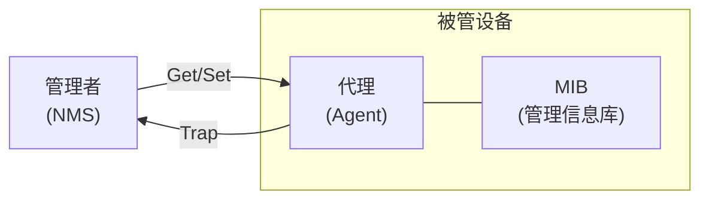

# 网络管理功能与SNMP协议（FCAPS五大功能、MIB、ASN.1）

## 网络管理功能与 SNMP 协议

网络管理的核心目标是确保网络高效、可靠运行。ISO 定义了 **FCAPS** 五大功能域，这是理解网络管理的基础框架：

| 功能域 | 核心任务 | 关键词 |
| :--- | :--- | :--- |
| **故障管理** (Fault) | 检测、隔离、纠正异常 | 告警、日志 |
| **配置管理** (Configuration) | 初始化、修改设备参数 | 拓扑、版本 |
| **计费管理** (Accounting) | 记录资源使用以分摊成本 | 流量、时长 |
| **性能管理** (Performance) | 评估效率与服务质量 | ==利用率、延迟== |
| **安全管理** (Security) | 控制访问、保护数据 | 认证、加密 |

> [!IMPORTANT]
> 考题常考定义辨析。例如：“对网络资源利用率及有关通信活动进行分析”属于 **性能管理**。注意区分“计费”（为了收钱/统计用量）与“性能”（为了优化/评价效率）。

## SNMP 体系结构与工作原理

简单网络管理协议 (SNMP) 是事实上的工业标准，其架构包含三个基本要素：

1.  **管理者 (Manager)**：运行管理进程，发出查询或设置指令。
2.  **代理 (Agent)**：运行在被管设备上，维护本地 MIB，响应请求或主动发送 Trap。
3.  **管理信息库 (MIB)**：==被管对象的集合==。只有存在于 MIB 中的对象才能被 SNMP 管理。MIB 采用树形结构，每个节点有唯一 OID。

> [!NOTE]
> SNMP 基于 UDP，默认端口 161（请求/响应）和 162（Trap）。它轻量级，适合大规模网络，但安全性较弱（v1/v2c 使用明文共同体字符串）。

## ASN.1 与数据编码

为了在不同厂商设备间无二义地交换数据，SNMP 使用 **ASN.1** (Abstract Syntax Notation One) 定义数据结构，并使用 **BER** (Basic Encoding Rules) 进行编码。

*   **ASN.1**：抽象语法，定义数据的类型和结构（如 INTEGER, OCTET STRING）。它独立于具体的机器表示。
*   **BER**：具体编码规则，将 ASN.1 描述的数据转换为唯一的比特序列（TLV 格式：Tag-Length-Value）。

> [!TIP]
> 记忆要点：ASN.1 是“怎么写”（语法），BER 是“怎么传”（编码）。ASN.1 消除了数据含义的二义性。

## SNMP 操作类型 (PDU)

SNMP 通过五种基本的协议数据单元 (PDU) 实现交互：

| PDU 类型 | 方向 | 作用 |
| :--- | :--- | :--- |
| **get-request** | Manager -> Agent | 查询一个或多个变量值 |
| **get-next-request** | Manager -> Agent | 遍历 MIB 树，获取下一个对象 |
| **set-request** | Manager -> Agent | 修改变量值（配置） |
| **get-response** | Agent -> Manager | 对上述请求的响应 |
| **trap** | Agent -> Manager | ==主动报告事件==（无需请求） |

> [!WARNING]
> `trap` 是单向的，Manager 不回复确认。若需可靠的事件通知，SNMPv2 引入了 `inform`，但这通常用于 Manager 之间的通信。`get-next-request` 常用于批量读取表格数据，避免多次往返。

## 典型例题解析

**题目**：网络管理功能中，“对网络资源利用率及有关通信活动进行分析，以帮助网络管理人员评价网络资源及相关通信活动的情况和效率”，描述的是（ ）。
A. 计费管理  B. 故障管理  C. 性能管理  D. 安全管理

**解析**：
题干关键词为“利用率”、“分析”、“评价效率”。
*   **计费管理**侧重于“用了多少”以计算费用；
*   **性能管理**侧重于“用得怎么样”以优化网络。
因此，评价效率和利用率属于 ==性能管理==。

**答案**：C
