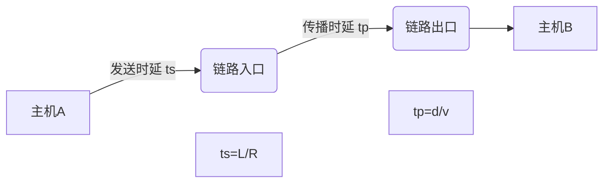

# 计算机网络性能指标（速率、时延、吞吐量计算）

> [!IMPORTANT]
> 计算机网络的性能指标是衡量网络“跑得快不快、堵不堵”的量化标准。南邮考试中，==速率换算、时延计算与 CSMA/CD 最短帧长推导==是第1章必考的计算核心。

## 速率：传码率与传信率

一个码元能携带多少信息？这取决于信号的电平数 $M$。

- **传码速率（波特率）** $R_B$：每秒传输的码元个数，单位 Baud（波特）。$R_B = 1/T$（$T$ 为码元周期）。
- **传信速率（比特率）** $R_b$：每秒传输的二进制比特数，单位 bit/s（或 b/s）。

两者的关系为：
$$R_b = R_B \times \log_2 M$$

> [!WARNING]
> 常见坑：把波特率和比特率混为一谈。只有当 $M=2$（即二电平信号）时，两者数值才相等。

**算对了的例子**：若码元周期 $T = 2 \times 10^{-4}$ 秒，传送 8 电平信号。
$$R_B = \frac{1}{2 \times 10^{-4}} = 5000 \text{ Bd}$$
$$R_b = 5000 \times \log_2 8 = 5000 \times 3 = 15000 \text{ b/s}$$

结合奈氏准则，理想低通信道最高码元速率 $R_{Bmax} = 2W$（$W$ 为带宽）。若一个码元携带 3bit 信息，带宽 4kHz，则最高信息速率 $R_{bmax} = 2 \times 4000 \times 3 = 24 \text{ kb/s}$。

## 时延：数据到底慢在哪一步？

总时延由四部分组成，考试重点在前两项：

| 时延类型 | 计算公式 | 物理意义 |
| :--- | :--- | :--- |
| ==发送时延== $t_s$ | $\frac{\text{数据帧长度 (bit)}}{\text{信道带宽/发送速率 (bit/s)}}$ | 数据从结点推入传输媒体所需时间 |
| ==传播时延== $t_p$ | $\frac{\text{信道长度 (m)}}{\text{电磁波传播速率 (m/s)}}$ | 信号在物理线路上“飞”的时间 |
| 处理时延 | 视设备而定 | 结点存储转发、查表等耗时 |
| 排队时延 | 视网络拥塞度 | 在路由器缓存中等待的时间 |

> [!TIP]
> 记忆口诀：“发看长短（数据量），传看远近（物理距离）”。发送时延和链路带宽有关，和距离无关；传播时延和距离有关，和带宽无关。

**算对了的例子**：AB相距 $1000\text{ km}$，信号速度 $2\times 10^8\text{ m/s}$，数据块 $10^5\text{ bit}$，发送速率 $1\text{ Mb/s}$。
$$t_s = \frac{10^5}{10^6} = 0.1\text{ s} = 100\text{ ms}$$
$$t_p = \frac{1000 \times 10^3}{2 \times 10^8} = 5 \times 10^{-3}\text{ s} = 5\text{ ms}$$

## 吞吐量与 CSMA/CD 综合应用

**吞吐量**指单位时间内实际通过某网络的数据量，受限于瓶颈链路带宽。而在以太网中，为了保证碰撞能被检测到，必须满足：**发送时延 $\ge$ 往返传播时延（争用期 $2\tau$）**。

由此推导出最短帧长公式：
$$L_{min} = R \times RTT = R \times 2\tau$$

如果题目反过来求最大传输速率 $R$，只需变形为 $R = L_{min} / (2\tau)$。

**算对了的例子**：CSMA/CD 局域网，电缆长 $1000\text{ m}$，信号速度 $2\times 10^8\text{ m/s}$，最短帧长 $1000\text{ bit}$。
先求单程传播时延 $\tau$：
$$\tau = \frac{1000}{2 \times 10^8} = 5 \times 10^{-6}\text{ s} = 5\text{ }\mu\text{s}$$
往返时延（争用期）$RTT = 2\tau = 10\text{ }\mu\text{s}$。
最大传输速率：
$$R = \frac{L_{min}}{RTT} = \frac{1000}{10 \times 10^{-6}} = 10^8\text{ b/s} = 100\text{ Mbps}$$

> [!CAUTION]
> 如果题干中出现“中继器”，中继器会引入额外的处理时延，计算总往返时延时必须将其加上！例如经过中继器产生 $2\mu\text{s}$ 时延，则总 $RTT = 2\tau + 2\mu\text{s}$。
