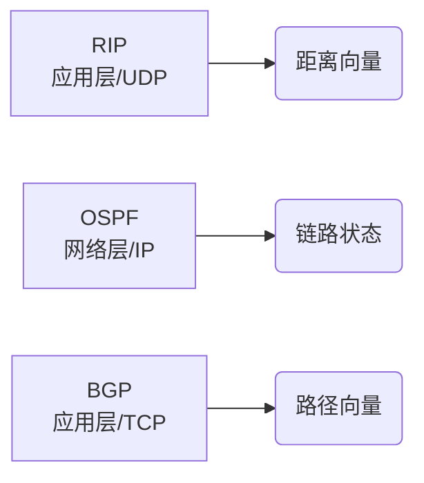
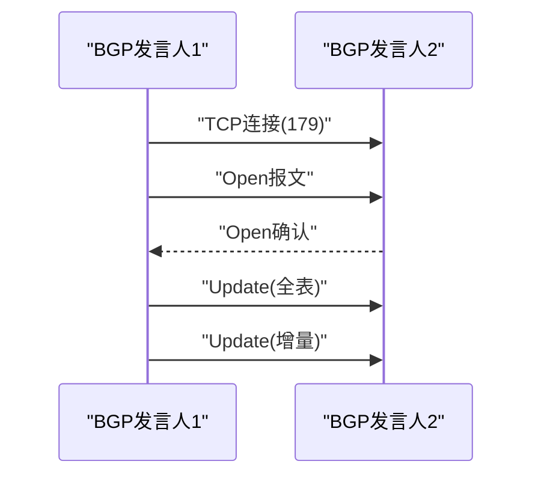

# 互联网路由选择协议（RIP距离向量、OSPF链路状态、BGP）

互联网被划分为多个自治系统（AS），路由选择协议按作用范围分为 ==内部网关协议（IGP）== 和 ==外部网关协议（EGP）==。RIP 与 OSPF 用于 AS 内部，BGP 用于 AS 之间。

## RIP：距离向量算法

RIP 是应用层协议（使用 UDP 520 端口），基于距离向量算法。它以“跳数”作为度量值，最大为 15，16 表示不可达。

**怎么做？**
每个路由器周期性地将自己的路由表发给相邻路由器。收到邻居的距离向量后，按 Bellman-Ford 方程更新：

$$D_x(y) = \min_v \{ c(x,v) + D_v(y) \}$$

> [!WARNING]
> 课件要求掌握书上 RIP 路由更新的例子。核心原则：只关心“从哪个邻居来、距离加 1”，若新距离更小则更新路由表。

## OSPF：链路状态算法

OSPF 是网络层协议（直接封装在 IP 数据报中，协议号 89）。它不用跳数，而是用“代价（Cost）”作为度量值，支持负载均衡、特定于主机/网络的路由。

**怎么做？**
每个路由器向全网泛洪链路状态信息（LSA），所有路由器据此构建相同的拓扑图，再用 Dijkstra 算法算出最短路径树。

> [!TIP]
> 填空题常考：==OSPF 工作在网络层，RIP 工作在应用层==。选择题易错点：OSPF 是 IGP，不是 EGP。

## BGP：外部网关协议

BGP-4 是不同 AS 的路由器之间交换路由信息的协议。BGP 的主旨是提供一种域间路由选择系统，确保 AS 只能无环地交换路由信息。

**为什么需要 BGP？**
若组织有多条到 ISP 的连接，需要对路径属性进行操纵，就必须用 BGP。ISP 也需要配置 BGP 以实现中转策略。

**怎么做？**
BGP 是 ==路径向量协议==。两个 BGP 发言人先通过 TCP（端口 179）建立连接，再交换 BGP 报文建立会话。BGP 强制包含两条路径属性：
- **Origin**：路径信息来源（如 IGP 获悉或配置得到）。
- **AS_PATH**：前往目标网络必须经过的 AS 号列表。

BGP 路由器不接受 AS_PATH 中包含自己 AS 号的更新，从而保证无环。初始运行时交换整个路由表（超 190,000 个网络），之后仅发送增量更新。

## 三者对比辨析

| 特性 | RIP | OSPF | BGP |
| :--- | :--- | :--- | :--- |
| **类型** | IGP | IGP | EGP |
| **算法** | 距离向量 | 链路状态 | 路径向量 |
| **工作层次** | 应用层 | 网络层 | 应用层 |
| **传输协议** | UDP | IP 数据报 | TCP (179) |
| **度量标准** | 跳数 ($\le 15$) | 代价 (Cost) | 多种路径属性 |
| **收敛速度** | 慢（有坏消息传得慢问题） | 快 | 较慢（侧重策略控制） |

> [!NOTE]
> BGP 交换路由信息的结点是 AS 量级，远少于 AS 内的网络数；且每个 AS 中 BGP 发言人数目很少，防止域间路由过分复杂。BGP 只能通告它使用的最佳路径，且支持 CIDR。
