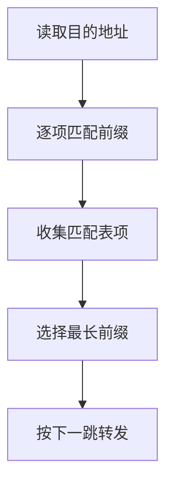

# 子网划分与CIDR（子网掩码计算、路由聚合、最长前缀匹配）

## 子网划分：把网络号再细分

分类编址中，一个网络包含大量主机，直接分配容易造成地址浪费。**子网划分**从主机号中借出若干位作为子网号，形成“网络号—子网号—主机号”的三级结构。子网对外仍表现为一个网络，内部则由路由器根据子网掩码区分不同子网。

子网掩码中，网络号和子网号对应位为 1，主机号对应位为 0。若主机号原有 $h$ 位，借出 $s$ 位作为子网号，则：

- 子网掩码增加 $s$ 个 1；
- 每个子网有 $2^{h-s}$ 个地址；
- 全 0 主机号是子网地址，全 1 主机号是直接广播地址，因此可用主机数为 $2^{h-s}-2$。

> [!IMPORTANT]
> 主机号至少保留 2 位，否则无法同时提供子网地址、广播地址和有效主机地址。若题目规定不能使用全 0、全 1 子网，则子网号也至少要有 2 位，可用子网数为 $2^s-2$。

例如，将 `192.168.10.0/24` 划分为两个一样大的子网，且不允许使用全 0、全 1 子网。借 1 位只能得到这两个禁用子网，所以应借 2 位，选用 `192.168.10.64/26` 和 `192.168.10.128/26`。子网掩码为 `255.255.255.192`，每个子网有 $2^6=64$ 个地址，其中有效主机 $64-2=62$ 个，广播地址分别为 `192.168.10.127`、`192.168.10.191`。

> [!WARNING]
> “需要 120 个地址”和“需要 120 台主机”并不完全相同。若按每个局域网需分配不少于 120 个 IP 地址理解，将 `222.118.1.0/24` 平分为两个 `/25` 即可，每个子网有 128 个地址、126 个有效主机地址；若要求 120 台主机，126 也足够。

## CIDR：用网络前缀取代分类边界

CIDR（无分类域间路由选择）消除了传统 A、B、C 类地址及固定子网划分的限制，用任意长度的**网络前缀**标识网络，并采用斜线记法，如 `202.15.64.0/21`。它与子网划分的计算本质相同：前缀对应掩码中的 1，其余部分是主机号。

| 计算对象 | 方法 |
|---|---|
| 地址总数 | $2^{32-\text{前缀长度}}$ |
| 子网掩码 | 前缀位置置 1，其余置 0 |
| 最大地址 | 网络前缀不变，主机号全置 1 |
| 地址块大小 | 必须是 2 的整数次幂 |

以 `128.10.64.0/20` 为例，主机号有 $32-20=12$ 位，因此包含 $2^{12}=4096$ 个地址。掩码前 20 位为 1，即 `255.255.240.0`。第三字节的块大小为 $256-240=16$，地址块从 `128.10.64.0` 到 `128.10.79.255`，所以最大地址是 `128.10.79.255`。

> [!TIP]
> 快速判断地址块：先找“发生变化的那个字节”，计算块大小 $256-\text{该字节掩码}$；起始地址必须是块大小的整数倍，结束地址就是下一块起始地址减 1。

## 路由聚合与最长前缀匹配

多个前缀相同、地址连续的网络可以合并为一个更大的 CIDR 地址块，这就是**路由聚合**。聚合时保留各网络地址共同的最长前缀，用一个路由表项代替多个表项，从而减小路由表规模。

例如，`202.118.132.0/24` 与 `202.118.133.0/24` 的第三字节分别为 132、133，二进制为 `10000100`、`10000101`，只有最后一位不同。将这一位归入主机部分，可聚合为 `202.118.132.0/23`。

聚合可能使多个路由同时匹配同一目的地址。例如，路由表同时存在 `202.118.132.0/23` 和 `202.118.133.0/24`，目的地址 `202.118.133.8` 两者都匹配，应选择 `/24`。这就是==最长前缀匹配==：前缀越长，地址范围越小，路由越具体。

> [!CAUTION]
> 路由聚合不能只看“地址是否连续”，还要满足数量是 2 的幂、总空间按块大小对齐。两个 `/24` 不一定都能聚合成 `/23`；如 `...131.0/24` 与 `...132.0/24` 虽数值相邻，却不能仅用一个 `/23` 精确覆盖。此外，聚合后的地址块不能无意包含其他网络，否则可能造成错误转发。
