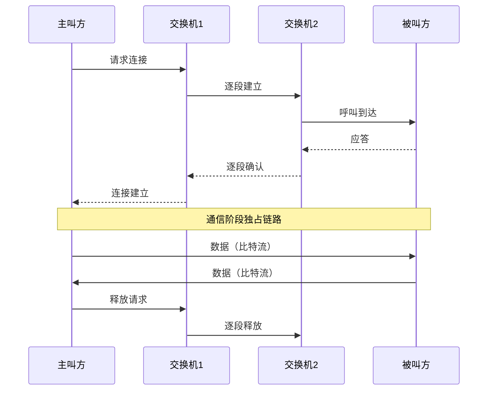
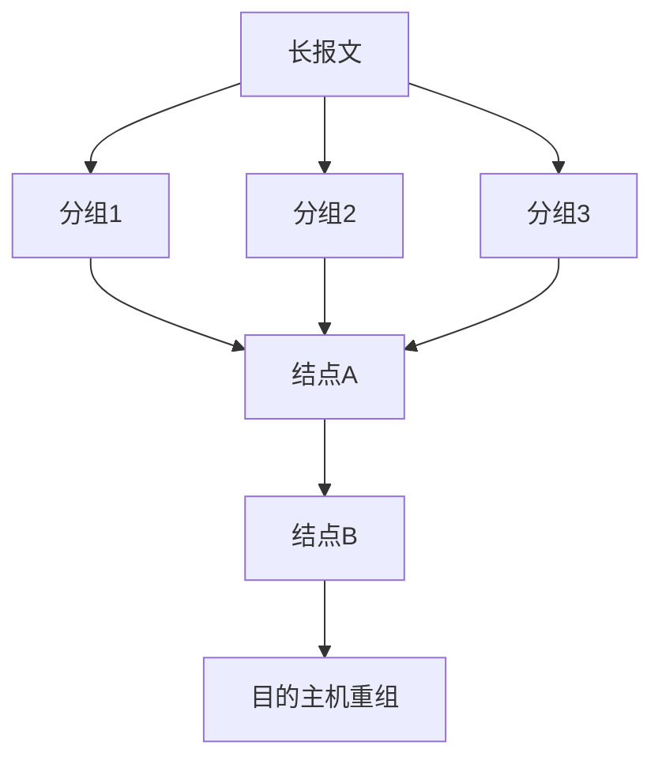

# 数据交换技术（电路交换、报文交换、分组交换）

## 数据交换技术

两台主机通信时，如果它们之间没有一条直接线路，就需要经过若干中间结点转发数据。这些中间结点以什么方式把数据从入端口“搬”到出端口，就是==数据交换技术==要解决的问题。

先想一个问题：如果所有用户两两之间都拉一条专线，线路数量将是 $n(n-1)/2$，显然不现实。所以中间结点必须承担“交换”的职责。根据交换方式的不同，分为三类：

| 交换方式 | 是否建立连接 | 转发单位 | 线路利用率 | 时延 |
|---------|------------|---------|-----------|------|
| 电路交换 | 是 | 比特流 | 低 | 传输时延小，实时性好 |
| 报文交换 | 否 | 整个报文 | 高 | 存储转发，时延大 |
| 分组交换 | 否（数据报）/ 是（虚电路） | 分组 | 高 | 较小，可靠性高 |

### 电路交换

电路交换的核心是：通信前先==建立一条独占的物理通路==，通信结束后释放。典型代表是传统电话网。

- **优点**：一旦连接建立，数据以恒定速率传输，==实时性好==，适合语音等连续流。
- **缺点**：连接建立时间长；通信期间链路被独占，即使没有数据发送，其他人也不能用，==线路利用率低==。

> [!WARNING]
> 分组交换产生的一个重要动机就是：电路交换网中，通信路径上任一交换机或链路被毁，整个通信电路就中断，==生存性差==。

### 存储转发：报文交换与分组交换

电路交换要求双方同时“在线”且独占资源。如果允许中间结点先把数据==存下来，再找机会转发==，就得到存储转发方式。

**报文交换**把整个报文作为一个单位转发。中间结点收到完整报文后，存储、查路由表、再转发到下一跳。

**分组交换**则把报文拆成若干较小的==分组（packet）==，每个分组携带首部（含地址等信息）独立转发。

为什么分组更好？假设结点 A 要把一个 1 MB 的报文发给结点 B，链路速率 1 Mb/s。报文交换下，B 必须等整个报文收完（8 s 后）才能开始转发；分组交换下，第一个分组到达即可转发，==端到端时延大幅降低==。

> [!IMPORTANT]
> ==报文交换和分组交换都采用存储转发方式==。区别在于转发单位：报文交换以整个报文为单位，分组交换以较小的分组为单位。

### 分组交换的两种实现：数据报与虚电路

分组交换内部又分两种服务方式：

| 特点 | 数据报 | 虚电路 |
|------|--------|--------|
| 是否需要建立连接 | 不需要 | 需要（建立、数据传输、释放） |
| 每个分组的路径 | 可以不同 | 相同（沿虚电路） |
| 分组首部 | 含完整目的地址 | 含虚电路号 |
| 可靠性 | 尽力而为 | 相对有序、可控 |

> [!NOTE]
> 虚电路是==逻辑==连接，不是物理独占链路。它建立在分组交换基础上，与电路交换的“独占物理通路”有本质区别。考试常考这一点：**虚电路 ≠ 电路交换**。

### 常见坑

1. 把“报文交换”和“分组交换”混为一谈——两者都是存储转发，但转发单位不同。
2. 把虚电路等同于电路交换——虚电路不独占链路资源，只是逻辑上的连接。
3. 认为电路交换实时性好是因为“速率高”——速率由链路决定，实时性好来自==独占信道、无排队时延==。

### 一个算对了的例子

> 源站通过分组交换网向目的站发送 900000 bit 的文件，经过 3 段链路，数据率 100 Mb/s。每个分组长 1000 bit，其中头部 100 bit。忽略传播时延和结点处理时延，求总时延。

**第一步**：每个分组的数据部分为 $1000 - 100 = 900$ bit。

**第二步**：所需分组数 $N = 900000 / 900 = 1000$ 个。

**第三步**：一个分组的发送时延 $T_t = 1000 / (100 \times 10^6) = 10^{-5}$ s $= 10\ \mu$s。

**第四步**：总时延 = 第一个分组经过 3 段链路的发送时延 $+$ 剩余分组的发送时延：
$$T = 3T_t + (N-1)T_t = 3 \times 10^{-5} + 999 \times 10^{-5} = 1002 \times 10^{-5} = 10.02\ \text{ms}$$

> [!TIP]
> 分组交换的总时延公式：$T = \text{链路数} \times T_t + (N-1) \times T_t$。其中第一项是“首分组走完全程”，第二项是“后续分组依次发送”。如果题目给的是“数据部分大小”而非“总分组大小”，注意先加上分组头部再算 $T_t$。
