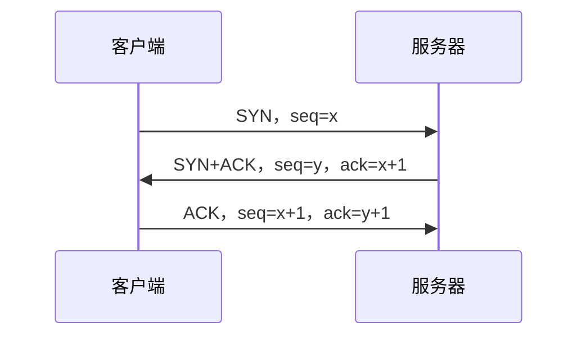
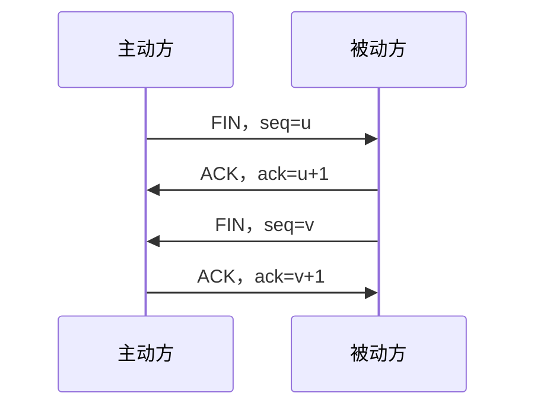

# TCP连接管理与可靠传输（三次握手、四次挥手、序号确认、RTT与RTO）

## 是什么与为什么需要

TCP（传输控制协议）位于网络层 IP 之上，向应用层提供**面向连接、可靠、全双工**的字节流服务。IP 只负责“尽力交付”，可能出现丢包、重复、失序和错误；因此 TCP 必须借助**连接管理、序号与确认、超时重传**等机制，保证“发送什么就收到什么”。

> [!IMPORTANT]
> TCP 的可靠传输不是只靠确认，而是“序号 + 累积确认 + 重传 + 流量/拥塞控制”的协同机制。

## 三次握手与四次挥手

三次握手用于同步双方的初始序号并确认双向收发能力：

- 第一次：客户端请求建立连接，并发送初始序号。
- 第二次：服务器确认客户端序号，同时发送自己的初始序号。
- 第三次：客户端确认服务器序号。

四次挥手通常是因为 TCP 全双工，两个方向要分别关闭：

主动关闭方最后进入 `TIME_WAIT`，等待 `2MSL`，以便确认丢失的 FIN 报文并让旧报文消失。

> [!WARNING]
> “关闭连接为什么不是三次握手？”关键在于服务器的 ACK 与 FIN 通常不能合并，因为服务器可能仍有数据要发送。

## 序号、确认与重传

TCP 报文段中的**序号 seq**按字节编号。ACK 字段中的**确认号 ack**表示“期望收到的下一个字节序号”，而不是已经收到的最后一个字节序号。

例如：第一个报文段含 200 字节，序号为 100；第二个含 500 字节。正确收到两段后，下一个期望字节为

$$
100+200+500=800
$$

所以确认号是 **800**，不是 700 或 1000。若某段未按序到达，TCP 通常累积确认，只确认连续收到的前缀；SACK 可额外告知已乱序到达的区间。

发送方为每个报文段设置重传计时器。未在截止时间前收到所需确认，就重传该段。RTO 过大导致重传迟缓，过小则会造成不必要的重传。

## RTT、RTTD 与 RTO

RTT（往返时延）是从发送报文段到收到对应确认的时间；RTTD（偏差）用于描述 RTT 的波动。教材采用的指数加权平均为：

$$
RTT_{new}=\alpha RTT_{old}+(1-\alpha)RTT_{sample}
$$

超时重传时间通常取：

$$
RTO=RTT_{new}+4RTTD_{new}
$$

**例：**当前 RTT 为 30 ms，新样本为 34 ms，$\alpha=0.9$：

$$
RTT_{new}=0.9\times30+0.1\times34=30.4\text{ ms}
$$

因此选择 **C（30.4 ms）**。

## 发送窗口与易错点

TCP 实际可发送的数据量受接收能力限制：

$$
发送窗口=\min(rwnd,cwnd)
$$

其中 `rwnd` 是接收窗口，`cwnd` 是拥塞窗口。发生超时后，`cwnd` 通常减半进入拥塞避免，再按规则增长；不能只根据接收窗口计算发送能力。

> [!TIP]
> 记忆口诀：**握手三次同步序号，挥手四次分向关闭；ACK 指下一字节，RTO 依据 RTT 波动。**

| 易混概念 | 含义 |
|---|---|
| 序号 `seq` | 本段数据第一个字节的编号 |
| 确认号 `ack` | 期望收到的下一个字节编号 |
| RTT | 一个报文段往返所需时间 |
| RTO | 等待确认后判定超时并重传的时间 |
| `rwnd` | 接收方通告的接收能力 |
| `cwnd` | 发送方根据网络拥塞估计的发送能力 |
