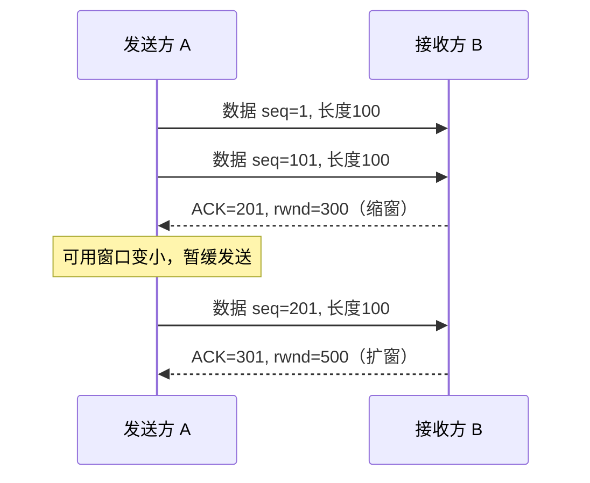
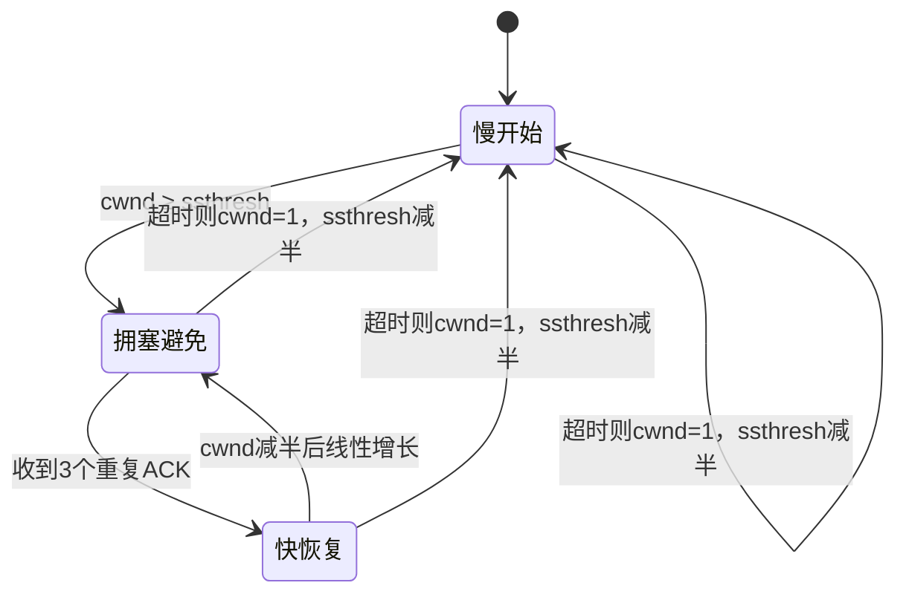

# TCP流量控制与拥塞控制（滑动窗口、慢开始、拥塞避免、快重传与快恢复）

## TCP 流量控制与拥塞控制

发送方如果只顾着“把数据塞进网络”，而不考虑接收方的处理能力和网络的承载能力，就会出现两个问题：接收方缓冲区被撑爆，或者网络中间节点（路由器）排队溢出。前者靠 **流量控制** 解决，后者靠 **拥塞控制** 解决。

> [!IMPORTANT]
> 流量控制是“端到端”的——保护接收方；拥塞控制是“全网”的——保护网络。两者都通过调整发送窗口来限制发送速率，但目的和依据不同。

---

## 流量控制：滑动窗口如何“随对方呼吸”

TCP 采用 ==大小可变的滑动窗口== 进行流量控制，窗口单位是**字节**。接收方在报文段的“窗口”字段中写入自己还能接收的字节数，即接收窗口 `rwnd`（receive window）。发送方据此调整发送窗口：

$$
\text{发送窗口} = \min(\text{拥塞窗口 cwnd},\ \text{接收窗口 rwnd})
$$

比如主机甲 `cwnd=1000` 字节，主机乙通告 `rwnd=2000` 字节，则甲的发送窗口取 ==1000 字节==（取较小值）。

> [!TIP]
> **窗口缩小意味着“刹车”**：接收方如果窗口字段减小，发送方必须同步减小发送窗口，甚至减到 0 时完全停发（等待零窗口探测报文）。

---

## 拥塞控制：四个算法如何“探测路况”

拥塞发生在网络中间。TCP 引入 **拥塞窗口 `cwnd`**，思想是：先谨慎地小步试探，再逐步加大发送速率，一旦发现丢包就快速收缩。

### 慢开始（slow start）

起点：`cwnd = 1` 个报文段（MSS）。每收到一个 ACK，`cwnd` 就 **指数增长**（每经过一个传输轮次 RTT，`cwnd` 翻倍），直到达到门限 `ssthresh`。

### 拥塞避免（congestion avoidance）

当 `cwnd ≥ ssthresh`，改用**线性增长**：每经过一个 RTT，`cwnd` 只增大 1 个 MSS，防止增长过快。

### 快重传（fast retransmit）

接收方收到失序报文段时立即发送**重复 ACK**。发送方==连续收到 3 个重复 ACK== 就立刻重传丢失报文段，不等待超时。

### 快恢复（fast recovery）

快重传后不进入慢开始，而是把 `ssthresh` 和 `cwnd` 都设为当前 `cwnd` 的一半，然后直接进入拥塞避免。

> [!WARNING]
> **超时**和**快重传**的后果完全不同：超时说明网络拥堵严重，回到慢开始（`cwnd=1`）；快重传说明只是个别包丢了，网络还能跑，所以只做快恢复。

---

## 一个算对了的例子

设 `ssthresh` 初始值为 8（单位：报文段），当 `cwnd` 上升到 12 时发生超时。求此后各轮次的 `cwnd`。

**解：**

超时发生时：`ssthresh = 12 / 2 = 6`，`cwnd = 1`，进入慢开始。

| 轮次 | 算法阶段 | cwnd（报文段） |
|:---:|:---:|:---:|
| 1 | 慢开始 | 1 |
| 2 | 慢开始 | 2 |
| 3 | 慢开始 | 4 |
| 4 | 拥塞避免（cwnd=6≥ssthresh=6） | 6 |
| 5 | 拥塞避免 | 7 |
| 6 | 拥塞避免 | 8 |
| 7 | 拥塞避免 | 9 |

前 3 轮指数增长：1→2→4；第 4 轮达到 `ssthresh=6` 后转为线性增长：6→7→8→9。

> [!NOTE]
> **“慢开始”其实并不慢**——它是指数增长的，只是起点低。真正“慢”的是拥塞避免阶段的线性增长。这个名字容易误导，注意区分。
