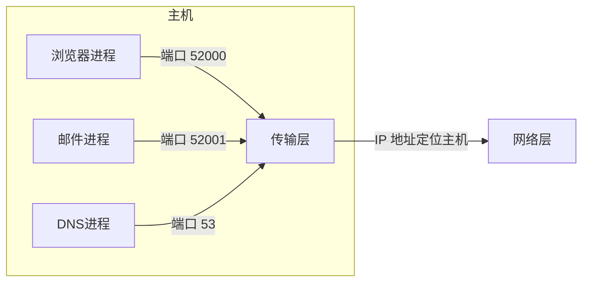
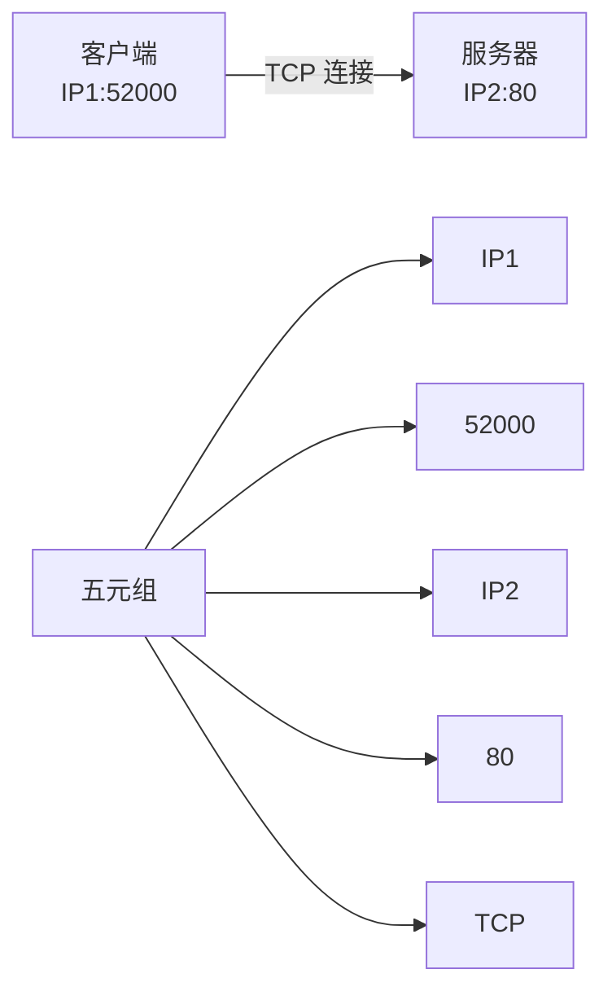

# 传输层服务与端口（复用与分用、五元组、熟知端口）

## 为什么需要端口

传输层向下把数据交给网络层，向上把数据交给应用进程。问题在于：一台主机上同时运行着很多应用进程——你在用浏览器看网页，音乐播放器在缓冲歌曲，邮件客户端在后台收信。IP 地址只能定位到主机，无法区分这些进程。

==端口就是传输层用来标识应用进程的地址==。TCP 和 UDP 都使用端口号与应用进程通信，端口也被称为传输层服务访问点（TSAP）。



## 复用与分用

- **复用**：发送方的多个应用进程，通过不同的端口号共用传输层和下层网络，把数据发出去。
- **分用**：接收方的传输层收到数据后，根据目的端口号把数据交给正确的应用进程。

> [!IMPORTANT]
> ==复用和分用必须通过端口才能实现==。没有端口，传输层就无法知道数据该给谁。

## 套接字与五元组

IP 地址标识主机，端口号标识主机上的进程，二者组合起来就形成了套接字：

$$\text{套接字} = \langle IP地址,\ 端口\rangle$$

但套接字只在单个端点内部有意义。要唯一确定网络中的一次通信，需要五个量：

$$\text{五元组} = \langle 源IP,\ 源端口,\ 目的IP,\ 目的端口,\ 传输协议\rangle$$

> [!WARNING]
> 同一个 TCP 连接的两端五元组必然是唯一的；但 UDP 是无连接的，两次通信即使五元组相同也没有“连接”的语义。另外，**协议类型必须写入五元组**——TCP 80 端口和 UDP 80 端口是两个完全不同的东西。



## 端口号分类

| 范围 | 类别 | 说明 |
|---|---|---|
| 0 ~ 1023 | ==熟知端口== | 由 IANA 统一分配给常用服务，如 HTTP 80、DNS 53、FTP 21 |
| 1024 ~ 49151 | 注册端口 | 分配给特定应用软件，需向 IANA 注册 |
| 49152 ~ 65535 | 动态/私有端口 | 客户端临时使用，用完释放 |

客户端发起请求时，通常由操作系统随机分配一个动态端口作为源端口，目的端口则使用服务器的熟知端口。比如浏览器访问网页时，源端口可能是 52000，目的端口是 80。

> [!TIP]
> 记忆常用熟知端口：**“网页 80，域名 53，邮件 25/110，文件 20/21，远程 23”**。

## 一个算对了的例子

某 IP 数据报首部片段（十六进制）如下，求本次通信的五元组：

```
45 00 00 3C 1C 46 40 00 40 06 B1 E6 C0 A8 00 64 C0 A8 00 C8
07 38 00 50 ...
```

逐步分析：

- 协议字段：`06` = TCP（IPv4 首部第 10 字节）
- 源 IP 地址：首部第 13～16 字节 `C0 A8 00 64` → 192.168.0.100
- 目的 IP 地址：首部第 17～20 字节 `C0 A8 00 C8` → 192.168.0.200
- 源端口号：TCP 首部前两字节 `07 38` = $7 \times 256 + 3 \times 16 + 8 = 1848$
- 目的端口号：TCP 首部第三、四字节 `00 50` = 80

五元组为：

$$(192.168.0.100,\ 1848,\ 192.168.0.200,\ 80,\ TCP)$$

> [!NOTE]
> 目的端口 80 是熟知端口，说明服务器在提供 HTTP 服务；源端口 1848 属于动态端口范围，是客户端临时分配的。

## 常见易错点

一个经典考题：**网络上具有唯一性的 IP 地址和端口号的组合，称为套接字**。注意题目问的是“IP + 端口”这个二元组，不要填成“五元组”。

另一个高频误区是混淆 **UDP 和 TCP 的端口是否相同**。端口号本质是 16 位整数，TCP 80 和 UDP 80 是不同协议的端口，互不冲突。DNS 使用 UDP 53，但区域传送时也用 TCP 53，这并不矛盾。
