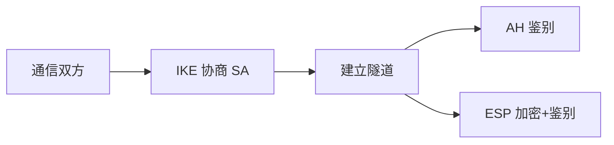
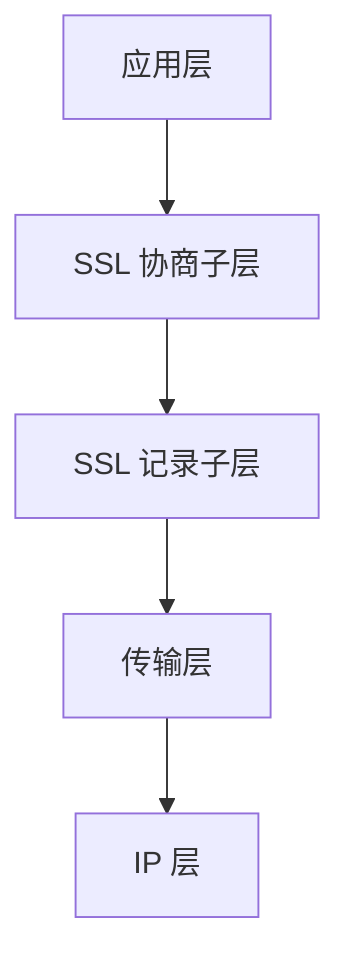
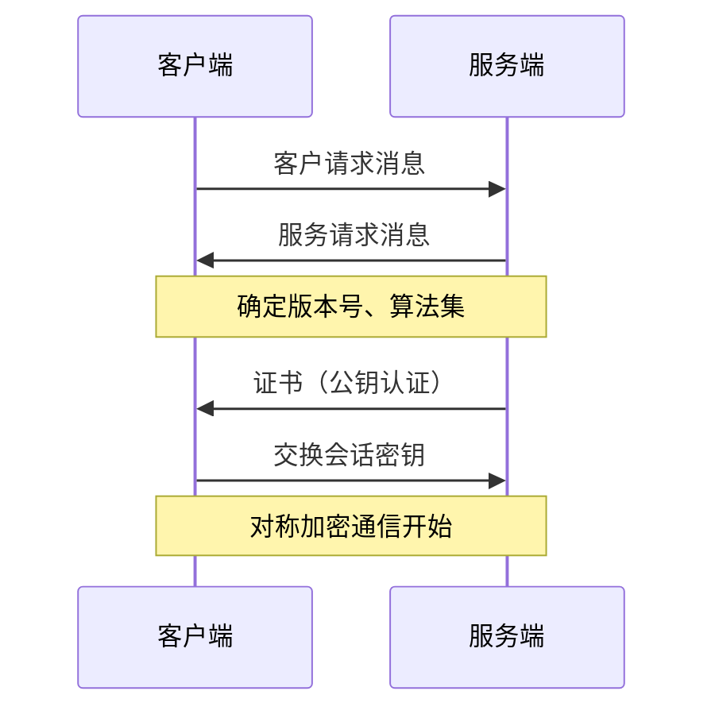

# 虚拟专用网与高层安全（隧道协议、IPSec、SSL/TLS）

## 什么是 VPN 与高层安全

当你在家里想访问学校的内网资源，或者公司在北京和上海的两个局域网要安全互通时，不可能自己铺设专线——太贵了。能不能"借道"Internet，又让别人看不到你的数据？

答案是**虚拟专用网（VPN）**：将物理分布在不同地点的网络通过公用骨干网（尤其是 Internet）连接而成的==逻辑上的虚拟子网==。它对用户透明，感觉就像一条专用通道。

> [!IMPORTANT]
> 实现 VPN 的两种基本技术是：==隧道技术==和==加密技术==。（考试填空常客）

## 隧道协议：数据怎么"穿隧道"

隧道就是把原始数据包**再封装一层**，让公网上只看到外层头部。按 OSI 层次，主要有三种：

| 协议 | 工作层次 | 特点 |
|------|---------|------|
| PPTP | 第 2 层 | 支持封装 IP 及非 IP 协议（IPX、AppleTalk） |
| L2TP | 第 2 层 | PPTP 的改进，通用性更强 |
| IPSec | 第 3 层 | IP over IP，提供鉴别和检错，仅支持 IP |

## IPSec：网络层的安全

IPSec 在第三层执行对称或非对称加密。建立安全通路前，双方先协商加密算法、密钥、密钥生存期等安全策略，协商完成后即建立一个**安全关联（SA）**，确定 IPSec 要执行的处理。

IPSec 协议分三部分：

- **IKE**：密钥交换管理（可选 DES / 3DES）
- **AH**：鉴别首部，保证完整性与真实性
- **ESP**：封装安全净载荷，加密 + 鉴别

> [!WARNING]
> IPSec 的==主要缺点是仅支持 IP==，且 IP 层对不同进程的包不作区别——它提供的是**基于主机**的安全服务，无法区分同一主机上的不同应用。

## SSL/TLS：运输层之上的安全

IPSec 管不到"哪个进程"，那浏览器和网银服务器的安全怎么办？这就要靠工作在应用层与传输层之间的**SSL（安全套接层）**。SSL 结构分两个子层：

- **协商子层（上层）**：交换版本号、加密算法、身份认证并交换密钥。用==公钥方式认证身份==（RSA、Diffie-Hellman），但大量数据传输仍用==对称密钥==——公钥慢，只用来安全地交换会话密钥。
- **记录子层（下层）**：把应用层信息**分段、压缩、认证、加密**后交给传输层，支持 MD5/SHA 做认证，RC4/DES 做加密。

协商流程：

> [!NOTE]
> SSL 与 S-HTTP 的区别：S-HTTP 对**单个文件**作"保密/签字"区分；SSL 则把通信双方的**整个数据通道**按"保密（Private）"和"已认证（Authenticated）"监管。粒度不同。

## 对比小结

| | IPSec | SSL/TLS |
|---|-------|---------|
| 层次 | 网络层（第 3 层） | 传输层之上 |
| 保护对象 | 主机到主机，所有 IP 流量 | 应用进程间通道 |
| 典型场景 | 站点到站点 VPN | Web 安全（HTTPS） |

## 例题

**填空：实现 VPN 的两种基本技术是：______ 和 ______。**

答案：**隧道技术、加密技术**。

> [!TIP]
> 记忆口诀：隧道负责"藏起原包"（封装），加密负责"看不懂内容"。一个管封装，一个管保密，缺一不可。
