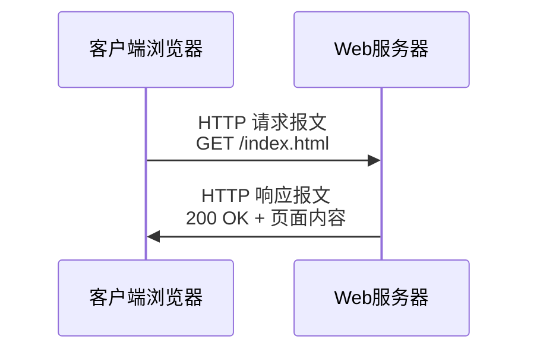
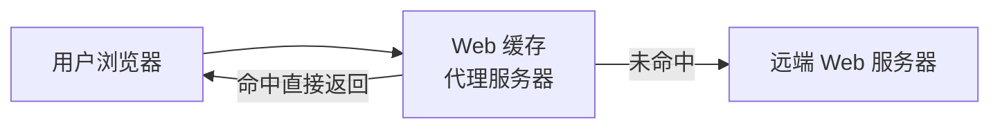

# 万维网与HTTP协议（URL、请求与响应报文、Web缓存）

## 万维网与 HTTP 协议

你每天打开浏览器输入网址、点击链接，页面就出现了。但背后发生了什么？万维网（World Wide Web）不是互联网本身，而是==构建在互联网上的分布式超媒体系统==。它以客户服务器方式工作：你的浏览器是客户端，存放网页的计算机是服务器端，双方通过 **HTTP 协议**（超文本传送协议）交互。

### 为什么需要 URL？

万维网上有无数文档，如何精确定位其中一个？答案是 **URL**（统一资源定位符）。它相当于==文件名在网络范围的扩展==，为每个文档赋予全球唯一的标识符。

URL 的一般形式为：

```
<访问方式>://<主机>:<端口>/<路径>
```

以 HTTP 协议访问为例：`http://www.njupt.edu.cn:80/index.html`

- **访问方式**：`http`，表明使用 HTTP 协议
- **主机**：`www.njupt.edu.cn`，万维网服务器的域名
- **端口**：`80`，HTTP 的熟知端口（可省略，默认即 80）
- **路径**：`/index.html`，指向服务器上的具体文件；若省略则通常返回主页

> [!TIP]
> **记忆要点**：URL = 协议 + 主机 + 端口 + 路径。HTTP 默认端口 80，HTTPS 默认端口 443。

### HTTP 的请求与响应报文

HTTP 是==面向事务的应用层协议==，每完成一次"请求-响应"交互，就完成一次事务。HTTP 报文分两种：

| 报文类型 | 方向 | 核心内容 |
|---------|------|---------|
| 请求报文 | 客户 → 服务器 | 方法（GET/POST等）、URL、协议版本 |
| 响应报文 | 服务器 → 客户 | 状态行（如 200 OK）、首部、实体主体 |

以综合题中抓取到的 HTTP 请求为例，十六进制数据中包含 `47 45 54 20 2F`——对照 ASCII 码，这正是 `GET /`，表明客户端用 **GET 方法**请求服务器根目录下的页面。



一个常见的考点是 **HTTP/1.1 的持续连接**。HTTP/1.1 默认使用持续连接，一次 TCP 连接可以传送多个请求和响应，从而节省了反复建立 TCP 连接的开销。

> [!WARNING]
> **常见误区**：HTTP 本身是无状态的，服务器不记得上次是谁请求了什么。状态管理（如登录保持）需要借助 Cookie 或 Session 等额外机制来实现。

### Web 缓存：加速访问的关键

如果每次访问同一个页面都要从远程服务器重新获取，既慢又浪费带宽。**Web 缓存**（又称代理服务器）就是解决这个问题的。



Web 缓存的工作流程：

1. 用户浏览器向缓存发送 HTTP 请求
2. 缓存检查本地是否存有该资源的副本
3. 若有（命中），直接返回缓存内容
4. 若无（未命中），缓存代表用户向远端服务器请求，获得响应后本地暂存一份，再转发给用户

> [!IMPORTANT]
> **核心价值**：Web 缓存既减少了用户访问延迟，又降低了对互联网出口链路的带宽占用。局域网内第一个用户访问某页面后，后续用户再访问同一页面即可直接从缓存获得。

### 一个算对了的例子

**题目**：HTTP/1.1 协议以持续的非流水线方式工作，一次请求-响应时间为 RTT。假定 `rfc.html` 页面引用了 2 个 JPEG 小图像，则从 Web 请求开始到浏览器收到全部内容为止，需要多少个 RTT？

**分析**：
- 非流水线方式：一个请求-响应结束后才能发送下一个
- 持续连接：同一个 TCP 连接上可以传输多个请求
- 步骤：获取 `rfc.html` 本身（1 RTT），然后逐一获取 2 个 JPEG 图像（各 1 RTT）

**答案**：共 **3 个 RTT**。

> [!NOTE]
> 若换成**流水线方式**，客户端可以连续发出所有请求而不必等待前一个响应返回，那么总时间仅需 2 RTT（第 1 个 RTT 获取 HTML，第 2 个 RTT 并行获取所有图像）。这也是 HTTP/1.1 持续连接流水线方式相对于非流水线的优势所在。

### 与其他应用层协议的关系

通过 TCP 端口号可以识别应用层协议。在综合题中，TCP 首部的目的端口字段 `00 50`（十六进制）换算为十进制即 **80**，因此可以推断该数据报封装的是 HTTP 协议。这一思路常用于协议分析题：==看到端口 80，就联想到 HTTP==。其他常见对应关系包括：

- ==FTP 控制连接端口 21==，数据连接端口 20
- ==SMTP 端口 25==，用于发送邮件
- ==DNS 端口 53==
- ==DHCP 服务器端口 67==，客户端端口 68
