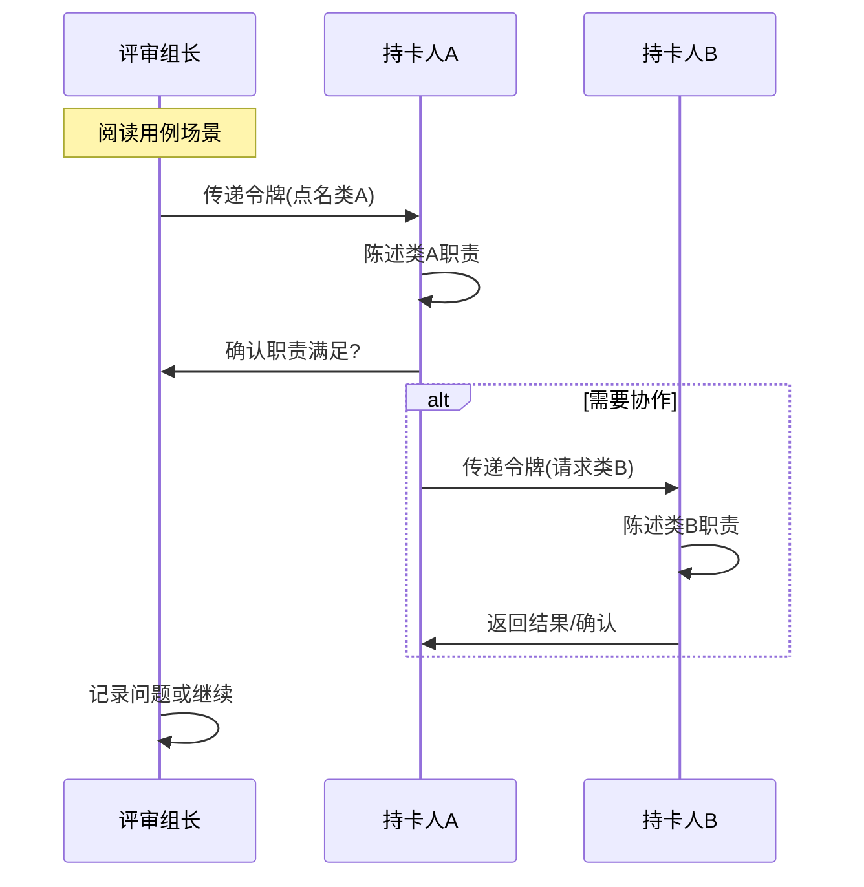

# CRC建模（类-职责-协作）与评审

## CRC建模与评审核心机制

在需求分析阶段，当我们从用例描述中提取出一堆名词后，如何验证这些类是否真正满足了业务需求？仅仅画出UML类图往往过于静态且抽象。此时，我们需要一种轻量级、以“行为”为导向的验证手段。CRC（Class-Responsibility-Collaborator）建模正是这样一种==通过模拟对象交互来验证分析模型正确性==的技术。它不关注类的内部属性细节，而是聚焦于“谁负责做什么”以及“需要找谁帮忙”。

### 什么是CRC及其三要素

CRC模型由索引卡组成，每张卡片代表一个分析类。理解CRC的关键在于区分其三个组成部分：

| 要素 | 英文术语 | 核心含义 | 填写原则 |
| :--- | :--- | :--- | :--- |
| 类名 | Class Name | 问题域中的实体或概念 | 使用名词，避免实现细节 |
| 职责 | Responsibilities | 该类必须执行的操作或拥有的知识 | 动词短语，回答“该类做什么？” |
| 协作者 | Collaborators | 履行某项职责时需交互的其他类 | 仅列出直接依赖的类名 |

> [!IMPORTANT]
> ==协作者（Collaborators）是为了履行另一张卡上的职责所需的类==。如果类A要完成“计算总价”的职责，需要向类B询问“单价”，则B是A的协作者。反之，若B无需主动请求A，则A不是B的协作者。

### 为什么需要CRC而非直接画图

UML类图擅长表达结构关系（继承、关联），但难以直观展示动态的行为流转。CRC建模迫使团队在编码前进行“思维演练”：
*   **发现缺失**：当某个职责无人认领时，说明遗漏了分析类。
*   **识别过载**：若一张卡片写满职责，提示该类可能违反单一职责原则，需拆分。
*   **低成本试错**：修改一张纸质卡片远比重构代码或重绘复杂类图快得多。

### CRC评审的“令牌传递”法

这是南邮《软件工程（双语）》课程中关于CRC评审的==核心考点==。当开发出完整CRC模型后，利益相关者需通过特定流程评审模型，而非简单的传阅文档。

[!WARNING]
评审时必须遵守==物理隔离原则==：所有评审人员拿到的CRC卡片必须按协作关系分开。即**每个评审员不得同时持有两张存在协作关系的卡片**。这强制了真实的沟通与接口验证，防止一人分饰多角导致的思维盲区。

### 常见误区与辨析

*   **混淆可靠性与职责**：CRC卡片上只记录类名、职责和协作者。==可靠性（Reliability）等非功能性指标不出现在CRC卡上==，这是选择题高频陷阱。
*   **分析类与设计类不分**：CRC建模阶段产出的是==分析类（Analysis Classes）==，侧重于问题域的概念和行为；不要过早考虑设计模式、继承层次或具体算法实现，那是后续“分析类→设计类”转化阶段的任务。
*   **职责描述过细**：职责应是抽象的意图（如“验证用户身份”），而非具体实现步骤（如“比对数据库MD5哈希值”）。

### 实战检验示例

假设评审“信用卡支付”场景，组长读到“系统读取卡片信息”时，将令牌传给持有 `CreditCard` 卡的评审员。

> [!TIP]
> 该评审员需立即说明 `CreditCard` 是否包含“提供卡片数据”或“读卡”的职责。若卡片上仅有“存储余额”而无读取相关职责，则说明==模型存在缺陷==，需现场补充或标记待修改。这种即时反馈正是CRC评审区别于普通文档审查的价值所在。
