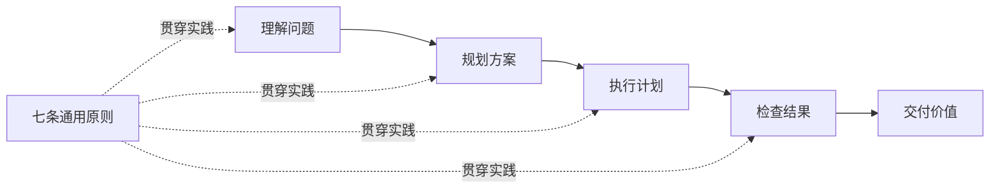

# Hooker的通用原则（General Principles）

## 它是什么

Hooker 的通用原则（General Principles）是软件工程实践（software engineering practice）的七条“底线规则”。无论采用哪种 process model、methods 或 tools，开发软件时都应反复检查：==所做工作是否真正创造价值，并且能被长期维护==。

> [!IMPORTANT]
> 七条原则：①存在理由（The Reason It All Exists）；②保持简单（KISS）；③维护愿景（Maintain the Vision）；④你生产的东西，别人会消费（What You Produce, Others Will Consume）；⑤面向未来开放（Be Open to the Future）；⑥提前计划复用（Plan Ahead for Reuse）；⑦思考（Think!）。

## 为什么需要

软件工程不只是写代码，而是把 problem solving 落实为可靠的产品。没有这些原则，团队容易堆功能、过度设计、偏离需求，或留下难以理解和复用的 legacy software。它们把“技术能完成”提升为“结果有价值、可维护”。

## 怎么做

| 原则 | 实践中的问题 | 正确做法 |
|---|---|---|
| 存在理由 | 这个功能为用户增加价值吗？ | 无价值就不做 |
| KISS | 设计能否更简单？ | 简单不等于简陋 |
| 维护愿景 | 架构与需求还一致吗？ | 防止局部修改破坏整体 |
| 别人会消费 | 别人能读懂、测试、维护吗？ | 写清接口、文档和约束 |
| 面向未来开放 | 变化时容易扩展吗？ | 预留扩展，避免过度设计 |
| 提前计划复用 | 哪些部分值得复用？ | 提前抽象并控制质量 |
| Think! | 决定前有依据吗？ | 思考后再行动 |

其中，“提前计划复用”会直接降低成本，并提高复用构件所进入系统的价值；但复用不是复制粘贴，必须考虑接口、质量和适用场景。

## 和相近概念的区别

通用原则不是 software process，也不是某一项 method 或 tool。process 规定活动如何组织，methods 提供具体做法，tools 提供支持；通用原则则判断这些实践是否合理。它也不等于 framework activities：communication、planning、modeling、construction、deployment 回答“做什么”，七条原则回答“应以什么标准做”。

软件工程实践的精髓可概括为：==理解问题、规划解决方案、执行计划、检查结果准确性==。这与七条原则相容，但不是把七条原则缩减成四步。

> [!WARNING]
> KISS 不是“永远选最短代码”；面向未来开放也不是“预先实现所有可能需求”。前者忽视质量，后者导致过度设计。

## 例题

判断：Planning ahead for software reuse reduces the cost and increases the value of the systems into which they are incorporated.

答案：**A. True**。它对应第六条原则 Plan Ahead for Reuse。提前规划复用，能减少重复开发，并让经过良好设计和验证的复用成果提升系统价值；题干说的正是“提前计划”，不是无约束复制代码。
