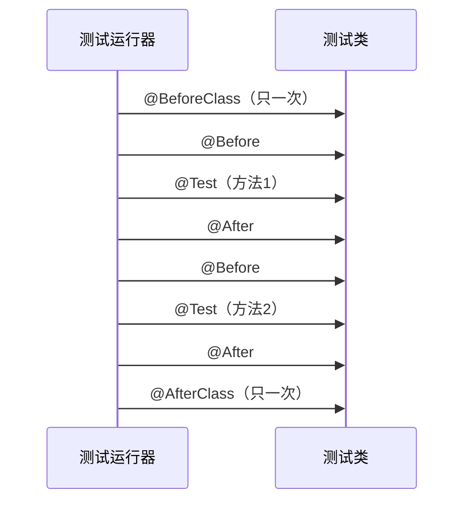

# JUnit4注解（@Test、@Ignore等）、setUp/tearDown与Fixture机制

# JUnit4 注解与 Fixture 机制

## 为什么需要单元测试框架

你在一个类里写了十几个方法，想逐个验证它们是否正确。最原始的办法是写一个 `main` 方法，在里面逐一调用并肉眼比对输出。但这样做有几个问题：

- 所有测试都挤在一起，一个失败就会中断整个流程
- 无法方便地复用测试数据和初始化逻辑
- 测试结果没有结构化的“通过/失败”反馈

JUnit4 用 **注解 + Fixture** 的组合解决了这些问题。它让你可以**声明式**地标记哪些方法是测试、哪些是准备/清理工作，框架自动帮你调度执行。

## 核心注解：@Test 与 @Ignore

### @Test——标记测试方法

在 JUnit4 中，你不需要继承任何类，只需在方法上写 `@Test`：

```java
@Test
public void testAddition() {
    Calculator c = new Calculator();
    assertEquals(5, c.add(2, 3));
}
```

JUnit4 通过反射找到所有带 `@Test` 的方法并逐一执行。==方法必须是 `public void` 且无参数==。

`@Test` 还支持两个可选参数：

| 参数 | 含义 | 示例 |
|------|------|------|
| `expected` | 预期抛出某异常，则视为通过 | `@Test(expected = ArithmeticException.class)` |
| `timeout` | 超过指定毫秒数则判定失败 | `@Test(timeout = 1000)` |

### @Ignore——暂时跳过测试

如果你有一个测试暂时不想跑（比如功能还没实现、环境不支持），加上 `@Ignore` 即可：

```java
@Ignore("等待接口 v2.0 上线后启用")
@Test
public void testNewFeature() { ... }
```

运行时该测试会被跳过，并显示在“忽略”列表中。==比直接注释掉更好，因为测试报告里会保留记录，不会悄悄丢失。==

>[!WARNING]
> `@Ignore` 不会阻止测试类被实例化或 Fixture 方法执行，它只是跳过被标注的那个测试方法本身。

## Fixture 机制：setUp 与 tearDown

### 它是什么

Fixture 是一组测试方法**共享的初始状态和测试数据**。如果 5 个测试方法都需要同一个初始化好的对象，你当然不希望在每个方法里复制粘贴初始化代码。

JUnit4 提供了四个注解来管理 Fixture 的生命周期：



### 四个生命周期注解

| 注解 | JUnit4 对应 | 执行时机 | 适用场景 |
|------|-------------|----------|----------|
| `@BeforeClass` | 全局 setUp | 所有测试前执行一次（必须 static） | 建立数据库连接池 |
| `@Before` | 局部 setUp | **每个** `@Test` 之前都执行一次 | 初始化输入数据对象 |
| `@After` | 局部 tearDown | **每个** `@Test` 之后都执行一次 | 清理临时文件 |
| `@AfterClass` | 全局 tearDown | 所有测试后执行一次（必须 static） | 关闭数据库连接池 |

>[!IMPORTANT]
> **每个 `@Test` 都从独立的 Fixture 开始。** JUnit 对每个测试方法都会新建一个测试类实例，然后执行 `@Before` → `@Test` → `@After`。这保证了测试之间完全隔离，不会互相污染。

### 一个完整例子

需求：测试一个 `Stack` 类的 `push` 和 `pop` 方法。

```java
import org.junit.*;
import static org.junit.Assert.*;

public class StackTest {
    private Stack<String> stack;

    @Before
    public void setUp() {
        stack = new Stack<>();
        stack.push("A");
        stack.push("B");
    }

    @After
    public void tearDown() {
        stack = null;  // 释放引用
    }

    @Test
    public void testPop() {
        assertEquals("B", stack.pop());
        assertEquals("A", stack.pop());
    }

    @Test
    public void testIsEmptyAfterPush() {
        assertFalse(stack.isEmpty());
    }

    @Test(expected = EmptyStackException.class)
    public void testPopEmpty() {
        Stack<String> s = new Stack<>();
        s.pop();  // 应抛出异常
    }

    @Ignore("暂不实现")
    @Test
    public void testSearch() { ... }
}
```

运行结果：`testPop` 和 `testIsEmptyAfterPush` 通过，`testPopEmpty` 通过（因为抛了预期异常），`testSearch` 忽略。

>[!TIP]
> 记忆口诀：`@BeforeClass` 和 `@AfterClass` 是“全班上课前和下课后各一次”，`@Before` 和 `@After` 是“每节课前擦黑板、每节课后收作业”。

## 常见易错点

>[!CAUTION]
> **`@BeforeClass` / `@AfterClass` 忘记加 `static`。** 这是最常见的错误，编译期不会报错，但运行时会抛出异常：`java.lang.Exception: Method xxx should be static`。由于 SonarQube 等工具可能在 CI 阶段才检测，学生本地容易漏掉。

>[!WARNING]
> **在 `@Before` 里做了不该做的共享状态修改。** 因为每个测试前 `@Before` 都会执行，如果你在 `@Before` 里累加一个 static 计数器，它会不断增长，破坏了测试隔离性。==Fixture 的正确姿势是每次“重建”，而非“复用上次残留”。==

## 与 JUnit5 的关键区别

南邮课件以 JUnit4 为主，但你可能接触到 JUnit5，这里快速对照：

| 概念 | JUnit4 | JUnit5 |
|------|--------|--------|
| 测试标注 | `@Test` | `@Test` |
| 前置/后置 | `@Before` / `@After` | `@BeforeEach` / `@AfterEach` |
| 全局前置/后置 | `@BeforeClass` / `@AfterClass` | `@BeforeAll` / `@AfterAll` |
| 忽略测试 | `@Ignore` | `@Disabled` |
| 预期异常 | `@Test(expected=…)` | `assertThrows(…)` |

>[!NOTE]
> JUnit5 不再要求 `@BeforeAll` 方法必须是 `static`（如果测试类生命周期配置为 `PER_CLASS`），这是对 JUnit4 反直觉设计的一个重要改进。
