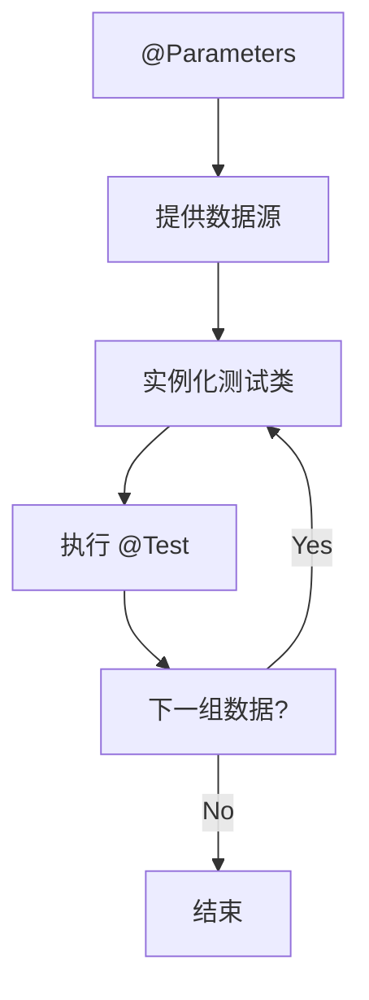

# JUnit高级特性：限时测试、异常测试、参数化测试、打包测试

# JUnit高级特性：限时、异常、参数化与打包测试

在基础功能验证之外，如何确保代码的**鲁棒性**与**执行效率**？当面对边界条件或批量数据时，传统的 `@Test` 显得力不从心。本节深入解析 JUnit 4 的四大高级特性，助你构建更严密的测试网。

## 核心特性解析

### 1. 限时测试 (Timeout)
防止死循环或性能退化导致测试挂起。
```java
@Test(timeout = 1000) // 毫秒为单位
public void testFast() { ... }
```
> [!IMPORTANT]
> 若方法执行超过指定时间，JUnit 直接抛出 `AssertionError`，标记测试失败。

### 2. 异常测试 (Expected Exception)
验证代码是否按预期抛出特定异常，而非正常返回。
```java
@Test(expected = ArithmeticException.class)
public void testDivByZero() {
    int i = 1 / 0;
}
```
> [!WARNING]
> 仅检查**类型**匹配。若需校验异常消息内容，建议使用 `ExpectedException` Rule 或 JUnit 5 的 `assertThrows`。

### 3. 参数化测试 (Parameterized Tests)
同一逻辑，多组数据。避免复制粘贴测试代码。
- **关键步骤**：
    1. 类添加 `@RunWith(Parameterized.class)`
    2. 定义静态方法返回 `Collection<Object[]>` 并标注 `@Parameters`
    3. 通过构造函数注入参数



### 4. 打包测试 (Suite)
将多个测试类组合成一个测试套件，统一运行。
```java
@RunWith(Suite.class)
@Suite.SuiteClasses({TestA.class, TestB.class})
public class AllTests {}
```

## 对比与常见坑

| 特性 | 适用场景 | 常见误区 |
| :--- | :--- | :--- |
| **Timeout** | 网络请求、复杂算法 | 忽略机器负载差异，设值过小导致误报 |
| **Expected** | 非法输入校验 | 忘记写 `expected`，导致异常未被捕获而报错 |
| **Parameterized** | 边界值、等价类划分 | 数据源顺序与构造函数参数顺序不一致 |
| **Suite** | 模块集成测试 | 遗漏新增加的测试类，导致覆盖不全 |

> [!TIP]
> ==参数化测试的核心==在于数据驱动。确保 `@Parameters` 返回的数据结构与构造函数参数一一对应，否则会出现 `ClassCastException` 或逻辑错位。

## 实战示例：参数化计算平方

假设需测试 `MathUtils.square(int n)` 方法。

```java
@RunWith(Parameterized.class)
public class SquareTest {
    private int input;
    private int expected;

    // 1. 构造函数注入
    public SquareTest(int input, int expected) {
        this.input = input;
        this.expected = expected;
    }

    // 2. 提供数据
    @Parameters
    public static Collection<Object[]> data() {
        return Arrays.asList(new Object[][] {
            { 0, 0 },
            { 1, 1 },
            { -2, 4 },
            { 5, 25 }
        });
    }

    // 3. 执行测试
    @Test
    public void testSquare() {
        assertEquals(expected, MathUtils.square(input));
    }
}
```
此例中，JUnit 会自动实例化 4 次 `SquareTest`，分别代入四组数据执行。若 `{ -2, 4 }` 失败，报告会明确指出是该组数据出错，极大提升了调试效率。
