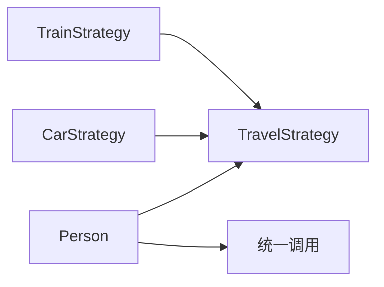

# Liskov替换原则（Liskov Substitution Principle, LSP）

## 它是什么

里氏替换原则（Liskov Substitution Principle, LSP）由 Barbara Liskov 提出，课件中的定义是：

> **Subclasses should be substitutable for their base classes.**

即：==超类对象出现的地方，都能用子类对象替换，且程序功能与正确性不受影响==。例如 `Person` 只依赖 `TravelStrategy`，则 `CarStrategy`、`TrainStrategy` 等实现应能互换，而无须修改 `Person`。

## 为什么需要

继承只说明代码可以复用，并不保证子类在行为上真的“是一种”父类。若客户端必须判断具体子类、增加异常分支，替换就会破坏多态，也会使新增子类迫使旧代码修改。LSP 用“可替换性”约束继承，使客户端能够放心地面向父类或接口编程。

> [!IMPORTANT]
> LSP 判断的是**行为契约是否保持**，不是“子类能否编译通过”，也不是“子类是否继承了父类”。

## 怎么做到

子类可以扩展功能，但不能让父类方法的承诺失效。答题时可从以下方面分析：

| 检查点 | 替换时应满足的要求 |
|---|---|
| 前置条件 | 子类不能提出更强、更苛刻的调用条件 |
| 后置条件 | 子类不能削弱父类保证的结果 |
| 参数与返回值 | 参数不得随意收窄；返回值可更具体，并与语言规则一致 |
| 异常 | 不抛出父类契约未允许的新异常 |
| 不变式 | 父类始终成立的约束，子类仍须保持 |
| 客户端 | 不应靠 `instanceof` 或强制转型规避子类差异 |

> [!WARNING]
> 课件参考解答中的“协变参数、逆变返回值”表述容易记反。通常应记为：**参数逆变、返回值协变**；但考试更稳妥的写法是“参数约束不加强、返回结果不削弱”，并结合具体语言说明。

## 与相近原则的区别

| 原则 | 核心问题 | 在设计中的作用 |
|---|---|---|
| OCP 开闭原则 | 新功能能否通过扩展加入 | 目标：对扩展开放、对修改关闭 |
| DIP 依赖倒置原则 | 高层模块依赖什么 | 手段：依赖抽象，不依赖具体实现 |
| LSP 里氏替换原则 | 子类能否安全替换父类 | 保证：多态替换后行为仍正确 |
| ISP 接口隔离原则 | 接口是否过于臃肿 | 避免客户端依赖不用的方法 |

三者常配合使用：==DIP 建立抽象依赖，LSP 保证实现可替换，从而支持 OCP==；但 LSP 本身不等于 OCP。

## 一个答对了的例子

绘图系统定义抽象接口 `Figure`，提供 `draw()`；`Rectangle`、`Circle`、`Polygon` 分别实现它，绘图客户端只保存并调用 `Figure`。

- **LSP**：客户端原来使用 `Figure`，换成任一具体图形后仍通过同一接口完成绘制，不需要修改客户端，也不需判断图形类型。
- **DIP**：客户端依赖 `Figure` 抽象，而非某个具体图形类。
- **OCP**：新增 `Ellipse` 时，只增加一个实现 `Figure` 的类，无须修改原有客户端和其他图形类。

> [!CAUTION]
> 经典反例是让 `Square` 继承可独立设置宽、高的 `Rectangle`。若父类承诺“设置宽不改变高”，正方形为保持两边相等而同时修改高，就破坏了该契约。问题不在正方形不能绘图，而在于它不能安全替换这个父类。

> [!TIP]
> 简答题可按“定义—图中替换关系—为何不破坏正确性—如何支持 OCP”作答；只写“子类继承父类，所以符合 LSP”通常不充分。
