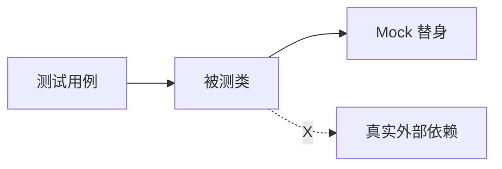
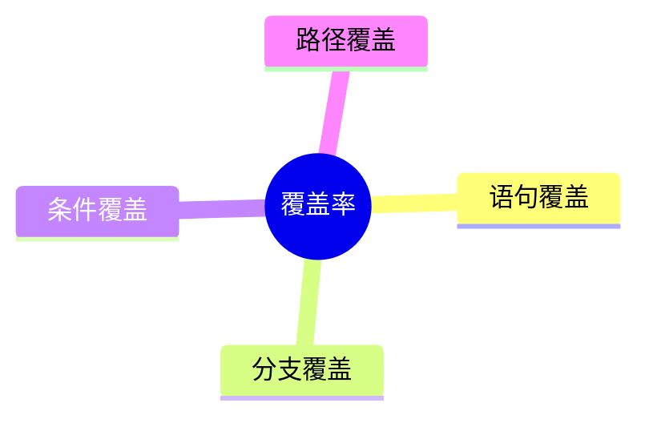

# 使用Mock技术隔离外部依赖与代码覆盖率分析

# 使用 Mock 技术隔离外部依赖与代码覆盖率分析

单元测试（Unit Testing）的理想状态是：一次测试只验证一个类/方法的逻辑，==不碰数据库、不调第三方接口、不依赖网络==。但现实中的软件往往与这些"外部依赖"纠缠在一起。这就引出两个问题：怎么把依赖"切"开？切完之后怎么知道测得够不够？前者靠 **Mock**，后者靠**代码覆盖率（Code Coverage）分析**。

## 为什么需要 Mock

设想一个 `OrderService.createOrder()`，它内部要调 `PaymentClient.charge()` 去扣款。如果每次跑测试都真的发 HTTP 请求：

- 速度慢、不稳定（网络抖动、第三方宕机会让测试挂掉）；
- 会产生副作用（真扣钱、真写库）；
- 难以构造边界场景（如"支付超时"该分支永远走不到）。

Mock 的思路是：==用一个"替身"对象替换真实依赖==，替身的行为由测试代码控制，从而把被测单元（SUT, System Under Test）从外部世界中**隔离**出来。



## Mock / Stub / Spy 的区别

三者都属于"测试替身（Test Double）"，但职责不同：

| 替身类型 | 作用 | 是否校验交互 |
|---|---|---|
| Stub | 只提供预设返回值 | 否 |
| Mock | 预设返回值 + **校验是否被调用/调用参数** | 是 |
| Spy | 包装真实对象，记录调用细节 | 部分 |

[!TIP]
> 记忆口诀：**Stub 给答案，Mock 查动作，Spy 旁听记**。JUnit 5 用 `@MockBean` / Mockito 框架的 `when(...).thenReturn(...)` 造数据，`verify(mock).method(args)` 校验调用。

## 代码覆盖率的四个层级

覆盖率用来回答"我写的测试到底测到了多少代码"，常用指标：

- **语句覆盖（Statement）**：每条语句至少执行一次；
- **分支覆盖（Branch / Decision）**：每个 `if` 的真假两支都走到；
- **条件覆盖（Condition）**：复合条件中每个原子布尔都取过真假；
- **路径覆盖（Path）**：所有可能的执行路径都跑过（组合爆炸，实践中难以 100%）。

$$覆盖率 = \frac{\text{被测元素数}}{\text{总元素数}} \times 100\%$$



[!IMPORTANT]
> ==语句覆盖最弱，分支覆盖能发现"漏掉一个 else"类缺陷，是工程上最常用的下限指标。== 一般要求核心模块分支覆盖率 ≥ 80%。

## 怎么做：结合 Mock 与覆盖率

以 `isEligible(age, vip)` 为例，逻辑为 `age >= 18 && vip == true` 时返回 true。用 Mockito 写测试：

```java
@Test void testEligible() {
    User mockUser = mock(User.class);
    when(mockUser.getAge()).thenReturn(20);
    when(mockUser.isVip()).thenReturn(true);
    assertTrue(service.isEligible(mockUser));
    verify(mockUser).getAge();     // 校验交互发生
}
```

执行后用 JaCoCo 统计覆盖率。想让分支覆盖达标，还需补一条 `vip == false` 的用例走到 else 分支。

## 常见的坑

[!WARNING]
> - **过度 Mock**：把被测类自己的私有方法也 mock 掉，等于什么都没测；
> - **Mock 后不 verify**：替身永远返回 true，测试"绿"了但逻辑是错的；
> - **追求 100% 路径覆盖**：组合爆炸，投入产出比极低；
> - **把覆盖率当质量指标**：==覆盖率高 ≠ 测试有效==，还要看断言是否覆盖关键等价类。

[!NOTE]
> Mock 解决"测得稳不稳"，覆盖率回答"测得全不全"，二者正交：Mock 是手段，覆盖率是度量，配合使用才能让单元测试既可运行又可信任。
