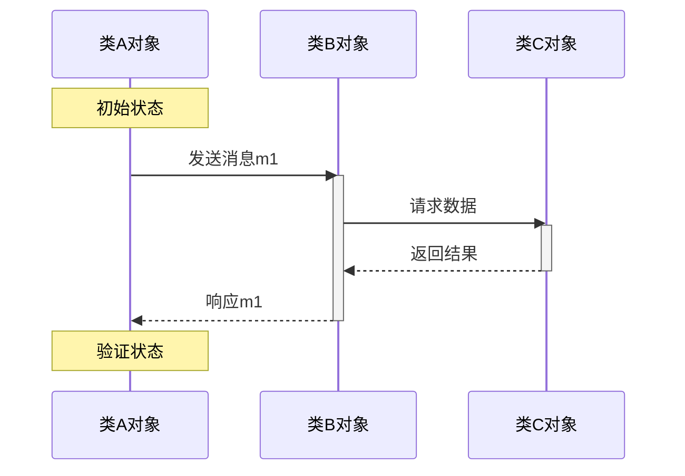

# 面向对象测试方法：类间测试（Inter-Class Testing）

# 面向对象测试方法：类间测试（Inter-Class Testing）

在面向对象系统中，单独的类测试（Class Testing）不足以发现系统级错误。当多个类协同工作以完成特定功能时，我们需要进行**类间测试**。它本质上是 OO 语境下的集成测试，重点关注类之间的交互、消息传递及协作行为。

## 为什么需要类间测试？

类不是孤立存在的。一个对象的正确行为往往依赖于其他对象的状态和响应。
*   **单一视角局限**：类内测试仅验证封装内部逻辑，无法检测接口调用错误或状态同步问题。
*   **协作复杂性**：对象间的动态链接（Dynamic Binding）和多态性使得静态分析难以覆盖所有执行路径。

> [!IMPORTANT]
> 核心目标：验证**类簇（Cluster）**或**子系统**中，对象通过消息传递协作时，是否满足设计规格说明。

## 怎么做：基于行为模型的测试用例设计

根据课件第 19.6 节，类间测试用例通常从**行为模型**（如状态图、顺序图）中推导。

### 1. 识别交互场景
首先确定需要测试的类组合。通常选取参与同一用例（Use Case）的一组类。

### 2. 构建测试模型
利用 UML 图描述对象间的动态行为：
*   **顺序图（Sequence Diagram）**：展示消息的时间顺序。
*   **状态图（State Chart）**：展示对象状态随事件的变化。

### 3. 生成测试路径
从模型中提取关键路径：
*   **状态转换路径**：覆盖对象从初始状态到终止状态的所有合法迁移。
*   **消息序列**：确保消息参数的类型、顺序符合接口定义。

> [!TIP]
> 技巧：将复杂的多类交互简化为**线程（Thread）**测试，即追踪一个特定用户请求所触发的对象调用链。

## 与相近概念的区别

| 特性 | 类内测试 (Intra-Class) | 类间测试 (Inter-Class) | 系统测试 (System) |
| :--- | :--- | :--- | :--- |
| **测试单元** | 单个类 | 类簇/协作组 | 完整应用 |
| **关注点** | 方法逻辑、属性封装 | 消息传递、接口兼容 | 用户需求、端到端流程 |
| **依据模型** | 类图、代码 | 顺序图、状态图 | 用例图、需求文档 |
| **可见性** | 白盒为主 | 灰盒（结合结构与设计） | 黑盒为主 |

## 常见的坑

1.  **忽略多态影响**：父类引用指向子类对象时，调用的方法可能不同。测试时需覆盖所有可能的子类实现。
2.  **状态依赖遗漏**：对象 B 的行为可能取决于对象 A 的前置状态。若未正确初始化 A，B 的测试将失败。
3.  **桩模块（Stub）偏差**：在测试类 A 与 B 交互时，若用桩模拟 B，桩的行为可能与真实 B 不一致，导致“假阳性”通过。

> [!WARNING]
> 易错点：不要试图对类间关系进行“穷举测试”。由于对象状态空间巨大，必须采用==选择性测试（Selective Testing）==策略，优先覆盖高频交互路径和异常处理路径。

## 算对了的例子

**场景**：测试 `Order`（订单）类与 `Inventory`（库存）类的交互。
**行为模型**：`Order.place()` 调用 `Inventory.checkStock()`，若充足则调用 `Inventory.reserve()`。

**测试用例设计**：
1.  **输入**：创建 `Order` 对象，注入 `Inventory`  mock/stub。
2.  **前置条件**：设置 Mock `Inventory` 返回库存充足。
3.  **执行**：调用 `order.place()`。
4.  **验证**：
    *   检查 `Inventory.reserve()` 是否被调用且参数正确（消息验证）。
    *   检查 `Order` 状态是否变为 "Confirmed"（状态验证）。

此过程不仅验证了 `Order` 的逻辑，也验证了两个类之间的**协议一致性**，这正是类间测试的核心价值。
