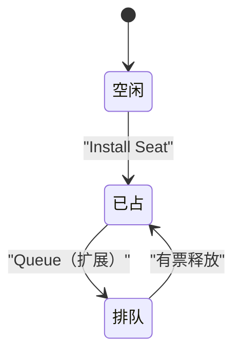

# 面向对象测试方法：行为测试（Behavior Testing）

## 它是什么

在面向对象测试（Object-Oriented Testing, OOT）里，**Behavior Testing（行为测试）** 属于类级测试方法（19.5 Testing Methods Applicable at the Class Level）中的一种。它不看代码内部怎么实现，而是把每个类当成一个“黑盒”，依据它的**状态变化与外部可见动作**来设计测试。

课件里把它写成 `Black-Box Testing behavioral testing`，也就是说：

> 行为测试 = 黑盒视角 + 对象状态/行为模型驱动。

先想一个问题：如果一个类的方法 `reserve()` 在座位不足时到底会“直接失败”还是“进入排队”，你只读代码能猜，但测试更该关心——==用户可见的行为路径==。这就是行为测试要覆盖的东西。

## 为什么需要

传统黑盒测试容易只测输入/输出；但 OO 系统里对象有**生命周期**。类从生到死会经过多个状态，若只在某个状态点调用方法，可能漏掉：
- 状态顺序错误导致的异常；
- 可选行为（Optional Behavior，如 `Queue` extends `Reserve Seat`）没被测到；
- 强制行为（Mandatory Behavior，如 `Reserve Seat` 必然包含 `Check Seat Availability` 与 `Install Seat`）被跳过。

所以复习提纲里把 `Mandatory Behavior` / `Optional Behavior` 放在行为模型附近，就是在提醒你：测类要测“状态迁移里的必选与分支”。

## 怎么做

行为测试的标准做法是从**行为类模型**导出测试。课件给的答案是：测试应基于 `state transition diagram`（状态迁移图），而不是数据流图、对象关系图或用例图。

| 相近概念 | 看什么 | 和行为测试区别 |
|---|---|---|
| 随机测试 Random Testing | 随便调方法序列 | 不保证覆盖关键状态 |
| 分区测试 Partition Testing | 按属性/操作划区 | 侧重输入空间，不侧重时序 |
| 行为测试 Behavior Testing | 状态图路径 | 覆盖对象生命周期与迁移 |

步骤可以记成：
1. 画/拿类的 `state transition diagram`；
2. 标出所有 `Mandatory Behavior` 与 `Optional Behavior` 分支；
3. 让测试用例走完状态图中的主要迁移路径。

## 常见坑与算对的例子

> [!WARNING]
> 别把“行为测试”选成 `use-case diagram`（用例图）。用例图描述系统功能范围，不描述单个类内部状态跳转。

看这道南邮考过的选择题：

> Test derived from behavioral class models should be based on the （ ）
> - A. data flow diagram
> - B. object-relation diagram
> - C. state transition diagram
> - D. use-case diagram

正确答案是 **C**。因为 behavioral class models 就是类的行为模型，其可视化形式在课件 `Behavior Model for SE` 与 `18.6 Black-Box Testing` 中对应状态迁移；从它导出测试，自然依据 `state transition diagram`。

再结合例子：`Reserve Seat` 强制包含 `Check Seat Availability` 和 `Install Seat`；而 `Queue` 是可选扩展。一个“算对了”的测试用例应当至少覆盖：
- 必选链：空闲 → 检查座位 → 安装座位 → 已占；
- 可选链：已占满时的 `Queue` 扩展分支。

> [!TIP]
> 记忆口诀：**类行为 → 状态图 → C**。看到 behavior / behavioral model，就选 state transition diagram。
