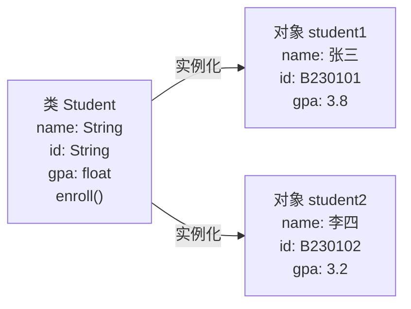

# 面向对象基本概念（类、对象、实例）

## 面向对象的基本概念：类、对象与实例

先想一个问题：你要在程序中描述“校园里的学生”，该怎么做？一个学生有姓名、学号、成绩，还能选课、考试。如果每次遇到一个新学生都重新写一遍这些代码，显然不合理。==面向对象的思路是：先定义一个模板，再用模板“造”出一个个具体的个体。== 这个模板就是**类**，造出来的个体就是**对象**。

### 类与对象是什么

> [!IMPORTANT]
> **类（Class）** 是对具有相同属性和服务的一组对象的抽象定义。**对象（Object）** 是类的具体存在，拥有自己的属性值和行为。

类描述“有什么”和“能做什么”，对象则是这些描述在运行时的真实载体。以“学生”为例：

| 概念 | 说明 | 示例 |
|---|---|---|
| 类（Class） | 抽象模板 | `Student`：属性有 `name`、`id`、`gpa`；方法有 `enroll()`、`takeExam()` |
| 对象（Object） | 类的具体实例 | `student1`（张三，B230101，3.8） |
| 实例（Instance） | 与“对象”基本同义 | `student1` 是 `Student` 类的一个实例 |



### 对象的三要素

课件中明确给出了对象的三要素，这也是理解“对象”这个概念最直接的抓手：

- **对象标识（Object Identifier）**：每个对象在系统中独一无二的身份，即使两个对象的属性值完全相同，它们仍然是两个不同的对象。
- **属性（Attribute）**：描述对象的状态。如学生的姓名、学号、成绩。
- **服务（Service）**：对象能提供的操作。如学生可以“选课”“参加考试”。

> [!TIP]
> 记忆口诀：“一个身份、两个能力——记（标识）得清属性、会服务。”

### 为什么需要类

回到开头的场景：如果学校有一万名在校生，面向对象的方式是**定义一个 `Student` 类，然后用它创建一万个对象**。这样：

1. **代码复用**——属性结构和方法逻辑只写一次；
2. **一致性**——所有学生对象拥有相同的字段和操作；
3. **可维护性**——修改类，就统一影响到所有实例的行为。

### 容易混淆的几组概念

> [!WARNING]
> **“类”和“对象”经常被混用**，尤其在口头表达中。但严格区分：题中说“`Student` 类的对象”，是对的；说“对象 `Student`”，通常指“类 `Student` 的某个具体对象”，需要看上下文。

| 对比 | 类 | 对象/实例 |
|---|---|---|
| 是否占据内存 | 不直接占据（加载后有类元信息） | 每个对象占据独立内存 |
| 存在时间 | 编译期定义 | 运行期创建 |
| 数量 | 一个 | 可有许多个 |
| 关系 | 是抽象的集合描述 | 是类的具体“成品” |

另一个易混点是**对象 vs. 实例**。在大多数语境下二者可以互换。细微差别在于：**“对象”强调它是“类的一个个体”，而“实例”强调“由类实例化而来”这个动作的结果**。比如你写 `new Student()`，可以说“创建了一个 `Student` 对象”，也可以说“创建了一个 `Student` 实例”。

### 实例化：从类到对象

```java
Student student1 = new Student("张三", "B230101", 3.8);
```

这行代码里发生了三件事：

1. 在内存中分配空间，赋予对象唯一标识；
2. 初始化属性（`name = "张三"`，`id = "B230101"`，`gpa = 3.8`）；
3. 返回该对象的引用，赋给变量 `student1`。

> [!CAUTION]
> **变量 ≠ 对象**。这里的 `student1` 只是一个引用（reference），它指向真正的对象。两个引用可以指向同一个对象，但对象本身只有一个。这和“两个人各拿一张写着同一地址的纸条，指向同一栋房子”是一个道理。

### 从考试题看“类、对象、实例”的灵活运用

之前考过这样一道设计题：游戏人物由头、身体、四肢组合而成，要求分析方案体现了哪些面向对象概念。这里“人物”可以设计为类 `Character`，而“具体的某个游戏角色”就是 `Character` 的实例。头部、手臂分别设计为 `Head`、`Arm` 类，具体某个人物的左臂是 `Arm` 类的对象。==组合关系本身建立在“对象拥有其他对象”之上——这不是继承，而是包含。==

再看 Windows 资源管理器那道题：文件和目录的共同抽象是 `FileSystemItem`（类），而每一个具体文件或文件夹都是它的实例。为何要抽出一个公共类？正是因为**类把“同类型个体”的共同结构提炼出来**，才使得后续用组合模式统一处理“单个对象”和“对象集合”成为可能。

### 一句话总结

==类描述“这一类事物是什么样的”，对象则是“某一个具体的东西”。== 先写类、再创建对象，是面向对象编程最基本的操作节奏。理清这层关系，是后续理解继承、多态、设计模式乃至面向对象测试的起点。
