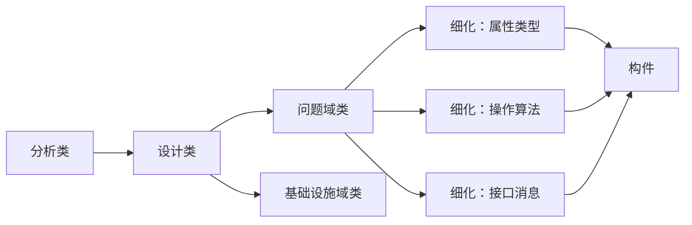
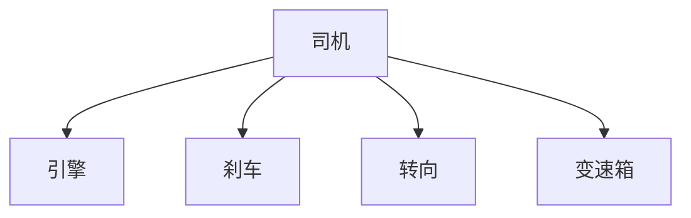
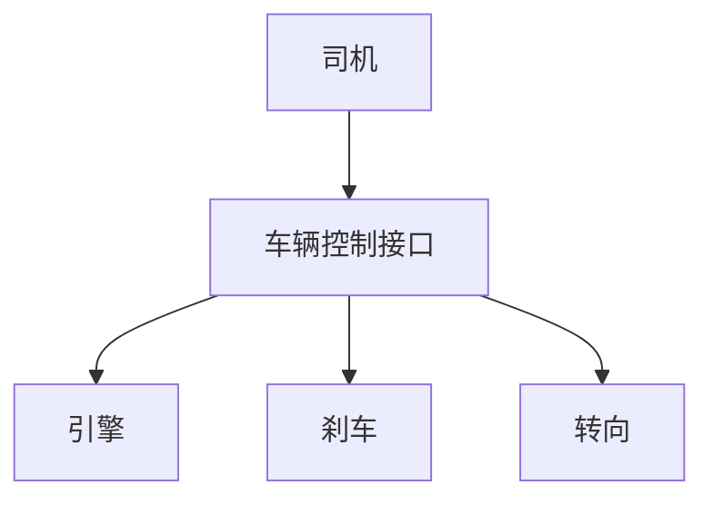

# 面向对象与设计类（OO and Design Classes）

# 面向对象与设计类（OO and Design Classes）

## 从“分析类”到“设计类”

分析阶段回答“系统要做什么”，设计阶段回答“系统怎么做”。面向对象方法中，==设计类是对分析类的精化==：分析类只描述属性和职责，设计类则进一步明确属性的数据类型、操作的处理流程、以及类之间的接口消息。

> [!NOTE]
> 分析类关注问题域，设计类关注解域。同一个分析类可能对应多个设计类（例如“用户”分析类可能拆分为 `UserEntity`、`UserDAO`、`UserService`）。

为什么要做这一步？因为直接拿着分析类去编码，会遇到三个问题：属性没有类型定义（无法分配内存）、操作没有算法描述（无法写代码）、类之间没有接口约定（无法并行开发）。设计类的任务就是把这三件事补全。

## 构件级设计的两种视角

构件（Component）的定义是：

> “…a modular, deployable, and replaceable part of a system that encapsulates implementation and exposes a set of interfaces.”

翻译过来：==构件是封装了实现、暴露一组接口的模块化、可部署、可替换部件==。要从“传统视角”和“面向对象视角”两条路理解它：

| 对比维度 | 传统视角 | 面向对象视角 |
|---------|---------|------------|
| 构件内容 | 一个模块（函数/过程） | 一组协作的类 |
| 关注点 | 数据结构、算法、接口 | 属性、操作、消息传递 |
| 内聚含义 | 模块只做一件事 | 封装关系紧密的属性和操作 |
| 耦合含义 | 模块间连接程度 | 类之间依赖的定性度量 |

理解这个区别之后，再看构件级设计的步骤就不会迷路。

## 构件级设计的步骤

课件给出以下标准流程：

1. ==标识所有与问题域对应的设计类==
2. ==确定所有与基础设施域对应的设计类==
3. ==细化所有非复用构件的设计类==
4. 识别持久化数据源（数据库、文件），确定管理这些数据源的类
5. 为每个类/构件开发并细化行为表示
6. 分解构件图表示，考虑备选方案

其中第 3 步有一个重要细节：

> [!IMPORTANT]
> 若一个属性在多个设计类中重复出现，且结构复杂，应分离为一个单独的类。

这是“提取类”重构思想的体现——重复出现的复杂属性意味着它本身就是一个实体，值得独立建模。

## 设计类的“好坏”怎么判断

考过的题目直接问：如何评价“组织良好的”设计类？答案从两个指标展开——==内聚（cohesion）==和==耦合（coupling）==。

**内聚**回答“类内部的成员是否紧密相关”。高内聚的类只封装与自身职责密切相关的属性和操作。**耦合**回答“类与类之间依赖程度如何”。低耦合的设计中，一个类的修改不会波及太多其他类。

> [!WARNING]
> 耦合不等于“有关联”。两个类通过接口正常协作是合理的；耦合过高的标志是：一个类的内部结构变化会强制修改另一个类的代码。

OO 类之间有三种耦合（依赖）关系：

1. **继承耦合**：子类依赖父类的实现
2. **聚合/组合耦合**：整体类依赖部分类的生命周期
3. **关联耦合**：一个类直接调用另一类的公开方法

评断设计类的五个标准可以归纳为：==低耦合、高内聚、可维护性、可复用性、可读性==。

## 面向对象设计原则

课件重点列出三条构件设计原则：

- **单一职责原则（SRP）**：“Every class should have a single responsibility, and that responsibility should be entirely encapsulated by the class.”——每个类只有一个职责，且该职责完全被类封装。
- **共同封闭原则（CCP）**：“Classes that change together belong together.”——一起变化的类放在一起。
- **共同复用原则（CRP）**：“Classes that aren't reused together should not be grouped together.”——不一起复用的类不应分在一组。

这些原则不是孤立口号，而是内聚与耦合的工程化表达。SRP 提升内聚，CCP 和 CRP 控制耦合。

## 例子：司机与汽车

考过的选择题给出了一个经典反例：

**问题在哪里？** 司机直接操控所有内部组件，耦合度过高。任何一个部件接口变化，司机类都要跟着改。这违反了最少知识原则（迪米特法则）和单一职责原则。

**改进方案**：引入一个高层接口或控制器，让司机只与“车辆控制接口”交互：

司机类知道的东西变少了，耦合降低；车辆内部结构可以独立演化，==可替换性==也增强了——这正是构件级设计的核心追求。

## 常见的坑

1. **把所有类都塞进一个构件里**。这样构件失去了“可替换”的意义，内部任何一个类变化都要重新部署整个构件。
2. **属性重复不提取**。时间一长，同一逻辑实体在多处定义不同的数据结构和校验规则，维护时极易漏改。
3. **只做类图，不写操作级细节**。类图显示“谁有哪种方法”，但如果没有细化方法内部的算法流程和数据结构的定义，编码人员还是无法直接实现。
4. **在耦合和内聚之间走极端**。过度追求低耦合可能制造大量琐碎接口；过度追求高内聚可能把一堆互不相关的类强行合并。==平衡点在于：变化原因相同的代码放一起，变化原因不同的代码分开==。
