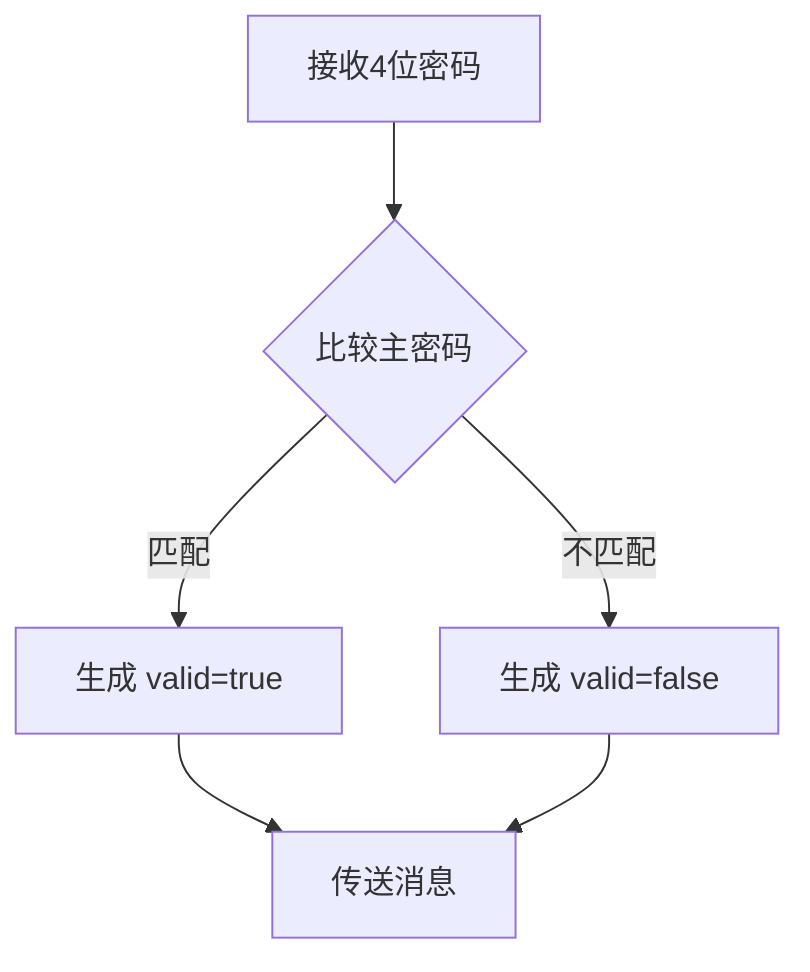
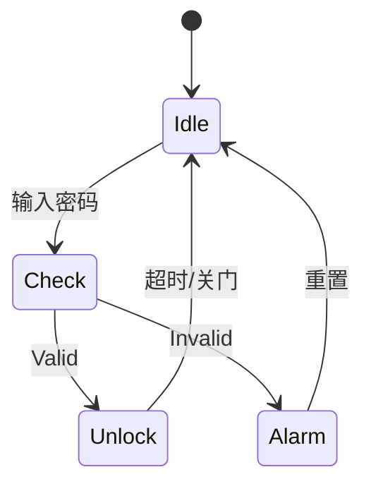

# 加工规格说明（PSPEC）与控制规格说明（CSPEC）

## PSPEC 与 CSPEC 的本质区别

在需求建模的 DFD（数据流图）中，我们常困惑于：**如何描述一个“黑盒”内部的具体逻辑？** 以及 **系统在不同状态下如何响应事件？** 这正是加工规格说明（PSPEC）与控制规格说明（CSPEC）要解决的问题。

> [!IMPORTANT]
> ==核心定义==：
> - **PSPEC (Process Specification)**：针对 DFD 最底层（最低求精层）的每一个基本加工（Primitive Process），描述其**输入到输出的转换逻辑**。它是“小型规格说明”。
> - **CSPEC (Control Specification)**：描述系统的**控制行为**，即系统如何响应外部事件、状态如何迁移。它关注的是“何时”做，而非“怎么做”数据变换。

## 为什么需要两者分离？

DFD 主要展示数据流动，但缺乏对**时间顺序**和**控制逻辑**的表达。
- 若只用 DFD，无法表达“只有密码正确才开门”这种条件约束。
- 若只用状态图，无法清晰展示数据是如何被计算和转换的。

因此，PSPEC 负责**数据变换细节**，CSPEC 负责**行为控制流程**，两者互补构成完整的需求模型。

## 怎么做：从示例看实战

### PSPEC：聚焦数据变换
以 SafeHome 系统中的“处理密码”为例。这是一个基本加工，其 PSPEC 需明确输入、处理逻辑和输出。

> [!NOTE]
> PSPEC 通常使用结构化英语、判定表或判定树来描述。关键在于：**无歧义地定义输入数据如何变为输出数据**。

### CSPEC：聚焦状态与事件
CSPEC 通常结合状态转换图（STD）使用。它不关心密码怎么比对，只关心：
1. 系统处于“等待输入”状态。
2. 发生“用户提交密码”事件。
3. 根据 PSPEC 的结果（Valid/Invalid），系统迁移到“解锁”或“报警”状态。

## 常见坑与辨析

| 维度 | PSPEC | CSPEC |
| :--- | :--- | :--- |
| **关注点** | 数据变换 (Data Transform) | 系统行为 (System Behavior) |
| **作用对象** | DFD 中的基本加工 | 整个系统或子系统 |
| **描述内容** | 算法、公式、逻辑判断 | 状态、事件、迁移条件 |
| **典型工具** | 结构化英语、判定表 | 状态转换图 (STD) |

> [!WARNING]
> **易错点**：不要在 PSPEC 中描述“等待用户点击”这类控制逻辑，那是 CSPEC 的事；也不要在 CSPEC 中详细描述“密码哈希算法”，那是 PSPEC 的事。**PSPEC 是静态的逻辑描述，CSPEC 是动态的行为描述。**

## 算对了的例子

回顾 SafeHome 案例：
- **PSPEC 任务**：定义“处理密码”加工。
  - 输入：4位数字串 $P_{in}$，系统存储的主密码 $P_{master}$。
  - 逻辑：If $P_{in} == P_{master}$ Then Output $<valid\_id = true>$ Else Output $<valid\_id = false>$。
- **CSPEC 任务**：定义控制面板行为。
  - 当收到 $<valid\_id = true>$ 事件时，状态从 `Locked` 迁移至 `Unlocked`，并触发“打开门锁”动作。

==总结==：PSPEC 解释“怎么算”，CSPEC 解释“什么时候动”。在复习时，看到 DFD 底层加工想 PSPEC，看到状态迁移想 CSPEC。
