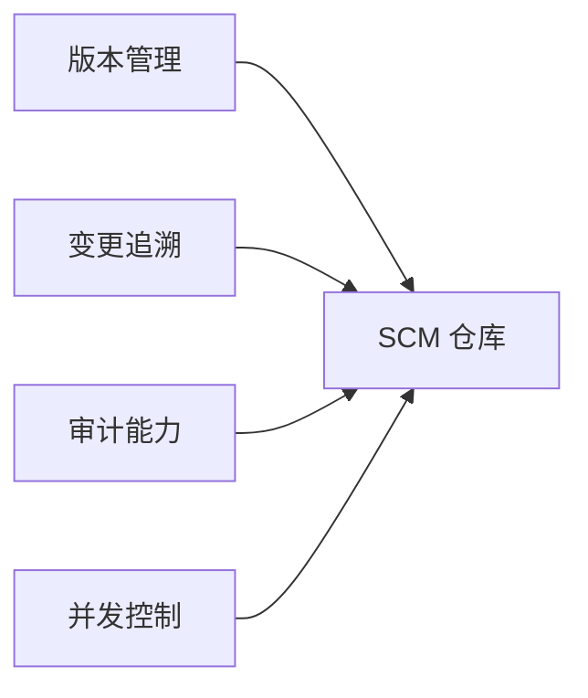
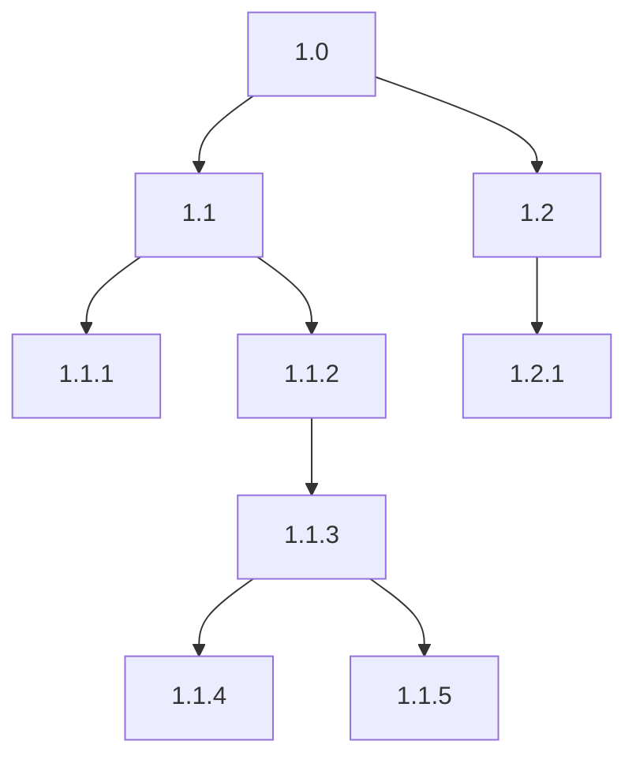

# SCM仓库（Repository）的内容与特性

## SCM 仓库的内容与特性

先想一个问题：一个大型软件项目可能有几百万行代码、上千个文档、几百个配置项，如果没有一个统一的地方来管理它们的历史版本和变更记录，会发生什么？——==你改的代码被同事的旧版本覆盖、发布时发现"这个 bug 三周前修过怎么又出现了"、想回退到两周前的稳定版本却找不到完整快照。==

SCM 仓库（Repository）就是为解决这些问题而设计的核心设施。

### 仓库里存了什么

仓库不只是"代码的网盘"。它存储的是构成软件配置的三大类信息：

| 类别 | 内容 | 示例 |
|------|------|------|
| **配置对象**（Configuration Objects） | 组成软件的各类实体及它们的**版本** | 源文件、测试用例、设计文档、构建脚本 |
| **数据库记录**（Database Records） | 关于对象之间关系的信息 | 依赖图、变更关联 |
| **结构信息**（Structure Info） | 软件体系结构层面的组织方式 | 模块划分、组件组合 |

[!IMPORTANT]
> ==配置对象是仓库的原子单元==。每个配置对象不只是"文件"，而是文件 + 基本属性（名称、类型、版本号）+ 与其他对象的关系。对象之间可以聚合（组成更大的对象）、关联（外部引用）、派生（如从 .c 文件编译出 .o 文件）。

### 仓库需要具备的特性

仓库若只能"存储"，价值有限。它必须支持：

- **版本管理**：保存每个配置对象的多个版本，支持任意版本的回溯与切换。版本号不一定用简单整数（如 1.0、1.1、1.1.1），常采用树状结构表达演进关系。
- **变更追溯**：每个版本的修改者、修改时间、修改原因（关联到 Change Request）、修改了哪些地方，都要可查询。
- **审计能力**：支持配置审计——"文档里写的和代码里做的一致吗？""已批准的变更真的落地了吗？"
- **并发控制**：多人同时修改时防止覆盖丢失（lost update），手段包括锁定（lock）或合并（merge）策略。
- **访问控制**：谁能读、谁能改、谁能创建基线。

### 版本树：仓库表达版本的方式

仓库中对象之间不是线性链条，而是一棵棵**版本树**：

[!WARNING]
> 版本号 **不是** 只增不减的连续整数。并行开发时同一父版本可以分裂出多个分支；合并时（如将 1.1.3 和 1.1.5 合入 1.1.6）可能需要人工解决冲突。考试时若看到"版本号是简单线性递增"的说法，要警惕。

### 一个算对的例子

场景：项目团队发现 v1.2 发布后有个严重 bug，需要立刻修复发补丁，但同时主线上 v1.1 分支还在开发新功能。

在 SCM 仓库中操作：

1. 从基线 v1.2 创建分支 v1.2.1，在分支上修复 bug（改动 2 个文件）。
2. 主线 v1.1 的开发不受影响（仓库支持并发）。
3. 修复完成后打新基线 v1.2.1 并发布补丁。
4. 通过仓库的 change tracking 功能，确认这 2 个文件的变更历史：由谁、何时、关联哪个缺陷单、改了哪几行。

整个过程没有冻结任何人的开发，仓库同时维护两条演进线。==这正是 SCM 仓库的并发控制 + 版本树 + 变更追溯能力共同作用的结果。==

[!TIP]
> SCM 三要素的记忆线索：**存储什么**（配置对象 + 关系）、**如何存储**（版本树 + 数据库记录 + 结构信息）、**如何用**（版本回溯、变更审计、并发协同）。遇到"哪些信息构成软件配置"的题，从 configuration objects、database records、structure information 三个层面回答。
