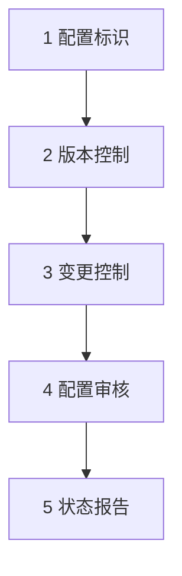
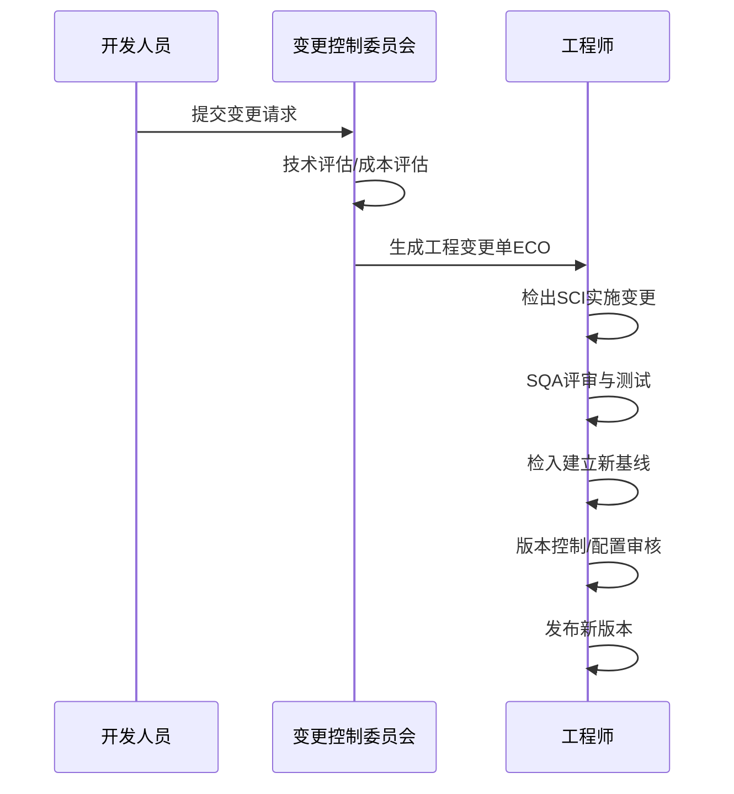

# 软件配置管理（SCM）的概念、第一定律与主要活动

## SCM 是什么

**软件配置管理（Software Configuration Management, SCM）** 是贯穿整个软件过程的==伞形活动（umbrella activity）==。因为变更（change）随时可能发生，SCM 的目标就是：**标识变更、控制变更、确保变更被正确实现，并向需要知道的人报告变更**。

软件过程中产生的每个工作产品都叫 **软件配置项（SCI）**，包括三大类：
1. 计算机程序（源代码和可执行文件）
2. 文档（技术文档和用户文档）
3. 数据（程序内部和外部的数据）

> [!IMPORTANT]
> **基线（Baseline）**：已经正式评审并达成一致的规范或产品，此后作为进一步开发的基础，且==只能通过正式变更控制程序修改==。基线是软件开发的里程碑，标志着一个或多个 SCI 通过正式技术评审后入库。

SCM 包含四类元素：**构件元素**（工具与文件管理系统）、**过程元素**（规程与任务）、**构造元素**（编译与构建工具）、**人员元素**（团队使用的工具与流程特征）。这些元素不是孤立的，例如过程元素指导人员活动，也可视为人员元素。

## SCM 仓库

**SCM Repository** 是使软件团队有效管理变更的一组机制和数据结构。现代仓库还应具备：

- 版本控制（Versioning）
- 依赖性跟踪与变更管理
- 需求跟踪
- 配置管理
- 审核跟踪（Audit trails）

此外，仓库支持**内容管理**（存储、检索、标注）和**影响管理**（理解变更波及范围）。

## SCM 过程：五个层次

SCM 过程可看作==同心圆层次结构==。SCI 在其生存期内由内向外穿越各层，每层活动可能适用也可能不适用。

### 配置项标识（Identification）

为每个 SCI 命名并描述其基本特征：
- 名称、描述、资源表（内容、类型、位置）
- "实现"：指向物理单元（文件）
- 建立基线时需要**正式技术评审（FTR）**确认

### 版本控制（Version Control）

将程序、文档、数据的演化过程全部管理起来，支持多种配置变体。核心概念是 **配置对象（Configuration Object）**：为每个 SCI 维护名称、描述、属性（如创建者、创建日期、状态、基线标识）。

### 变更控制（Change Control）

基线建立后，变更必须经过以下流程：

> [!WARNING]
> 访问控制决定谁有权"检出（check-out）"；同步控制确保多人并行修改时不会相互覆盖。

### 配置审核（Configuration Audit）

正式技术评审与配置审核互补，主要回答：
1. 变更是否已在 ECO 中指定？是否包含额外修改？
2. 是否进行了正式技术评审来评估技术正确性？
3. 软件过程是否被正确遵循？
4. 变更是否已在 SCI 中"突出显示"？
5. 是否遵循了 SCM 规程中标注、记录和报告变更的规程？

### 状态报告（Status Reporting）

**配置状态报告（CSR）** 回答：发生了什么？谁做的？什么时候发生的？会影响什么？每次变更、审核结果都需记录并分发给相关人员。

## SCM 第一定律

> [!TIP]
> **SCM 第一定律**：==无论你在软件过程的何处，都要为变更做好准备==。变更可能来自客户、市场、管理层、甚至团队成员自身。

## 常见考点与易错点

| 概念 | 易错提醒 |
|------|---------|
| SCI vs 基线 | SCI 是工作产品；基线是==通过正式评审后的 SCI 集合==，成为基线后变更必须走正式流程 |
| 变更控制 vs 版本控制 | 变更控制关注"是否该改"；版本控制关注"改了什么、如何管理多版本" |
| 配置审核 vs 技术评审 | 技术评审关注技术正确性；配置审核关注==是否遵循 SCM 规程== |

> [!NOTE]
> **例题（SCM Scenario）**：软件配置管理场景描述了在特定情况下如何进行软件配置管理活动，核心是说明变更发生时，SCM 各层活动如何协同工作，确保变更被正确识别、评估、实现、审核和报告。

> [!IMPORTANT]
> 记住 SCM 的五个核心问题：谁负责变更？变更涉及哪些 SCI？变更何时发生？变更如何影响其他部分？如何确保变更被正确实现和记录？
