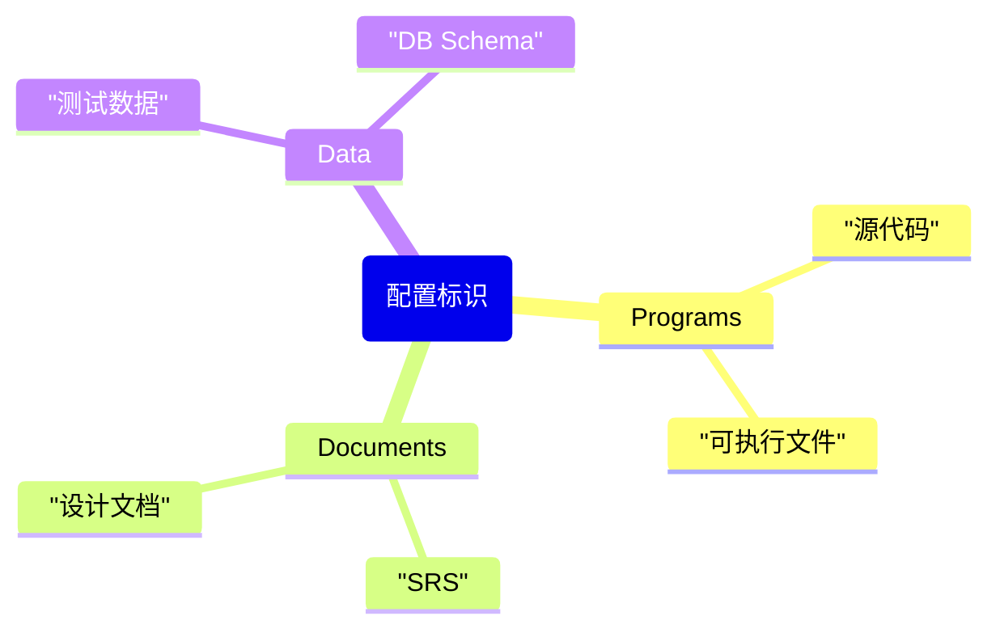

# SCM过程1：配置项标识（Identification）

> [!IMPORTANT]
> 配置项标识（Identification）是 SCM process 的第一步，核心任务是 ==identify change== 并定义所有需要被控制的 software configuration items (SCIs)。

## 它是什么

想象一下：一个项目有几十个人同时写代码、改文档。如果连“哪些东西该管起来”都没定清楚，后续的版本控制（version control）和变更控制（change control）根本无从谈起。

配置项标识就是给软件配置中的每一个“受控对象”发身份证。课件指出，software configuration 由三大类信息组成：

1. **Computer programs**（源代码与可执行程序）
2. **Documents**（需求规格、设计模型、测试计划等）
3. **Data**（数据库结构、测试用例数据等）

这三类信息在 SCM repository 中被实例化为一个个 configuration objects，即 SCIs。

## 为什么需要

如果不做标识会怎样？

- 开发人员 A 改了 `login.c`，但没人知道这个文件属于哪个 baseline。
- 客户提了一个 change request，你无法快速定位它会影响哪些 configuration objects。

> [!WARNING]
> 标识的缺失会导致 impact management 失效——你根本算不出一次变更的波及范围。

标识的目的就是建立 content management 的基础：明确“管什么”，才能决定“怎么管”。

## 怎么做

标识过程通常包含三个步骤：

1. **识别 SCIs**：从三大类信息中挑出需要纳入 SCM repository 管理的对象。
2. **命名与编号**：为每个 SCI 分配唯一标识符（如 `SCI-SRS-v1.2`）。
3. **定义属性与关系**：记录该 SCI 的类型、所属 baseline、与其他 SCI 的依赖关系。

> [!TIP]
> 记忆口诀：“找对象、起名字、建档案”。先 identify change 涉及的实体，再唯一命名，最后录入 repository。

## 与相近概念的区别

| 概念 | 关注点 | 发生阶段 |
| :--- | :--- | :--- |
| **Identification** | 确定“管什么”（define SCIs） | SCM process 起始 |
| **Version control** | 管理 SCI 的历史版本演进 | 标识之后 |
| **Change control** | 审批并执行对 SCI 的修改 | 标识之后 |
| **Configuration audit** | 验证 SCI 是否符合标准 | 变更后检查 |

> [!NOTE]
> Identification 是静态定义；version control 和 change control 是在此基础上的动态操作。没有标识，后续流程就没有操作目标。

## 常见的坑

> [!CAUTION]
> 很多初学者只把“源代码”当作 SCI，而忽略了 documents 和 data。复习提纲中明确列出了 3 broad categories，考试若问“software configuration 包含哪些信息”，漏答任何一类都会丢分。

另一个易错点：把 baseline 等同于 SCI。baseline 是某个时间点上 ==一组 SCI 的正式快照==，而不是单个配置项本身。

## 例题演练

**题目**：List the 3 broad categories of information that make up the software configuration, and give one example of a configuration object for each.

**解答**：

$$\text{Software Configuration} = \{\text{Programs},\ \text{Documents},\ \text{Data}\}$$

| Category | Example Configuration Object (SCI) |
| :--- | :--- |
| Computer programs | `main.c` source file |
| Documents | Software Requirements Specification (SRS) |
| Data | Integration test case dataset |

> [!IMPORTANT]
> 答题关键：必须覆盖全部三类，且每类给出具体实例。这是 identification 阶段最基础的输出产物。
