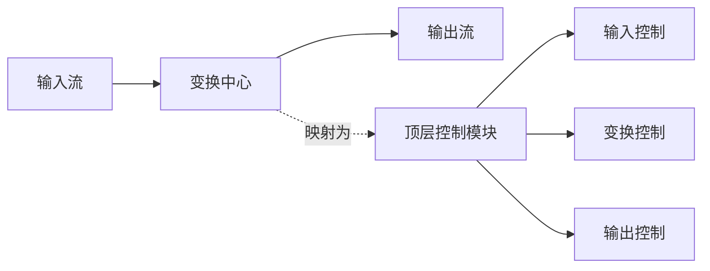
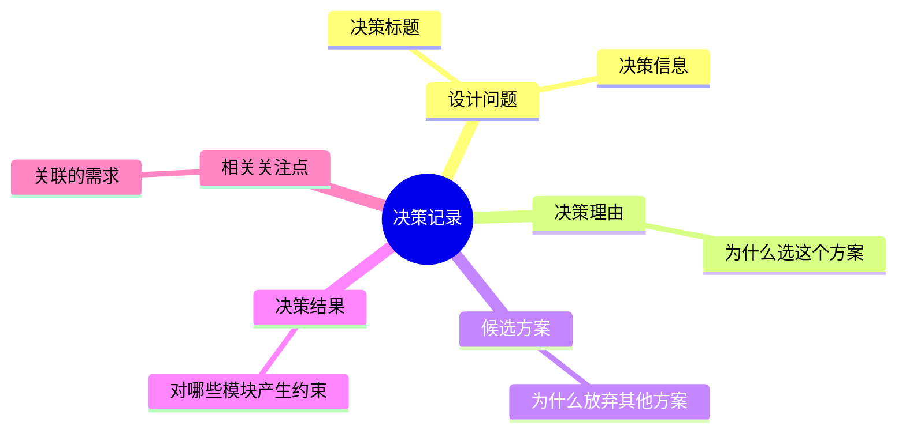

# 软件设计说明书（SDD）模板结构（体系结构设计、组件设计、未解决问题列表）

## 软件设计说明书（SDD）模板结构

### 它是什么

软件设计说明书（Software Design Document, SDD）是软件工程实验与课程设计中必须交付的核心文档，用来记录“系统**怎样**被构建”，是需求到代码之间的桥梁。南邮《软件工程（双语）》课程要求 SDD 至少覆盖三个板块：

| 板块 | 回答的问题 | 核心产出 |
|------|-----------|---------|
| 体系结构设计 | 系统由哪些大块组成？它们怎么协作？ | 结构图、体系结构决策记录 |
| 组件设计 | 每个“大块”内部如何设计？ | 组件接口、数据结构、算法描述 |
| 未解决问题列表 | 还有哪些悬而未决的设计问题？ | 风险与决策延期项 |

> [!IMPORTANT]
> ==SDD 的核心不是“画图”，而是“记录决策”==。评审者拿到你的 SDD，最想看到的是：你为什么选这个结构而不是那个，以及哪些问题还没想清楚。

### 为什么需要它

如果没有 SDD，直接写代码，会遇到三个典型问题：

1. **团队协作失衡**——每个人对“模块怎么划分”理解不同，集成时大量返工。
2. **评审无依据**——老师或评审者无法判断你的设计是否合理，只能看代码“猜”。
3. **风险不可见**——有些技术难题（如并发冲突、外部接口不明确）被悄悄绕过，最后集中爆发。

SDD 的价值在于：==在设计阶段暴露问题，而不是在编码阶段用更高的代价解决它==。

### 体系结构设计：从数据流图到结构图

课件强调了一个关键转换：==数据流图（DFD）→ 结构图（Structure Chart）==。

两者区别：

| | 数据流图 DFD | 结构图 SC |
|---|---|---|
| 关注 | 数据在系统中**如何流动** | 模块之间的**调用层级** |
| 节点含义 | 加工（动词，如“验证密码”） | 模块（名词，如“认证模块”） |
| 箭头含义 | 数据流向 | 调用关系与参数传递 |
| 回答的问题 | “系统做什么” | “系统怎么组织” |

转换的基本思路：

> [!TIP]
> 口诀：**“输入—变换—输出”三段式**。先找到 DFD 中的“变换中心”（数据从输入变为输出的关键加工），再向上封装一个总控模块，向下挂接输入、变换、输出三类子模块。

### 体系结构决策记录

课件给出了“体系结构决策描述模板”，其核心字段是：

> [!WARNING]
> 学生常见错误：只写“我选择了分层架构”，不写**放弃了什么**。没有候选方案对比的决策是“拍脑袋”，在评审中会被追问。

### 组件设计

体系结构设计回答“大块怎么分”，组件设计则回答==每个大块内部的接口、数据结构和关键算法==。例如一个“用户认证模块”的组件设计应包含：

- 接口签名：`boolean authenticate(String username, String password)`
- 数据结构：密码哈希存储格式（如 bcrypt，成本因子 10）
- 异常处理：认证失败返回码设计
- 依赖关系：依赖哪些外部组件（如数据库连接池）

### 未解决问题列表

这是最容易被学生省略、但评审时价值极高的板块。它明确列出**当前设计尚未解决的技术难点**：

- 高并发下会话状态如何跨服务器共享？
- 第三方支付接口的最终集成方式未确定？
- 日志存储容量与清理策略未明确？

> [!CAUTION]
> 未解决问题列表**不是“设计缺陷清单”**，而是“待办决策清单”。写出未解决问题，说明你清楚设计的边界；什么都不写，说明你根本不知道哪里会出问题。

### 一个算对了的例子

某学生小组设计“校园二手交易平台”，SDD 体系结构部分记录如下：

**决策标题**：采用分层架构还是微服务架构？

| 候选方案 | 理由 | 决策 |
|---------|------|------|
| 单体分层架构 | 团队 4 人，开发周期 8 周，功能点约 15 个 | ✅ 选用 |
| 微服务架构 | 部署与运维复杂度远超团队能力，且无独立伸缩需求 | ❌ 放弃 |

**决策结果**：所有组件部署为同一进程内模块，数据库采用单实例 MySQL；后续若用户量增长，可先做读写分离，再考虑拆分“消息服务”为独立进程。

这个例子的亮点在于：==决策有对比、有约束条件、有演进路径==，并且“未解决问题列表”中写了：“消息通知是否实时推送（WebSocket）还是轮询，待原型验证后决定。”

### 常见坑

1. **把体系结构图当“装饰画”**——画了分层图，但组件之间没有标注接口名与数据方向。
2. **组件设计写成伪代码**——SDD 描述“做什么”和“接口契约”，不是“怎么写代码”。
3. **未解决问题列表留空或写“无”**——这在评审中几乎必然被视为设计不成熟的信号。

> [!NOTE]
> 延伸辨析：SDD 与 SRS（软件需求规格说明书）的区别——SRS 回答“系统要做什么”，SDD 回答“系统怎么做”。需求变化应回溯 SRS，设计变化应回溯 SDD。
