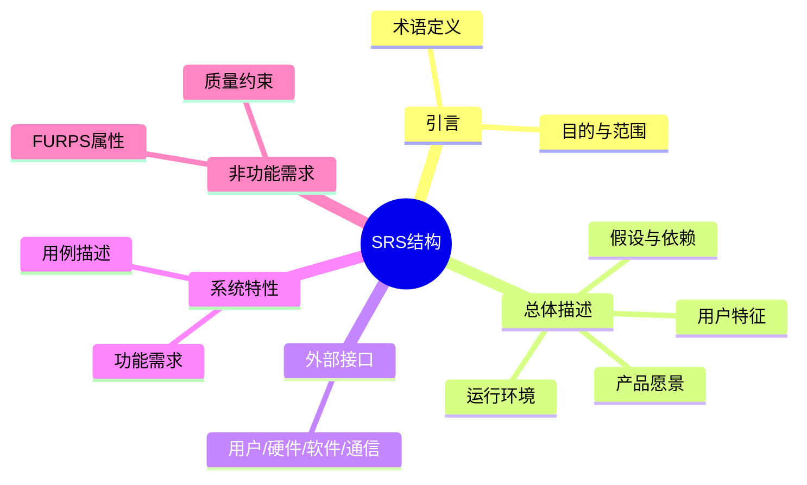

# 软件需求规格说明书（SRS）模板结构与撰写规范（引言、总体描述、外部接口、系统特性、非功能需求）

## SRS 模板结构与撰写规范

在动手写代码前，你是否想过：如果开发团队对“用户登录”的理解是手机号验证，而客户期望的是人脸识别，后果会怎样？软件需求规格说明书（SRS）正是为了消除这种歧义而存在的契约。它不仅是开发的依据，更是验收测试的基准。

> [!IMPORTANT]
> SRS 的核心价值在于==无歧义、可验证、可追溯==。它描述系统“做什么”（What），而非“怎么做”（How）。

### 五大核心模块解析

根据 IEEE 830 标准及课程模板，SRS 由以下部分构成，撰写时需严格区分边界：

-   **引言 (Introduction)**：明确文档目的、适用范围及参考文献。注意“项目范围”需界定系统边界，防止需求蔓延。
-   **总体描述 (Overall Description)**：提供宏观背景。包括产品愿景、用户类型、操作环境及==设计约束==（如必须使用国产数据库）。此处的“假设和依赖”常被忽视，却是后期变更的高风险点。
-   **外部接口 (External Interfaces)**：定义系统与外界的交互点。务必区分四类接口：用户接口（UI规范）、硬件接口（设备协议）、软件接口（API/SDK）及通信接口（网络协议）。
-   **系统特性 (System Features)**：SRS 的主体。每个特性应对应一个或多个用例，包含优先级、前置/后置条件、基本流与扩展流。
-   **非功能需求 (Non-functional Requirements)**：即 ==FURPS+== 模型中的性能、安全、可靠性等属性。**切记：设计师常专注于解决问题，但 FURPS 属性始终是问题的一部分**，不可遗漏。

### 用例撰写的规范化示例

系统特性通常通过结构化用例来描述。以下是一个符合规范的“用户登录”片段：

| 字段 | 规范内容 | 避坑指南 |
| :--- | :--- | :--- |
| 用例名称 | 动词短语，如“验证用户身份” | 避免名词化，如“登录模块” |
| 基本事件流 | 1. 用户输入凭证；2. 系统校验；3. 返回令牌 | 仅描述正常路径，不含异常 |
| 扩展事件流 | 2a. 密码错误：提示重试并记录日志 | 必须关联基本流步骤编号 |
| 规则与约束 | 密码需满足正则 `^[A-Za-z0-9]{8,}$` | 将业务规则与非功能需求显式列出 |

> [!WARNING]
> 常见误区是将“界面布局”写入“系统特性”。UI 细节属于“外部接口-用户接口”，功能逻辑才属于“系统特性”。混淆两者会导致需求耦合，难以维护。

### 概念辨析与考试要点

许多同学混淆“总体描述”与“系统特性”。简言之，==总体描述是上下文环境，系统特性是具体行为契约==。例如，“系统需支持 1000 并发”若在总体描述中提及，仅为背景信息；若作为验收标准，则必须放入“非功能需求-性能需求”中量化定义。

> [!TIP]
> 针对判断题考点：Software designers tend to focus on the problem to be solved. Just don’t forget that the FURPS attributes are always part of the problem. 答案为 **True**。这提醒我们在撰写 SRS 时，不能只写功能流程，必须同步明确质量属性约束。

最后检查你的 SRS：每个需求是否都有唯一标识？是否使用了课件规定的术语表？模糊词汇（如“快速”、“友好”）是否已替换为可度量指标？规范不是形式主义，而是工程质量的底线。
