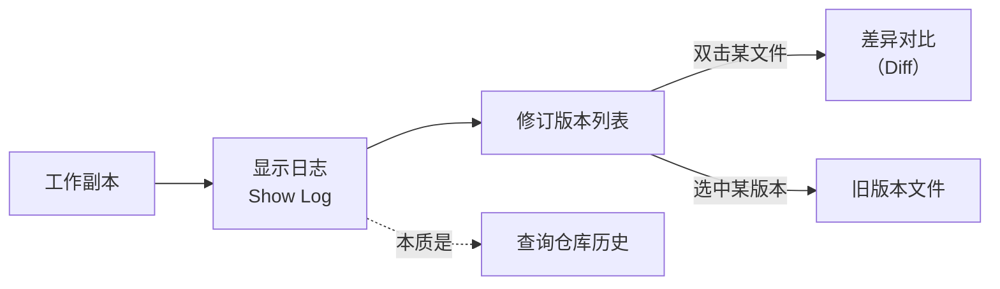

# SVN其他功能：显示日志、还原（Revert）、锁定/解锁、忽略列表、导出、清理

在 SVN 的工作流里，除了基本的提交和更新，你肯定遇到过这些情况：提交了一段代码后发现改出 Bug 了想撤回；不小心把本应配置好的文件也加入版本控制了；或者想给某个团队协作的大文件上锁避免冲突。这些日常场景都需要用到 SVN 的其他实用功能。

### 显示日志与追溯

我们为什么需要“显示日志”？因为版本控制的灵魂是 ==**让每一次变更都有迹可循**==。日志让你能回答：“谁在什么时候因为什么原因改了什么”。

- **怎么做**：在文件或目录上右键选择 `TortoiseSVN` -> `Show log`，或使用命令 `svn log`。
- **能看什么**：
  - **修订版本号**：唯一且全局递增的标识。
  - **作者、日期、提交信息**。
  - **变更的文件列表**：可以双击查看这个文件在这一版与上一版的具体差异。

[!WARNING]
> “显示日志”查看的是已提交到仓库的历史，如果你想撤销一个尚未提交的本地修改，请看下面的“还原”。

### 还原与清理：项目级别的“撤销”

这是大家最容易搞混的两个功能，我们通过一个表格来辨析。

| 功能 | 作用对象/范围 | 目的 | 常见场景 |
| :--- | :--- | :--- | :--- |
| **还原**（**Revert**） | **未提交的本地修改** | ==**放弃本地修改**，将文件恢复到最新检出时的状态。== | 代码改乱了想推倒重来；错误地添加了文件但未提交。 |
| **清理**（**Cleanup**） | **中断的本地工作副本** | ==**清除锁定和未完成的事务**，修复工作副本的状态。== | 更新/提交过程被强制中断后，工作副本被锁定，无法进行后续操作。 |

[!IMPORTANT]
> **还原是不可逆的危险操作！** 一旦执行，所有在修改后未提交的代码将永久丢失，无法通过 SVN 自身找回。所以，还原前请再三确认：“这些修改我真的都不要了吗？”

- **还原怎么做**：在有问题的文件或目录上右键，选择 `TortoiseSVN` -> `Revert`，勾选你想还原的文件，点击确定。
- **清理怎么做**：在受影响的目录的空白处右键，选择 `TortoiseSVN` -> `Clean up`。通常勾选所有默认选项（`Clean up working copy status`, `Include externals`等）。

### 锁定/解锁：应对无法合并的文件

为什么需要“锁定”？如果团队中多个人同时修改同一个二进制文件（如一个 `.psd` 设计稿，或一个 `.docx` 需求文档），或者两份修改无法用SVN自动文本合并的UML模型文件（`.uml`）。

- **机制**：这是一种==悲观锁==策略。用户A锁定文件进行编辑时，用户B对该文件只读，避免了冲突的产生。SVN默认的“编辑-合并-提交”是乐观锁，假定冲突不多。对于二进制文件，乐观锁必然导致冲突且无法合并，所以必须用悲观锁。
- **操作流程**：
  1.  **锁定**：编辑前，在文件上右键 `TortoiseSVN` -> `Get Lock`，输入理由。
  2.  **编辑与提交**：修改文件后，正常提交。提交时会自动解锁。
  3.  **手动解锁**：如果改了但不想提交，需 `Release Lock` 解锁。
  
### 忽略列表：让版本库保持整洁

为什么需要“忽略”？你的项目目录里总有些私货，比如编译生成的 `.class` 文件、`node_modules` 文件夹、本地的 IDE 配置文件。这些文件不应该被提交到仓库，但又不想在每次提交时都看到它们出现在未版本控制的文件列表里。

- **如何操作**：
  - **未加入版本控制前**：对文件右键，`TortoiseSVN` -> `Add to ignore list` -> 选择按文件名或按扩展名忽略。
  - **全局忽略配置**：在 `TortoiseSVN` -> `Settings` -> `General` 的 `Global ignore pattern` 里配置，如 `*.o *.lo *.la *.class *.pyc *.~vsdx node_modules .idea`。这是经验丰富的开发者的必备配置。

### 导出：生产纯净的副本

“导出”回答了这个问题：如果我想把项目压缩发给甲方，怎么去掉所有隐藏的 `.svn` 目录（SVN的元数据）？

- **功能**：导出一个完全干净的目录树，不包含任何版本控制信息。
- **场景**：打包发布软件版本。这就是你从开发库到发布包的最后一公里。

[!TIP]
> 宣称要做“发布版本”时，务必使用 `Export` 功能，而不是简单的文件夹复制。后者会把耗时存储的所有版本历史元数据也一并打包，体积巨大且不安全。

---

**算对了的例子**

假设你修改了 `calc.py`，并错误地将生成的 `__pycache__` 文件夹加入到了暂存区。接着你不小心把 `calc.py` 也改乱了。

1.  **恢复乱了的文件**：在 `calc.py` 上右键 -> `Revert`。文件恢复到你最初检出时的内容。
2.  **移除错误添加的文件夹**：此时 `__pycache__` 还处于“已添加”状态。右键 -> `Revert`，这个文件夹从 SVN 的管理列表中消失了。
3.  **永久忽略该文件夹**：右键 `__pycache__` 文件夹 -> `Add to ignore list` -> `__pycache__`。之后提交时，这个文件夹再也不会出现。
