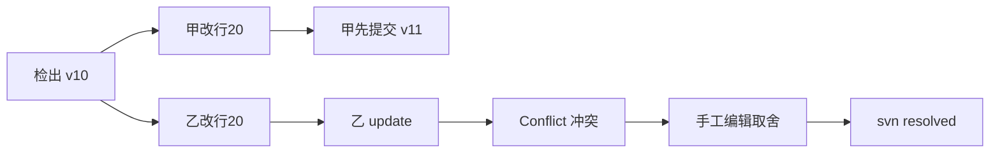

# SVN冲突（Conflict）的产生原因、提示与解决方案

## 是什么与为什么需要

在 SVN 这类集中式版本控制里，多名同学会同时修改同一个文件。先问自己：如果甲乙都改了 `Login.java` 的第 20 行，SVN 该听谁的？答案是它不会自动替你选，而是标记为 **Conflict（冲突）**。产生原因通常是：两人基于**同一旧版本**检出，随后修改了**重叠区域**，后提交者在 update/commit 时便触发冲突。

> [!IMPORTANT]
> 冲突根源 = ==重叠修改+并发提交==；SVN 不自动合并语义，只提示人工裁决。

## 怎么做：提示与解决

SVN 会给出明确提示：`C` 状态（冲突）、生成 `.mine` / `.rOLD` / `.rNEW` 三个副本，文件中出现 `<<<<<<<`、`=======`、`>>>>>>>` 标记。

解决流程是：打开冲突文件→阅读双方改动→==删除标记并保留正确逻辑==→`svn resolved <file>` 告知 SVN 冲突已解→再 commit。

## 与相近概念区别

| 概念 | 含义 | SVN 行为 |
|---|---|---|
| Conflict | 重叠修改无法自动合 | 报 C，人工裁决 |
| Merge 自动合并 | 改动区域不重叠 | 直接合成新版本 |
| Lock-Modify-Unlock | 加锁避免并发 | 需先获得锁 |

> [!TIP]
> 不重叠=自动 Merge；重叠=Conflict。加锁可预防，但降低并行度。

## 常见坑与算对例子

> [!WARNING]
> 最常错：==忘了 `svn resolved`==，导致冲突状态残留，后续提交仍被拒。

考过的题常这样给：甲乙都从 r5 改 `A.java` 第 10 行，甲提交成 r6，乙 update 后出现冲突。乙看到标记：
`<<<<<<< .mine` 下面是乙写的代码，`=======` 后到 `>>>>>>> .r6` 是甲的代码。乙核对后保留甲的空值判断+乙的日志输出，删净三行标记，再 `svn resolved A.java` 并提交——这便算"解决正确"。若只删标记不执行命令，SVN 仍认为未解决，是典型坑。

> [!NOTE]
> 冲突不可怕，它是配置管理里"并发协作"的正常信号；关键是读完两边再裁决，而非盲目覆盖。
