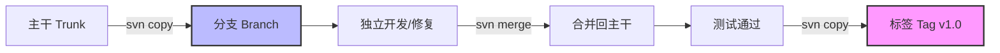

# SVN高级操作：建立分支（Branch）、标签（Tag）与合并（Merge）

# SVN高级操作：建立分支（Branch）、标签（Tag）与合并（Merge）

在软件配置管理中，版本库不仅是代码的仓库，更是团队协作的枢纽。当多条开发线并行或需要发布稳定版本时，简单的提交（Commit）已无法满足需求，此时需引入分支、标签与合并机制。

## 核心概念辨析

许多初学者容易混淆 Branch 与 Tag。从 SVN 底层实现看，二者本质都是**目录拷贝**（廉价拷贝），但语义截然不同：

| 特性 | 分支 (Branch) | 标签 (Tag) |
| :--- | :--- | :--- |
| **用途** | 并行开发、隔离风险 | 版本快照、里程碑标记 |
| **可变性** | ==动态变化==，持续提交 | ==静态不变==，严禁修改 |
| **生命周期** | 长，随功能结束而废弃 | 永久保留，用于追溯 |

> [!IMPORTANT]
> **核心原则**：Tag 是只读的“照片”，Branch 是可写的“画布”。切勿在 Tag 上直接开发！

## 操作流程与合并策略

典型的生命周期如下：主干（Trunk）开发 -> 创建分支修复 Bug/开发新功能 -> 测试通过后合并回主干 -> 打标签发布。

合并（Merge）是最高危的操作。SVN 提供三种主要合并方式：
1. **合并两个不同路径**：常用于将分支变更同步到主干。
2. **合并特定版本范围**：精确控制合并哪些修订版（Revision）。
3. **重新整合（Reintegrate）**：SVN 1.5+ 特性，用于分支生命终结时一次性合回主干，避免重复合并冲突。

> [!WARNING]
> **常见坑**：合并前务必保证工作副本（Working Copy）是**干净**且**最新**的（Update to HEAD）。否则极易产生树冲突（Tree Conflict）或代码覆盖。

## 算例演示

假设主干 r100 创建分支 `bugfix`，在分支上提交了 r101, r102。现需将修复合并回主干。

**正确步骤：**
1. 切换到主干工作副本：`svn switch ^/trunk`
2. 更新到最新：`svn update` （确保处于 r100 之后的状态）
3. 执行合并：`svn merge ^/branches/bugfix`
   * SVN 会自动计算差异，应用 r101-r102 的变更。
4. 解决冲突（如有）并提交：`svn commit -m "Merge bugfix r101-r102"`

> [!TIP]
> **记忆口诀**：先更新，后合并；看日志，防冲突；打完标签锁死它，分支用完及时删。

==核心结论==：分支用于隔离变更，标签用于固化版本，合并需谨慎处理冲突。掌握 `svn copy` 和 `svn merge` 是协同开发的基础。
