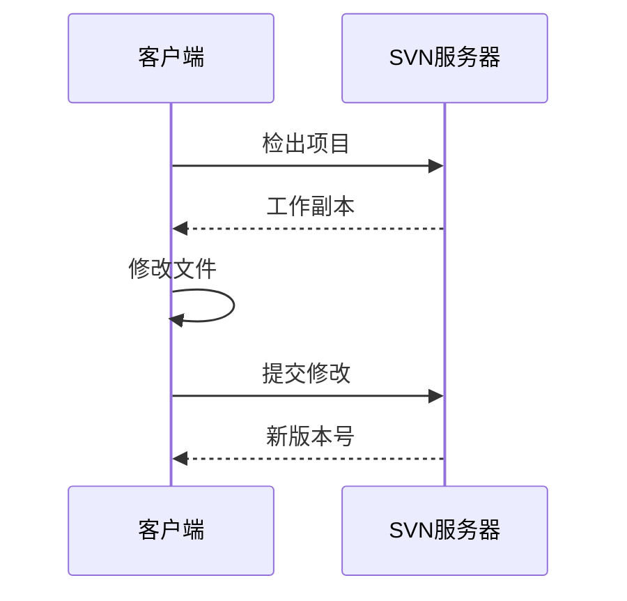
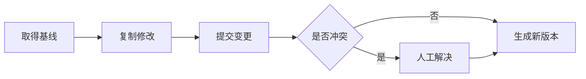
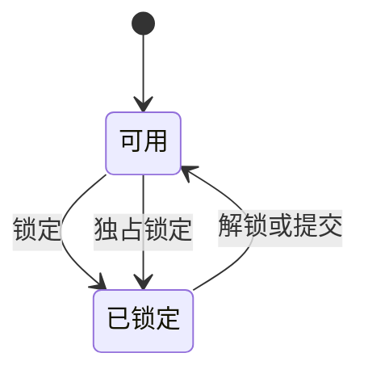

# SVN（Subversion）简单工作原理、复制-修改-合并与锁定-修改-解锁方案

## SVN 是什么

SVN（Subversion）是集中式版本控制系统，用于保存软件项目的多个历史版本，并记录每次修改的作者、时间、原因和差异。软件配置管理（SCM）要求能够追踪配置项的变化，SVN 正是实现这类管理的一种工具。

典型目录包括：

- `trunk`：开发主线；
- `branches`：从主线派生出的独立分支；
- `tags`：用于发布、冻结版本的标记目录。

SVN 的核心思想是：**服务器保存版本库，客户端从服务器获取工作副本，再将修改提交回服务器。**

## 简单工作原理



客户端执行 `svn checkout` 后得到工作副本，其中带有 `.svn` 元数据。修改文件后可执行 `svn diff` 查看差异，再执行 `svn commit` 提交。服务器会生成新的全局修订版本号（revision），例如从 `r105` 变为 `r106`。

SVN 属于**集中式版本控制**：历史版本主要保存在服务器上。多人同时修改时，服务器通过版本号和差异合并判断提交是否冲突。

## 复制—修改—合并

复制—修改—合并（Copy-Modify-Merge，CMM）是 SVN 常用的协作方式：



其过程可以概括为：

1. 从版本库复制文件或目录，形成工作副本；
2. 独立修改副本；
3. 提交时，将修改与服务器最新版本进行合并；
4. 若双方修改了同一区域，系统产生冲突标记，必须人工处理后重新提交。

例如，`r10` 中 `calc.c` 的内容为：

```c
int add(int a, int b) {
    return a + b;
}
```

甲修改为支持三个参数，乙修改为增加参数检查。若二者的修改位置不重叠，SVN 可以自动合并；若都在 `return` 语句附近修改，就可能发生冲突。

> [!IMPORTANT]
> ==SVN 提交的是“相对于基线版本的变化”==，不是简单地把整个文件替换掉。能否自动合并，取决于修改是否重叠。

## 锁定—修改—解锁

锁定—修改—解锁（Lock-Modify-Unlock，LMU）适用于不适合并行编辑的配置项，例如服务器配置文件、数据库脚本等。



用户先锁定文件，再修改并提交，最后解锁。锁定会写入仓库中的锁信息，其他用户通常只能读取该文件。锁主要用于提醒协作者“此文件正在修改”，并不等同于操作系统层面的文件锁。

两种方案对比如下：

| 对比项 | 复制—修改—合并 | 锁定—修改—解锁 |
|---|---|---|
| 修改方式 | 先复制，再并行修改 | 先锁定，再修改 |
| 适用对象 | 文本文件、代码文件 | 不易合并的配置项 |
| 冲突处理 | 合并时可能冲突 | 提前避免同时编辑 |
| 协作效率 | 通常较高 | 锁定期间他人不能修改 |
| 管理难度 | 需正确解决冲突 | 可能忘记解锁、产生僵锁 |

> [!TIP]
> 记忆：代码用“各改各的，提交时合并”；不适合合并的文件用“先占坑，再修改”。

## 常见坑

- **把更新当成覆盖**：应先 `svn update` 获取最新版本，再解决本地改动与新版本的冲突。
- **提交了错误文件**：提交前用 `svn status`、`svn diff` 检查新增、修改和删除项。
- **看到红色 `C` 就直接删除文件**：冲突标记中的 `<<<<<<<`、`=======`、`>>>>>>>` 必须人工合并。
- **忘记解锁**：提交后应确认锁已释放；异常退出可能导致文件长期保持锁定。
- **误以为 SVN 有本地完整历史**：与 Git 不同，SVN 的版本库通常集中在服务器，工作副本不是完整的独立仓库。

> [!WARNING]
> 提交前至少执行一次 `svn diff`；冲突未解决时不要直接提交，否则容易丢失他人修改。

## 一个算对了的例子

某文件的基线版本为 `r20`，包含 10 行代码。甲提交修改后形成 `r21`，乙又提交修改形成 `r22`。SVN 的修订版本号是**仓库级、连续递增**的，因此乙提交的版本号不是 `r21`，而是 `r22`。

若甲、乙都修改了第 5 行，提交后 SVN 会产生冲突，文件状态显示 `C`；若甲修改第 5 行、乙只修改第 8 行，则这两处改动通常可以自动合并。==判断是否冲突的关键是修改区域是否重叠，而不是两个提交者是否同时工作。==
