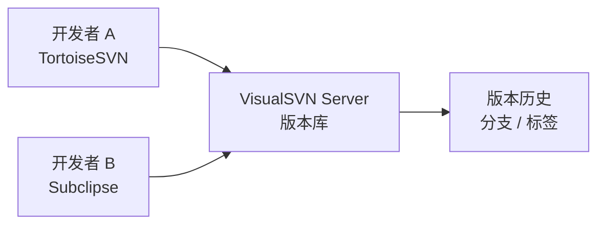
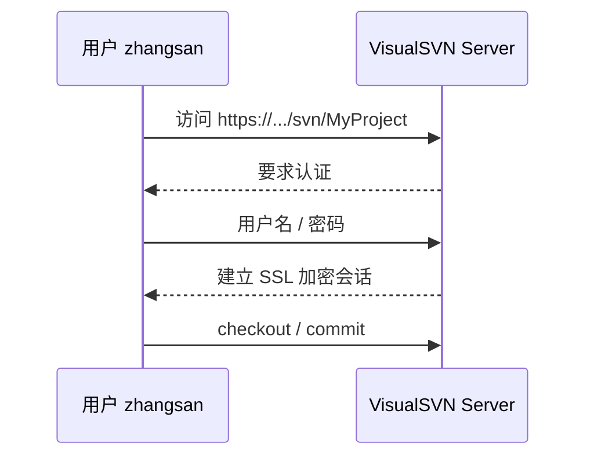
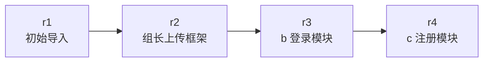

# VisualSVN Server服务端安装配置与TortoiseSVN/Subclipse客户端配置

## 这是什么

VisualSVN Server 是 Windows 平台上的一键式 Subversion（SVN）服务器，TortoiseSVN 是 Windows 资源管理器集成的 SVN 客户端，Subclipse 是 Eclipse 中的 SVN 插件。三者的关系可以理解为：

> [!IMPORTANT]
> VisualSVN Server 负责**集中存储版本库**并对外提供 `https://` 或 `svn://` 访问；TortoiseSVN / Subclipse 只是客户端工具，==本身不保存版本历史==，所有提交都推送到服务器。

## 为什么需要

SVN 是集中式版本控制：所有开发者共享一个中央仓库。只有先把服务器装好、配好 URL、账号和权限，团队才能进行 `checkout → update → commit` 的协作流程，否则任何客户端都无从连起。

## 服务端：VisualSVN Server 安装与配置

双击安装包后，关键选择是**认证方式**：推荐 Use secure connection（`https://`），需要指定证书；若选 `http://` 则明文传输，仅适合内网实验。

装好后在 VisualSVN Server Manager 中：

1. 右键 **Repositories → Create New Repository**，选 FSFS，建一个空仓库，如 `MyProject`。
2. 右键 **Users → Create User**，添加账号（如 `zhangsan` / `123456`）。
3. 右键仓库 → **Properties**，给用户分配权限：`Read/Write` 或 `Read Only`。
4. 复制仓库 URL：`https://<主机名或IP>/svn/MyProject`，发给客户端。

> [!WARNING]
> 若客户端连不上，先检查：① 服务是否已 Start；② Windows 防火墙是否放行 443 端口；③ URL 是否写成了 `https://localhost/svn/...`——其他机器访问时 `localhost` 指向自己，必须换成服务器 IP 或主机名。

## 客户端：TortoiseSVN 与 Subclipse

### TortoiseSVN

安装后普通文件夹所有操作都通过右键菜单完成，注意右键位置：

- 在**某个文件夹**上右键 → **SVN Checkout**：输入仓库 URL 和本地目录，检出到本地。
- 在**工作副本内部**空白处右键 → **SVN Commit / Update**：提交或更新。
- 在**工作副本内部**右键 → **TortoiseSVN → Repo-browser**：浏览服务器上的版本树。

提交前必须 `Update`，否则文件可能“过时”（out of date），提交会被拒。

### Subclipse

在 Eclipse 中通过 Marketplace 安装 Subclipse 后：

1. 打开 **SVN Repository Exploring** 透视图。
2. 新建 Repository Location，粘贴相同的 URL。
3. 右键工程 → **Team → Share Project → SVN**，选仓库路径。
4. 常规操作变为 **Team → Update / Commit**。

==两种客户端连接的是同一个仓库==，谁提交的代码另一方都能 Update 到。

## 与 Git 分布式客户端的区别

| 对比项 | SVN（VisualSVN + 客户端） | Git |
|---|---|---|
| 版本库位置 | 仅服务器 | 每人本地都有一份 |
| 离线提交 | 不可以 | 可以 |
| 核心操作 | checkout / commit | clone / commit / push |
| 权限控制 | 服务器统一管理 | 通常配合 GitLab 等 |

> [!NOTE]
> SVN 中 `commit` 直接把修改推到中央仓库，Git 中 `commit` 只写入本地，需再 `push`。这是两者最直观的操作差异。

## 常见坑

> [!CAUTION]
> 忘记 Update 就 Commit：会报 `out of date`。正确顺序应为 `Update → 解决冲突 → Commit`。

> [!TIP]
> 团队约定：**小步频繁提交**，Commit message 写清楚“改了什么、为什么改”，不要只写 `fix` 或 `update`。

## 一个算对了的例子

某课程设计小组 3 人分工，服务器 IP 为 `10.0.2.15`，仓库 `TeamProj`：

1. 组长在 VisualSVN Server 建仓库 `TeamProj`，创建用户 `a`、`b`、`c`。
2. 组长将仓库 URL `https://10.0.2.15/svn/TeamProj` 发给组员。
3. 组员 b 在 Eclipse 中用 Subclipse 检出到本地工作区，写完模块后 `Update`（无冲突），再 `Commit`，message 写 `add login module`。
4. 组员 c 用 TortoiseSVN 在同一目录右键 `SVN Update`，获得 b 的最新代码。
5. b 此时版本号为 `r3`，c 提交后版本号变为 `r4`。

结果的版本树：

说明服务器集中管理版本号，每次提交只产生一个全局递增的版本号。
