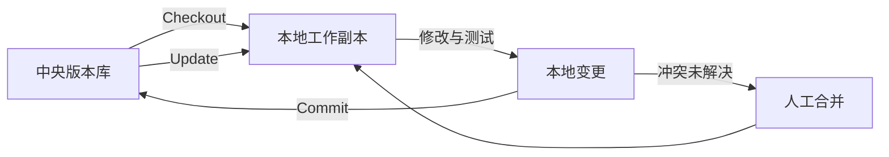

# SVN常用操作：检出（Checkout）、更新（Update）、提交（Commit）

## 为什么需要这三个操作

多人协作时，代码和文档都保存在 SVN 的中央版本库中。如果每个人只修改自己的文件，版本库无法获得成果；如果直接覆盖公共文件，又可能丢失他人的修改。因此，SVN 用三个基本操作形成协作闭环：

> [!IMPORTANT]
> ==检出取得工作副本，更新同步他人修改，提交发布自己的修改。==

## 检出、更新与提交

| 操作 | 英文 | 作用 | 数据传输方向 | 常用命令 |
|---|---|---|---|---|
| 检出 | Checkout | 首次从版本库取得完整工作副本，并建立版本管理信息 | 版本库 → 本地 | `svn checkout URL [目录]` |
| 更新 | Update | 将版本库中的新修订同步到已有工作副本 | 版本库 → 本地 | `svn update` |
| 提交 | Commit | 将本地已完成的修改写入版本库，形成新修订版本 | 本地 → 版本库 | `svn commit -m "说明"` |

检出不是普通的“下载压缩包”：得到的工作副本带有 SVN 管理信息，之后才能执行更新、提交和版本追踪。==Checkout 通常只在开始时做一次，Update 和 Commit 则在开发过程中反复进行。==



## 正确操作顺序

假设版本库地址为 `https://svn.example.com/project`，开发者需要修复登录缺陷：

```bash
svn checkout https://svn.example.com/project project
cd project
# 修改 login.java，并完成测试
svn update
svn status
svn commit -m "修复空密码导致的登录异常"
```

这里先检出，再修改；提交前再次更新，检查是否与他人修改冲突；确认状态并测试后，才提交。提交说明应写清“修改了什么、为什么修改”，不要只写“更新代码”。

若版本库原修订号为 $r=24$，一次成功提交后产生新修订号 $r=25$。SVN 的修订号针对整个版本库递增，并不表示某个文件恰好有 25 个版本。

## 与相近概念的区别

- **Update 不等于 Commit**：更新是“取别人的”，提交是“交自己的”，方向相反。
- **Checkout 不等于 Export**：检出保留版本管理信息；导出通常只得到普通文件，不能直接提交。
- **本地修改不等于已入版本库**：保存文件甚至本地编译成功，都不会自动产生新修订。
- **Commit 不等于变更获批**：在软件配置管理中，变更请求需评估技术指标、副作用、整体影响和预计成本，再由 CCA 决策；SVN 提交只是实施和记录变更的技术手段。

> [!WARNING]
> 不要未经更新和测试就提交，也不要把冲突标记直接提交。出现冲突时，应比较双方修改、人工合并、重新测试，再标记冲突已解决并提交。

> [!TIP]
> 记忆口诀：**先检出，勤更新；改后测，再提交；有冲突，先合并。** 提交应尽量围绕一个完整变更，避免把无关文件和临时文件一起提交。
