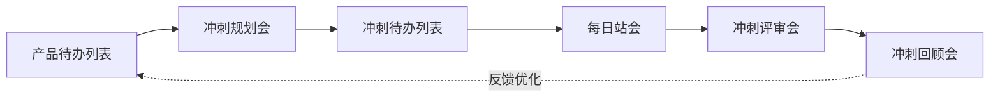

# Scrum架构、过程流与关键工件

## Scrum 是什么与为什么需要

如果传统的线性过程流（Linear Process Flow）追求的是预定义的可预测性，那么当需求频繁变更时，我们该如何保证交付价值？Scrum 正是为此而生的==迭代过程流（Iterative Process Flow）==框架。它不强调详尽的文档与合同谈判，而是通过短周期的“冲刺”快速交付可工作的软件，将变化视为机会而非风险。

> [!IMPORTANT]
> Scrum 的本质是==经验主义过程控制==，而非预设式计划。它属于敏捷过程模型，核心在于通过自组织团队在固定时间盒内持续交付增量价值。

## 架构、工件与过程流

Scrum 的运行依赖“3-3-5”结构：3 个角色、3 个关键工件、5 个事件。理解它们如何串联是掌握过程流的关键。

三大==关键工件（Artifacts）==承载了信息的透明化：

-   **Product Backlog**：所有需求的有序列表，由利益相关者与开发人员共同梳理。
-   **Sprint Backlog**：当前冲刺要完成的任务集合，包含用户故事、缺陷修复及技术改进。
-   **Increment**：冲刺结束时产出的“可工作软件”，必须达到完成的定义（DoD）。

> [!NOTE]
> OO 观点下，构件是一组协作的类。在 Scrum 中，Sprint Backlog 中的任务往往对应组件级的设计与实现，类通过属性、操作及接口消息详细说明，确保每个迭代都有结构化产出。

## 每日站会的三个问题

每日 Scrum 会议限时 15 分钟，旨在同步进度而非解决问题。每位成员必须回答三个标准问题：

1.  自上次会议以来你做了什么？
2.  ==到下次会议前你计划完成什么？==
3.  你遇到了什么障碍（Obstacles）？

> [!WARNING]
> 站会问的是“遇到什么障碍”，绝非“你在制造什么障碍”。前者识别外部阻碍以促进协作，后者带有负面归因，违背敏捷哲学中“个体和互动胜过流程和工具”的原则。这是考试中高频的语义陷阱。

## 与相近概念的区别

| 维度 | Scrum | 传统线性过程流 | XP（极限编程） |
| :--- | :--- | :--- | :--- |
| 流程特征 | 迭代、时间盒固定 | 顺序、阶段分明 | 迭代、工程实践驱动 |
| 核心关注 | 管理与交付节奏 | 文档与计划遵循 | 代码质量与结对编程 |
| 变更态度 | 拥抱变化 | 抵抗或高成本变更 | 拥抱变化 |
| 典型工件 | Backlog、Increment | SRS、设计文档 | 用户故事、验收测试 |

## 常见误区与应试要点

-   **误区一**：认为敏捷等于不要纪律。实际上，Scrum 通过固定的事件和工件提供==现实的纪律机制==，同时对工程师保持宽容。
-   **误区二**：混淆 Sprint Backlog 与 Product Backlog。前者是当前冲刺的承诺，后者是全局愿景。
-   **应试技巧**：涉及 Daily Scrum 的选择题，优先排除含“blame”“cause analysis”“creating obstacles”等表述的选项，正确答案始终围绕“同步”与“障碍识别”。

> [!TIP]
> 记忆口诀：==三工件承信息，五事件控节奏，站会三问只同步，障碍识别不追责==。结合敏捷宣言四条权衡理解，即可应对大部分概念辨析题。
