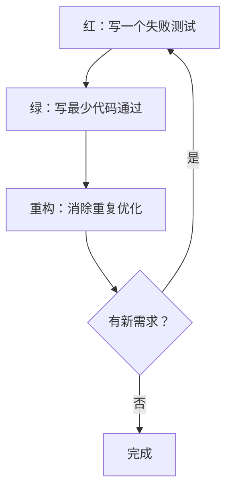

# 测试驱动开发（TDD）的本质、优势与流程

## 它是什么

测试驱动开发（Test-Driven Development, TDD）是一种"测试先行"的编码方法：==先写测试，再写代码==，让测试来驱动设计与实现。它把"验证代码对不对"从开发末期提前到每一次编码之前，是敏捷方法（如 XP）中的核心实践。

可以问自己一个问题：如果一段代码还没有测试，你怎么知道它"完成了"？TDD 的回答是——**只有通过测试的代码才算完成**。

## 为什么需要

传统开发常把测试放在最后，容易遇到两个问题：

| 问题 | 后果 |
|------|------|
| 需求理解偏差到测试时才暴露 | 返工成本高 |
| 代码难以测试（耦合紧） | 测试覆盖率低，缺陷漏到维护期 |

TDD 通过"先写测试"迫使开发者在编码前就思考接口与预期行为，从而==以测试为规格说明书==，自然得到模块化、可测试的设计。

## TDD 流程：红—绿—重构

TDD 的核心循环称为 **Red-Green-Refactor**，每一步目标明确：



| 阶段 | 目标 | 关键动作 |
|------|------|----------|
| 红 Red | 测试失败 | 先写测试，定义期望行为；此时编译都未必通过 |
| 绿 Green | 测试通过 | 写**刚好够用**的实现，不追求完美 |
| 重构 Refactor | 改进结构 | 消除重复、提取方法，保持测试全绿 |

> [!IMPORTANT]
> ==红—绿—重构是一个小步快走的循环==，每个循环通常只持续几分钟。一次只做一个很小的功能点，测试失败是预期状态，不是错误。

## 本质与优势

TDD 的本质不是"多写了几条测试"，而是==以测试为驱动的设计方法==：

- **测试即文档**：测试代码展示了如何调用模块、期望什么输出，是活的用法示例。
- **快速反馈**：几秒到几分钟就知道刚才的改动是否破坏已有功能（回归保护）。
- **设计导向**：为了让代码可测试，自然会拆分职责、依赖注入、减少耦合。

与"先编码后补测试"相比：

| 维度 | TDD | 传统后补测试 |
|------|-----|--------------|
| 测试目的 | 驱动设计、定义行为 | 验证已有实现 |
| 设计质量 | 倾向于松耦合、高内聚 | 常因结构僵化难以测试 |
| 回归保护 | 从第一行代码起就有 | 后期补，覆盖常不完整 |

> [!WARNING]
> 常见误区：以为 TDD 只是"把测试写在前面"。如果跳过重构阶段，或一次写大量测试再写大量实现，就退化为"测试先行"的形式主义，失去小步反馈与设计改进的价值。

## 一个最小例子

需求：实现 `add(a, b)` 返回两数之和。

1. **红**：先写测试
   ```python
   def test_add():
       assert add(2, 3) == 5
   ```
   运行失败（`add` 未定义）。

2. **绿**：写最少实现
   ```python
   def add(a, b):
       return a + b
   ```
   测试通过。

3. **重构**：当前代码已简洁，无需改动；若后续要支持浮点精度，再进入下一轮红—绿—重构。

> [!TIP]
> 口诀：==红绿重构，小步快走；测试失败是常态，重构保绿再前进==。写不出测试时，往往说明需求还没想清楚——这正是 TDD 帮你提前发现问题的时刻。
