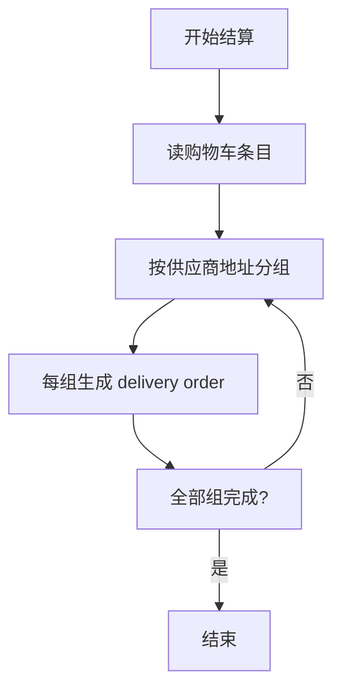

# UML体系结构描述（5视图）与UML图（9+4图）

## UML 体系结构描述（5 视图）

在需求建模阶段，我们要从不同角色视角描述系统，这就是 **UML 5 视图**（UML—5 views）的作用：

| 视图 | 英文 | 关注点 | 主要 UML 图 |
|---|---|---|---|
| 用例视图 | Use Case View | 用户角度的功能需求 | 用例图 |
| 逻辑视图 | Logical View | 系统内部抽象结构与分析类 | 类图、对象图、状态图、活动图等 |
| 进程视图 | Process View | 并发、同步与性能 | 活动图、顺序图（强调进程/线程） |
| 实现视图 | Implementation View | 代码文件与组件打包 | 组件图 |
| 部署视图 | Deployment View | 硬件拓扑与运行节点 | 部署图 |

> [!NOTE]
> 考题曾出现：Use Case View 用于从用户角度描绘信息模型——答案为 True，它正是从 `user's view` 出发的。

## UML 图（9+4 图）

课件中常说的是 **9 种基本图 + 4 种增强/包相关图**。9 种包括：用例图、类图、对象图、状态图、活动图、顺序图、协作图（通信图）、组件图、部署图；再加包图、组合结构图、定时图、交互概览图即常见 “9+4”。

> [!TIP]
> 记忆场景：情景建模靠用例；结构看类和对象；行为看状态、活动和交互（顺序/协作）。

依赖关系画法要注意：==带箭头的虚线，由依赖的一方指向被依赖的一方==，别把方向画反。

## 怎么做：一个算对了的例子

题目：电商平台购物车下单，因供应商不同城（上海、北京、广州），需按供应商拆单生成多个 delivery orders。用 **activity diagram（活动图）** 建模该功能。

我们一步步想：先拿到购物车条目 → 按“供应商地址”分组 → 同组生成一个 delivery order → 所有组都产出后结束。分组理由是 `dependencies`（不同城）导致物流必须分开。

上图中，若把虚线依赖方向搞反，或忘记“同供应商同单、不同供应商拆单”的规则，就会丢分。这个活动图正确覆盖了：开始、读条目、按地址分组、循环出单、终止。

## 相近概念与常见坑

- 活动图 vs 状态图：活动图强调动作流；状态图强调对象状态因 `events` 而迁移。
- 易错坑：把实现视图的组件图放到需求阶段画——需求建模多用 `Use Case View` 与 `Logical View`，别过早陷入代码。
- 另一个坑：以为 5 视图里“进程视图”就是部署图，其实部署归 `Deployment View`。

> [!WARNING]
> 写用例视图时只写功能，不写内部算法；逻辑视图才放分析类（`analysis classes`）、`attributes`、`operations` 和 `associations`。
