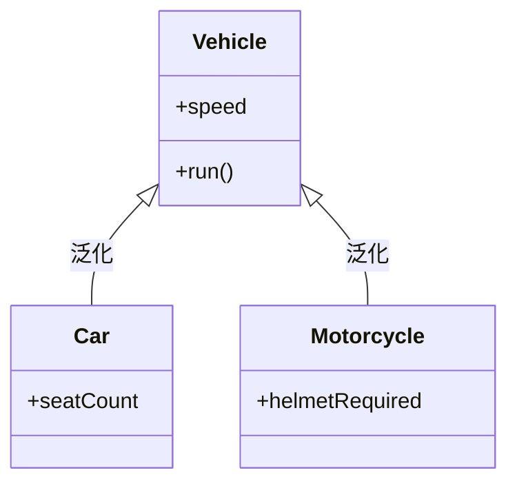
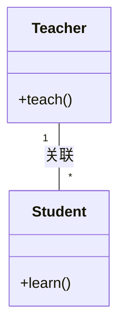
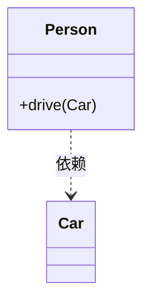

# UML类图与类之间的关系

## 什么是 UML 类图

当你面对一个软件系统时，最自然的想法是把系统里的“东西”和它们之间的“联系”画出来。UML 类图（Class Diagram）做的就是这件事——它用矩形表示类，用线表示类之间的关系，是==需求建模阶段最核心的静态结构图==。

> [!IMPORTANT]
> 类图描述系统内所声明的类以及类之间的关系，不涉及时间顺序或动态行为。

在面向对象视角下，一个构件本质上就是一组协作的类。理解了类之间的关系，也就理解了系统的骨架。

## 类之间有哪些关系

类之间的关系一共有六种：**泛化（继承）、关联、聚合、组合、依赖、实现**。它们的“亲密度”和语义各有不同。

一种直观的记忆方式是问自己：==“A 能不能独立于 B 存在？”“A 是不是 B 的一种？”== 顺着这两个问题，关系类型自然就分清了。

### 泛化（Generalization）

泛化也称为“is-a-kind-of”关系，描述父类（基类/超类）与子类（派生类）之间的继承。子类拥有父类的全部属性和方法，还可以扩展自己的特性。



### 关联（Association）

关联描述类之间的语义联系。在 UML 图中用实线连接有关联的对象所对应的类。编程实现时，==通常将一个类的对象作为另一个类的属性==。



### 聚合与组合（Aggregation & Composition）

这两者都是“整体-部分”关系，但耦合强度截然不同。这也是考试中反复出现的辨析点。

| 关系 | 符号 | 部分能否独立存在 | 生命周期是否一致 |
|------|------|----------------|----------------|
| 聚合 | `◊---->`（空心菱形） | ==能==独立存在 | 不同 |
| 组合 | `◆---->`（实心菱形） | ==不能==独立存在 | 相同 |

```mermaid
classDiagram
    Car ◊-- Engine : 聚合
    Mouth --◆ Head : 组合
    class Car {
    }
    class Engine {
    }
    class Head {
    }
    class Mouth {
    }
```

> [!WARNING]
> 聚合关系中，Engine 可以在 Car 销毁后继续存在（比如拆下来装到别的车上）；组合关系中，Mouth 离开 Head 就没有意义了，生命周期完全绑定。这正是题目中 `Car-Engine` 和 `Head-Mouth` 的区分依据。

### 依赖（Dependency）

依赖是最弱的关系，表示一个类在某个方法里“临时用到”另一个类。UML 中用带箭头的虚线表示。



### 实现（Realization）

实现关系连接接口和实现类。UML 中用带空心三角的虚线表示，和泛化箭头方向相同但线型不同。

```mermaid
classDiagram
    interface Movable {
        <<interface>>
        +move()
    }
    Movable <|.. Bird : 实现
```

## 一个算对了的例子

回到课件中的考题：设计题 1 给出了两段 Java 代码，要求用类图建模。

**Case 1** 中，`Car` 的构造函数接收一个 `Engine` 对象并赋值给私有属性，同时保留了 `setEngine` 方法。这意味着 `Engine` 可以从外部创建后注入，也可以在 `Car` 销毁后继续存在——这正是==聚合关系（`◊---->`）==的典型场景。

**Case 2**（图中水果拼盘）则不同：拼盘由若干水果构成，但水果完全可以脱离拼盘独立存在。同样使用聚合关系建模，多重性表示一个拼盘可以包含多个水果，而一个水果可以不加入任何拼盘。

> [!TIP]
> 判断聚合还是组合，就看“部分”的构造函数是否由“整体”负责创建并随整体销毁。如果部分是从外部传入的，基本就是聚合。

## 常见误区

1. **把依赖当成关联**——只在方法参数里用到，不代表需要持久的属性引用。能用虚线就别用实线。
2. **混淆聚合与组合**——只看符号记不住，就回想：发动机能拆下来继续用（聚合），嘴巴离了脑袋没法活（组合）。
3. **忽略多重性**——关联线上要标注“1”“*”“0..1”等，否则表达不完整。
