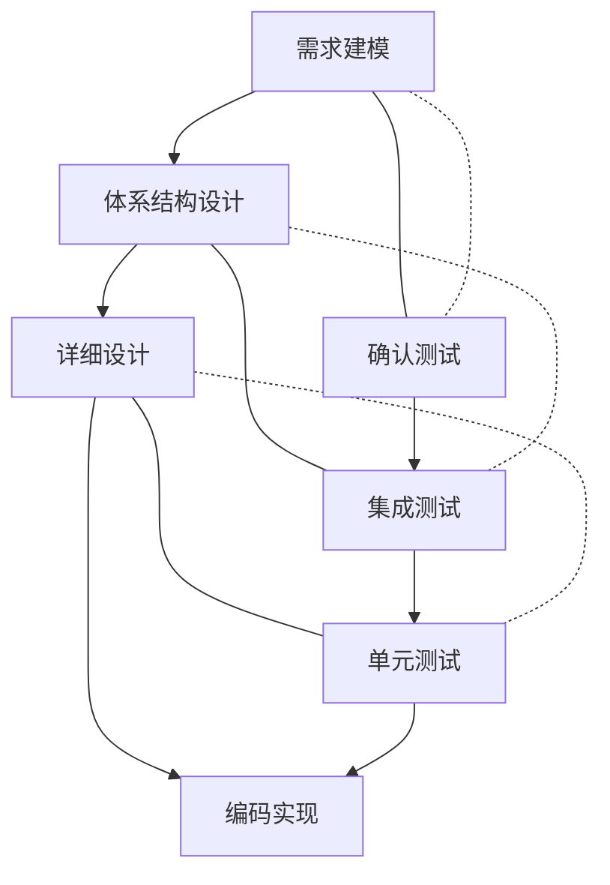

# 验证与确认（V & V: Verification and Validation）

## 验证与确认

### 为什么需要区分这两个概念？

软件项目中常听到两句话：“我们确保把产品**做对**了”，以及“我们确保做了**对的产品**”。你能分清这两句话分别对应谁吗？这便是验证和确认最直观的区别。

> [!IMPORTANT]
> 验证（Verification）：Are we building the **product right**? —— 关注过程正确性，确保软件正确实现了规约中定义的功能。
> 确认（Validation）：Are we building the **right product**? —— 关注产物有效性，确保最终软件可追溯到客户真实需求。

### 验证与确认在 V 模型中的位置

课件里反复提到 V 模型，它的核心思想是：==验证与确认活动并非只在测试阶段才出现，而是和早期工程活动一一对应==。

V 形左支是开发活动，右支是与之对应的测试活动。验收标准在需求阶段就与确认测试挂钩，接口设计在架构阶段就与集成测试联动。

### 宏观测试流程中的角色分配

整个测试流程从内向外逐层展开：**单元测试 → 集成测试 → 确认测试 → 系统测试**。

| 阶段 | 关注点 | 对应开发产物 | 核心验证对象 |
|------|--------|-------------|-------------|
| 单元测试 | 单个模块内部逻辑 | 详细设计 | 函数/类/组件 |
| 集成测试 | 模块间接口协作 | 体系结构设计 | 接口与调用关系 |
| 确认测试 | 功能是否满足规约 | 需求规格说明 | 可追溯的客户需求 |
| 系统测试 | 软件在真实环境表现 | 系统整体 | 性能/安全/兼容性等 |

> [!NOTE]
> 集成测试推荐采用**深度优先**策略，原因是一条完整功能路径能优先打通，确保一个软件分量完全可运行后再扩展到其他模块。

### 谁来做测试？

两个角色的分工是南邮双语课件的常见考点：

| 角色 | 驱动力 | 态度 | 介入时机 |
|------|--------|------|----------|
| 开发者 | 交付（delivery） | 温和地确认功能通过 | 单元测试为主，自始至终 |
| 独立测试组（ITG） | 质量（quality） | 努力“打破”软件 | 架构完成后正式介入，但全程参与分析、设计到测试计划 |

> [!WARNING]
> 不要误以为 ITG 只在集成测试才进场。课件明确指出：ITG 从分析、设计到测试计划全程参与，独立向 SQA 团队汇报。

### 确认测试 vs 验收测试

这是学生常混淆的一对概念。简单记：

- **确认测试**：由测试团队执行，检查软件功能/性能是否**与规约一致**。
- **验收测试**：由最终用户在真实工作环境中执行，检查软件是否**为用户正确工作**。

> [!TIP]
> 记忆口诀：“确认对规约，验收对用户”。

### 一个常见误区

很多同学认为“客户确认”必须等到项目尾声拿到可执行程序才能进行。课件特别指出：==若程序评审前未能发现重大缺陷，可能造成惨重损失==。所以在敏捷与原型驱动开发中，通过每次迭代交付**可运行的原型**，让利益相关者频繁参与评价，把确认活动提前分散到每个增量中。
