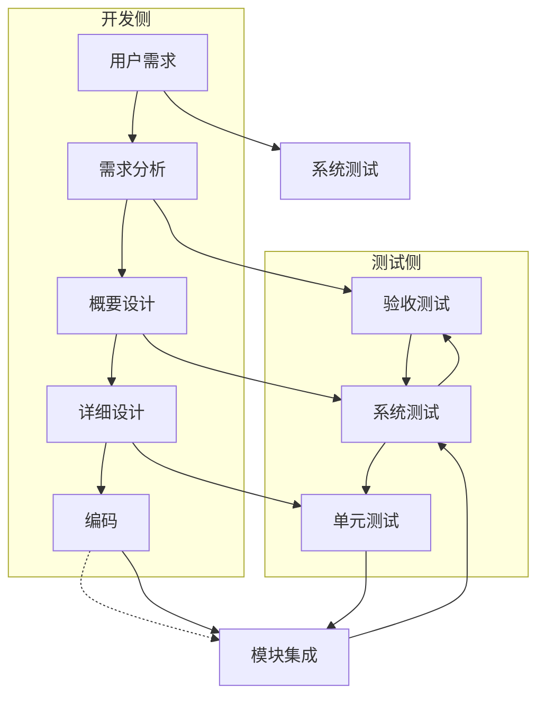

# V模型（The V-Model）

## V模型是什么

V模型（The V-Model）是瀑布模型的变种，它将软件开发过程与测试过程进行了严格的对应。想象一下，如果把软件生命周期画成一个“V”字形：
- **左侧**代表分解和定义阶段（需求、设计）；
- **右侧**代表集成和验证阶段（测试）；
- **底部**是编码实现。

> [!IMPORTANT]
> ==核心结论==：V模型强调了**验证（Verification）**和**确认（Validation）**活动与早期工程活动的**一一对应关系**。

## 为什么需要V模型

在传统的瀑布模型中，测试往往被推迟到编码完成后才开始。这导致如果需求理解有误，直到最后才发现，修改成本极高。
V模型通过“左移”测试思维，要求在写代码前就规划好怎么测。
- **尽早发现缺陷**：在需求阶段就设计验收测试用例，能确保我们做的是“正确的产品”。
- **结构清晰**：每个开发阶段都有明确的交付物和对应的测试级别，便于管理。

## 怎么做：左右映射关系

V模型的精髓在于左侧的每个工作产物，都在右侧有对应的测试活动：

| 开发阶段 (左侧) | 对应测试阶段 (右侧) | 测试重点 |
| :--- | :--- | :--- |
| 用户需求 (User Req) | 验收测试 (Acceptance Test) | 满足用户业务需求吗？ |
| 需求分析 (Req Analysis) | 系统测试 (System Test) | 整体功能符合规格吗？ |
| 概要设计 (Arch Design) | 集成测试 (Integration Test) | 模块间接口正确吗？ |
| 详细设计 (Detail Design) | 单元测试 (Unit Test) | 单个函数/类逻辑对吗？ |

> [!TIP]
> 记忆技巧：**“上对下，左对右”**。高层的需求对应高层的验收/系统测试，底层的设计对应底层的单元/集成测试。

## 与相近概念的区别

- **vs 瀑布模型**：瀑布模型是线性的，测试是最后一步；V模型是并行的规划，测试设计与开发同步进行。
- **vs 敏捷模型**：V模型文档重、流程僵化，不适合需求频繁变更的项目；敏捷则强调迭代和响应变化。

## 常见的坑

> [!WARNING]
> **误区**：认为V模型中测试只在右边发生。
> **真相**：测试的**执行**在右边，但测试的**设计和计划**必须在左边同步完成。如果在编码结束后才去想怎么测，那就退化成瀑布模型了。

## 算对了的例子

回顾课件中的判断题：
*The V-model illustrates how verification and validation actions are associated with earlier engineering actions.*

**解析**：这句话是**True**的。
- **Verification (验证)**：Are we building the product right?（对应单元测试、集成测试，检查是否符合设计文档）。
- **Validation (确认)**：Are we building the right product?（对应验收测试，检查是否符合用户需求）。
V模型清晰地展示了这些测试活动是如何关联到早期的需求和设计阶段的。
