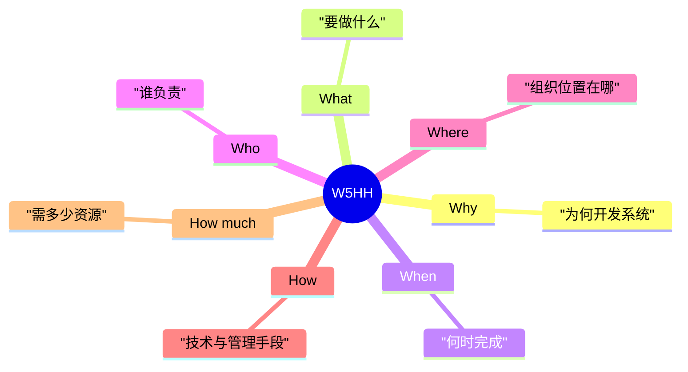

# W5HH原则（Why, What, When, Who, Where, How, How much）

> [!IMPORTANT]
> W5HH 原则是 Barry Boehm 提出的一种==定义关键项目特征的组织原则==，它通过回答 7 个核心问题（Why, What, When, Who, Where, How, How much），为软件项目提供从目标到资源的完整规划框架。

## 为什么需要它

在项目管理中，我们常问：如何确保一个计划既能覆盖所有关键点，又不会让简单项目被过度复杂的流程压垮？正如 Boehm 所言：“你需要一个能够向下扩展、为简单项目提供简单计划的组织原则。”

W5HH 原则正是为了回答“==How do we define key project characteristics?==”而设计的。它将项目目标（objectives）、里程碑与进度（milestones and schedules）、职责（responsibilities）、管理与技术方法（management and technical approaches）以及所需资源（required resources）浓缩为一组可伸缩的问题清单。

## 七个问题拆解

结合课件中的管理频谱（Management Spectrum），这 7 个问题直接映射到项目规划的各个维度：

| 提问 | 英文原文 | 对应管理要素 |
| :--- | :--- | :--- |
| **Why** | Why is the system being developed? | 明确项目目标与商业背景 |
| **What** | What will be done? | 界定软件范围（software scope） |
| **When** | When will it be accomplished? | 制定里程碑与进度表 |
| **Who** | Who is responsible? | 分配人员（people）与团队领导职责 |
| **Where** | Where are they organizationally located? | 确定团队组织结构与物理/逻辑位置 |
| **How** | How will the job be done technically and managerially? | 选择过程模型与技术路线 |
| **How much** | How much of each resource will be needed? | 估算人员、软件、工具、数据库等资源 |

> [!TIP]
> 记忆口诀：**“为何做、做啥、何时完、谁担责、人在哪、怎么干、花多少”**。注意这里有两个 H（How + How much），所以叫 $W^5HH$ 而不是 $W^6H$。

## 与相近概念的区别

初学者容易将 W5HH 与需求工程中的提问混淆。两者的本质区别在于关注点不同：

- **W5HH 原则**：聚焦于==项目管理==（Project Management），解决的是“如何组织和执行工作”。
- **需求工程提问**（如 Whom else do you think I should talk to? / What problem(s) will this solution address?）：聚焦于==产品本身==（Product），解决的是“客户到底要什么”。

> [!NOTE]
> W5HH 中的“What will be done?”是在已知软件范围后，对任务分解的宏观确认；而需求工程中的“What”是在探索阶段挖掘信息目标（Information objectives）和功能性能。

## 常见的坑

> [!WARNING]
> **易错坑**：认为 `What` 包含了资源分配。实际上，“做什么（What）”和“需要多少资源（How much）”是严格分开的。资源估算（人、工具、数据库）必须归入 `How much`。

> [!CAUTION]
> **高危误区**：把 `Who is responsible?` 和 `Where are they organizationally located?` 合并为一个问题。在分布式敏捷团队（agile teams）中，责任人是谁与该人处于哪个组织架构节点，直接影响协调与沟通（coordination and communication）成本，必须分别回答。

## 算对了的例子

回顾选择题 22：

**题目**：The W5HH principle contains which of the following questions?
A. Why is the system being developed?
B. What will be done by whom?
C. Where are they organizationally located?
D. How much of each resource is required?
E. a, c, d

**解析**：
- A 对应 **Why**（正确）。
- B 将 **What** 和 **Who** 混在了一起，W5HH 中这两个问题是独立的，不存在“What will be done by whom?”这种合并问法（错误）。
- C 对应 **Where**（正确）。
- D 对应 **How much**（正确）。

因此包含的正确选项是 A、C、D，即 ==答案为 E==。这道题精准考查了 W5HH 各问题的边界不可随意合并的原则。
