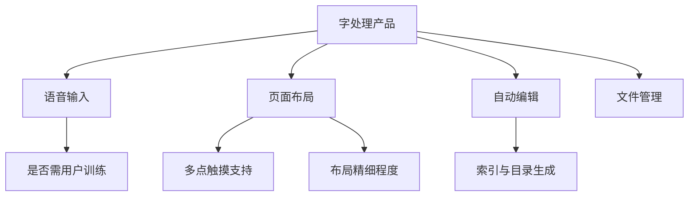

# 产品（Product）：产品范围（Scope）与问题分解（Problem Decomposition）

## 什么是 Product：先想清楚"做什么"

在项目管理四要素（People, Product, Process, Project）中，**Product 指要构建的软件本身**。项目开工前必须回答：这个软件有没有商业目的？用户是否感知到价值？——若答案是否定的，项目就不该开始。

> [!IMPORTANT]
> 项目规划的第一步不是定预算、选团队，而是 ==确立产品的目标与范围（objectives and scope）==。

## 产品范围（Product Scope）

软件范围描述了**要交付的功能、性能与约束**，回答"边界在哪里"。范围陈述必须是**界定的（bounded）**，即给出定量数据与限制条件：

| 范围要素 | 说明 | 示例 |
|---|---|---|
| 信息目标（information objectives） | 输入/输出数据 | 并发用户数、数据量 |
| 功能（function） | 系统做什么 | 语音输入、页面布局 |
| 性能（performance） | 量化指标 | 最大响应时间、内存上限 |
| 上下文（context） | 运行环境与约束 | 目标平台、成本限制、指定语言 |

> [!WARNING]
> 常见考题陷阱：范围的三大特征是 **context、function、performance**（或 information objectives），不要与"代码行数"这类过程度量混淆。

## 问题分解（Problem Decomposition）

面对复杂产品，直接把"做一个字处理软件"扔给团队是无法计划的。问题分解把它逐层拆成可管理的小问题，直到每个功能或问题类都被明确定义：

> [!TIP]
> 分解的粒度标准：直到每个子问题都能被单独估算、分配和验证，就停止分解。

## 与过程分解的区别

| | 问题分解 | 过程分解 |
|---|---|---|
| 对象 | 产品本身（做什么） | 过程模型（怎么做） |
| 结果 | 功能列表、子问题 | 框架活动下的工作任务 |
| 时机 | 范围定义阶段 | 选定过程模型之后 |

二者结合：先拆问题明确范围，再选过程模型（瀑布、增量、螺旋等），最后基于过程框架制定项目计划。

> [!NOTE]
> 范围定义不清是项目失败的首要信号。若连"做什么"都模糊，后续的人员组织、进度安排、预算估计都失去依据。
